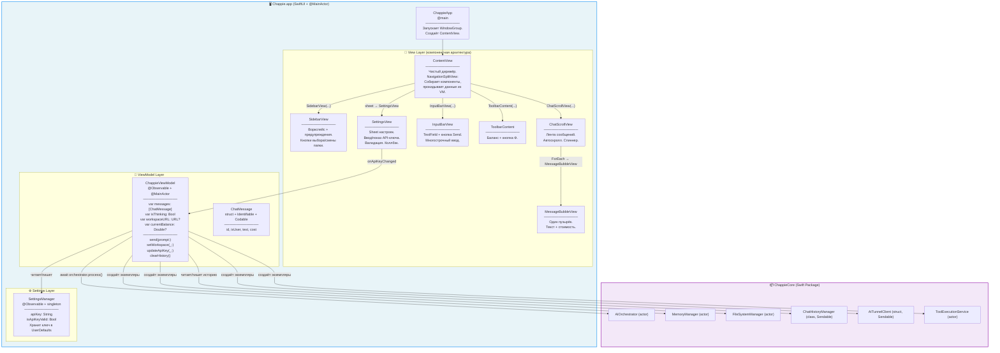
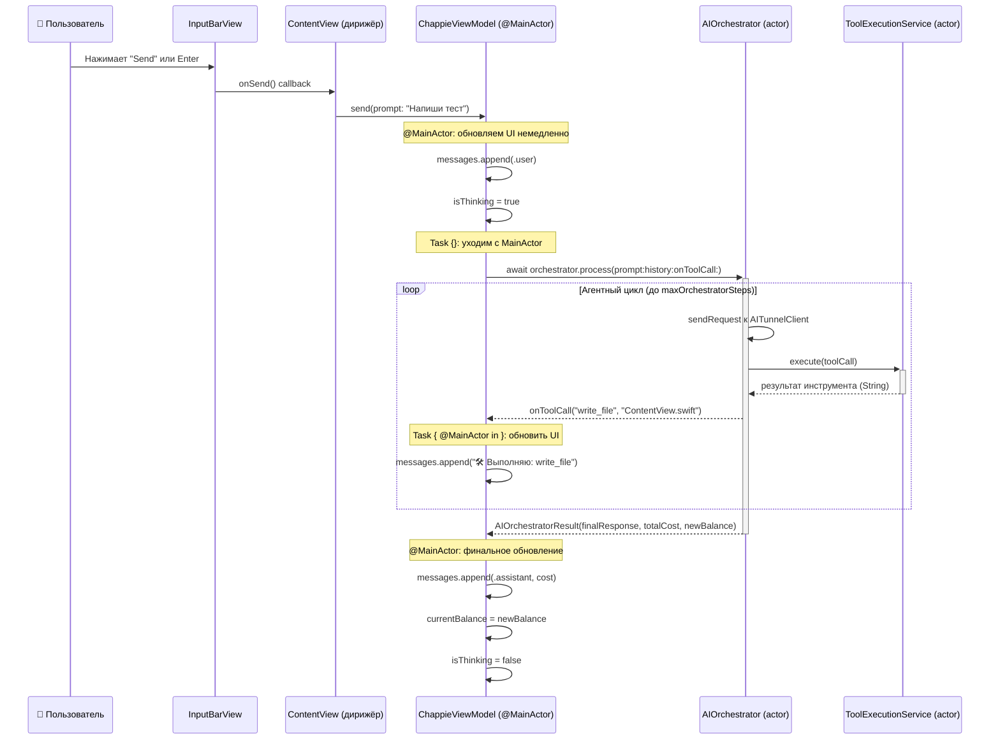

<!--
  Chappie/AI_Docs/architecture.md

  ДОКУМЕНТ АРХИТЕКТУРЫ — CHAPPIE APP (UI LAYER)

  Этот файл описывает РЕАЛЬНУЮ архитектуру UI-слоя приложения Chappie.
  Обновлён после Этапа 4 (2026-05-27): ContentView разбит на компоненты.
  Обновляй при каждом значимом архитектурном изменении.
-->

# Chappie App — Архитектура UI-слоя

## 1. Философия и назначение

**Chappie.app** — SwiftUI-приложение для macOS 26+, которое является тонкой оболочкой над `ChappieCore`.
Его единственная ответственность — отображать данные пользователю и передавать действия в бизнес-логику.

### Принцип "тонкого UI"

- **Никакой бизнес-логики во View.** View только отображают данные из ViewModel.
- **Никакой прямой работы с сетью или файлами в UI.** Всё делегируется в ChappieCore.
- **ViewModel — единственный посредник** между UI и ChappieCore.
- **Каждый компонент — отдельный файл.** ТД-4 закрыт в Этапе 4.

---

## 2. Реальная структура файлов

```
Chappie/
├── ChappieApp.swift                    # @main, точка входа, создаёт WindowGroup → ContentView
├── ContentView.swift                   # Чистый "дирижёр": собирает компоненты, делегирует логику
├── ChappieViewModel.swift              # Единственный ViewModel (@Observable, @MainActor)
│                                       # Содержит также модель ChatMessage (struct)
├── Views/
│   ├── Chat/
│   │   ├── MessageBubbleView.swift     # Пузырёк одного сообщения (текст + стоимость)
│   │   └── ChatScrollView.swift        # Лента сообщений с автоскроллом + спиннер
│   ├── Input/
│   │   └── InputBarView.swift          # Панель ввода: TextField + кнопка отправки
│   ├── Sidebar/
│   │   └── SidebarView.swift           # Боковая панель: воркспейс + предупреждения
│   └── Toolbar/
│       └── ToolbarContent.swift        # Тулбар: баланс + кнопка настроек
├── Settings/
│   ├── SettingsManager.swift           # Хранение и валидация API-ключа (UserDefaults)
│   └── SettingsView.swift              # Sheet настроек: ввод ключа, валидация, сохранение
├── Assets.xcassets/                    # Иконки, фоны (Chappie.jpg), акцентный цвет
└── AI_Docs/
    ├── semantic.json                   # Семантическая память App-таргета
    ├── architecture.md                 # Этот файл
    └── project_map.md                  # Карта файлов проекта
```

---

## 3. Общая архитектура: реальная схема



---

## 4. ChappieViewModel — детальное описание

ViewModel является центром UI-архитектуры. Это **единственный** класс, который знает и об UI, и о ChappieCore.

### Ключевые архитектурные решения

#### `@Observable` вместо `ObservableObject`
Используется новый макрос `@Observable` (Swift 5.9+, macOS 14+). Это означает:
- Нет `@Published` — все свойства автоматически отслеживаются.
- Нет `@StateObject` / `@ObservedObject` в View — используется `@State var viewModel`.
- Более точечные обновления UI: перерисовывается только то, что реально изменилось.

#### Инициализация стека сервисов
Весь стек (`FileSystemManager` → `MemoryManager` → `ToolExecutionService` → `AIOrchestrator`)
создаётся в одном приватном методе `initializeServices(for: URL)`.
Это единственное место инициализации — исключает дублирование кода.

#### Security-Scoped Bookmarks
Для работы в macOS Sandbox приложение сохраняет `bookmarkData` в `UserDefaults`.
При следующем запуске bookmark восстанавливается без повторного показа `NSOpenPanel`.

#### Оптимизация контекста (Smart Pruning)
Перед отправкой истории в API блоки кода в старых сообщениях заменяются заглушками:
```
[Код скрыт из истории для экономии контекста. Если он тебе нужен, прочитай файл через read_file]
```
Это экономит до 90% токенов в длинных диалогах.

#### API-ключ
Ключ НЕ захардкожен в коде. Хранится в `SettingsManager` → `UserDefaults`.
При смене ключа `updateApiKey(_:)` пересоздаёт `AITunnelClient` и `AIOrchestrator` без перезапуска.

### Публичный интерфейс ViewModel

| Свойство / Метод | Тип | Назначение |
|---|---|---|
| `messages` | `[ChatMessage]` | История чата. `didSet` → автосохранение на диск |
| `isThinking` | `Bool` | Флаг активного AI-запроса → ProgressView в UI |
| `workspaceURL` | `URL?` | Текущий воркспейс → отображается в сайдбаре |
| `currentBalance` | `Double?` | Баланс AITunnel → отображается в тулбаре |
| `send(prompt:)` | `func` | Отправить запрос в оркестратор |
| `setWorkspace(_:)` | `func` | Подключить новую папку проекта |
| `updateApiKey(_:)` | `func` | Обновить ключ без перезапуска |
| `clearHistory()` | `func` | Очистить историю с приветствием |

---

## 5. Компонентная архитектура View (Этап 4)

**ContentView** — чистый "дирижёр". Он знает о ViewModel и раздаёт данные компонентам,
но сам не рендерит ни одного пузырька и не содержит бизнес-логику.

### Иерархия компонентов

```
ContentView (NavigationSplitView)
│   @State var viewModel = ChappieViewModel()
│   @State var showSettings = false
│   @State var currentPrompt = ""
│
├── SidebarView
│   Входные данные:
│   ├── workspaceURL: URL?
│   ├── isApiKeyValid: Bool
│   ├── onSelectWorkspace: () -> Void
│   └── onOpenSettings: () -> Void
│   Показывает:
│   ├── Имя воркспейса / кнопка выбора
│   └── Предупреждение если ключ не задан
│
├── VStack (detail area)
│   ├── ChatScrollView
│   │   Входные данные:
│   │   ├── messages: [ChatMessage]
│   │   └── isThinking: Bool
│   │   Показывает:
│   │   ├── Приветствие (если messages пустые)
│   │   ├── ForEach → MessageBubbleView (для каждого сообщения)
│   │   └── ProgressView (если isThinking == true)
│   │   Поведение: автоскролл к концу при изменении messages/isThinking
│   │
│   └── InputBarView
│       Входные данные:
│       ├── prompt: Binding<String>
│       ├── isWorkspaceSelected: Bool
│       ├── isThinking: Bool
│       └── onSend: () -> Void
│       Показывает: TextField + кнопка paperplane
│       Блокируется: если нет воркспейса или isThinking == true
│
└── Toolbar → ToolbarContent
    Входные данные:
    ├── balance: Double?
    ├── isApiKeyValid: Bool
    └── onOpenSettings: () -> Void
    Показывает: таблетка баланса + кнопка ⚙️

Sheet (showSettings == true) → SettingsView
    Входные данные:
    └── onApiKeyChanged: (String) -> Void → viewModel.updateApiKey(_:)
```

### MessageBubbleView — детали рендеринга

```
MessageBubbleView (входные данные: msg: ChatMessage)
├── Сообщения пользователя (msg.isUser == true):
│   ├── Выравнивание: справа
│   ├── Цвет фона: .accentColor
│   └── Цвет текста: .white
├── Сообщения Чаппи (msg.isUser == false):
│   ├── Выравнивание: слева
│   ├── Цвет фона: Color(nsColor: .windowBackgroundColor)
│   └── Цвет текста: .primary
└── Если msg.cost != nil:
    └── "🪙 X.XX ₽" — снизу справа, мелким шрифтом
```

---

## 6. SettingsManager — хранение API-ключа

```
SettingsManager (@Observable, singleton)
├── apiKey: String              — читается/пишется в UserDefaults["aitunnel_api_key"]
├── isApiKeyValid: Bool         — computed: начинается с "sk-aitunnel-" и длина > 20
└── saveApiKey(_:)              — записывает в UserDefaults
```

**Почему UserDefaults, а не Keychain:**
Текущая реализация использует UserDefaults для простоты. Keychain — следующий шаг (ТД-5).

---

## 7. Swift 6 Concurrency в UI-слое

### @MainActor — гарантия безопасности UI

`ChappieViewModel` помечен `@MainActor` — все изменения `messages`, `isThinking` и т.д.
происходят строго на главном потоке. Компилятор Swift 6 гарантирует это на этапе компиляции.

### Паттерн отправки сообщений

```swift
func send(prompt: String) {
    // Выполняется на @MainActor — UI обновляется немедленно
    messages.append(ChatMessage(isUser: true, text: prompt))
    isThinking = true

    Task {
        // Task уходит с MainActor для await-вызовов ChappieCore
        let result = try await orchestrator.process(
            prompt: prompt,
            history: networkHistory,
            onToolCall: { toolName, path in
                // Коллбэк явно возвращается на MainActor для обновления UI
                Task { @MainActor in
                    self.messages.append(ChatMessage(...))
                }
            }
        )
        // После await — автоматический возврат на @MainActor
        self.messages.append(ChatMessage(isUser: false, text: result.finalResponse))
        self.isThinking = false
    }
}
```

---

## 8. Поток данных: от нажатия кнопки до обновления UI



---

## 9. Ключевые инварианты UI-слоя

> Нарушение любого из этих инвариантов означает архитектурный баг.

1. **Один ViewModel на всё приложение.** `ChappieViewModel` создаётся один раз в `ContentView` как `@State`.

2. **View никогда не держат ссылку на ChappieCore напрямую.** Все обращения к `AIOrchestrator`, `FileSystemManager` и т.д. — только через `ChappieViewModel`.

3. **Все изменения состояния — на `@MainActor`.** Гарантируется аннотацией класса.

4. **API-ключ никогда не захардкожен в коде.** Только через `SettingsManager` → `UserDefaults`.

5. **`initializeServices(for:)` — единственное место создания стека сервисов.** Вызывается из `setWorkspace(_:)` и `loadWorkspaceWithSecurityScope()`.

6. **История чата изолирована по воркспейсу.** `ChatHistoryManager` создаётся с `workspaceURL` — каждый проект имеет свою историю.

7. **Каждый View-компонент — отдельный файл.** ContentView — только дирижёр, не рендерит сам.

---

## 10. Технический долг (актуальный)

| # | Описание | Приоритет | Статус |
|---|---|---|---|
| ТД-4 | ContentView-монолит → разбить на компоненты | 🟠 | ✅ Закрыт (Этап 4) |
| ТД-5 | API-ключ хранится в UserDefaults → перенести в Keychain | 🟡 | Открыт |
| ТД-6 | ToolCall-сообщения как ChatMessage с эмодзи-префиксом → типизировать | 🟡 | Открыт |
| ТД-7 | Нет стриминга токенов — пользователь ждёт полного ответа | 🟡 | Открыт |
| ТД-8 | Нет тестов для ViewModel | 🟡 | Открыт |

---

## 📚 Changelog

| Date | Change | Author |
|------|--------|--------|
| 2026-05-21 | Initial creation | Chappie AI |
| 2026-05-27 | Полная переработка: документ приведён в соответствие с реальным кодом. Убраны несуществующие файлы, исправлены типы. Добавлены SettingsManager/SettingsView. | Chappie AI |
| 2026-05-27 | Этап 4: ТД-4 закрыт. ContentView разбит на компоненты. Обновлена схема, добавлена секция 5 с иерархией компонентов. | Chappie AI |
