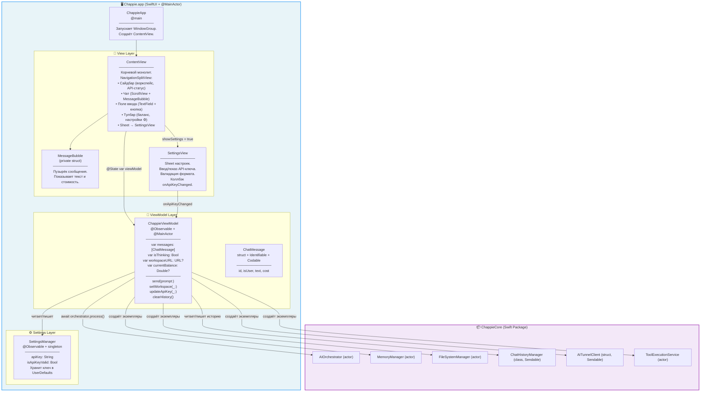
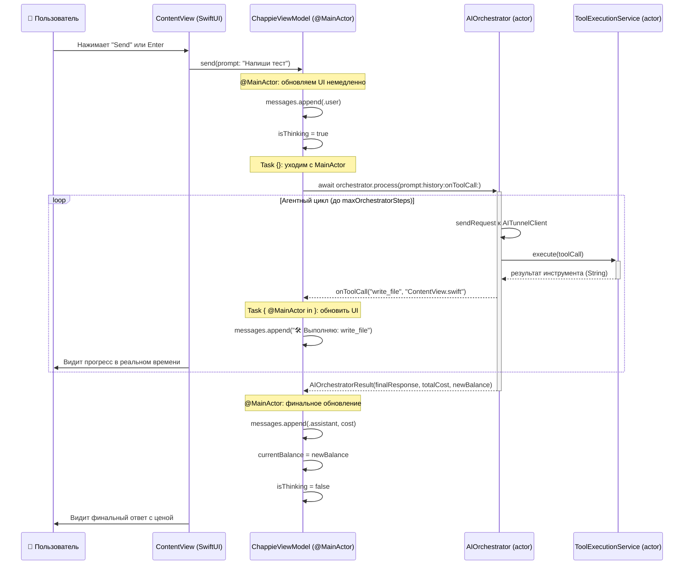

<!--
  Chappie/AI_Docs/architecture.md

  ДОКУМЕНТ АРХИТЕКТУРЫ — CHAPPIE APP (UI LAYER)

  Этот файл описывает РЕАЛЬНУЮ архитектуру UI-слоя приложения Chappie.
  Обновлён в ходе полной инспекции кода — отражает фактическое состояние на 2026-05-27.
  Обновляй при каждом значимом архитектурном изменении.
-->

# Chappie App — Архитектура UI-слоя

## 1. Философия и назначение

**Chappie.app** — SwiftUI-приложение для macOS 26+, которое является тонкой оболочкой над `ChappieCore`.
Его единственная ответственность — отображать данные пользователю и передавать действия в бизнес-логику.

### Принцип "тонкого UI"

- **Никакой бизнес-логики во View.** View только отображают данные из ViewModel.
- **Никакой прямой работы с сетью или файлами в UI.** Всё делегируется в ChappieCore.
- **ViewModel — единственный посредник** между UI и ChappieCore.

---

## 2. Реальная структура файлов

```
Chappie/
├── ChappieApp.swift              # @main, точка входа, создаёт WindowGroup → ContentView
├── ContentView.swift             # Монолитный корневой экран: сайдбар + чат + ввод + тулбар
│                                 # ВНИМАНИЕ: весь UI в одном файле — технический долг (ТД-4)
├── ChappieViewModel.swift        # Единственный ViewModel (@Observable, @MainActor)
│                                 # Содержит также модель ChatMessage (struct)
├── Settings/
│   ├── SettingsManager.swift     # Хранение и валидация API-ключа (UserDefaults)
│   └── SettingsView.swift        # Sheet настроек: ввод ключа, валидация, сохранение
├── Assets.xcassets/              # Иконки, фоны (Chappie.jpg), акцентный цвет
└── AI_Docs/
    ├── semantic.json             # Семантическая память App-таргета
    ├── architecture.md           # Этот файл
    └── project_map.md            # Карта файлов проекта
```

---

## 3. Общая архитектура: реальная схема



---

## 4. ChappieViewModel — детальное описание

ViewModel является центром UI-архитектуры. Это **единственный** класс, который знает и об UI, и о ChappieCore.

### Ключевые архитектурные решения

#### `@Observable` вместо `ObservableObject`
Используется новый макрос `@Observable` (Swift 5.9+, macOS 14+). Это означает:
- Нет `@Published` — все свойства автоматически отслеживаются.
- Нет `@StateObject` / `@ObservedObject` в View — используется `@State var viewModel`.
- Более точечные обновления UI: перерисовывается только то, что реально изменилось.

#### Инициализация стека сервисов
Весь стек (`FileSystemManager` → `MemoryManager` → `ToolExecutionService` → `AIOrchestrator`)
создаётся в одном приватном методе `initializeServices(for: URL)`.
Это единственное место инициализации — исключает дублирование кода.

#### Security-Scoped Bookmarks
Для работы в macOS Sandbox приложение сохраняет `bookmarkData` в `UserDefaults`.
При следующем запуске bookmark восстанавливается без повторного показа `NSOpenPanel`.

#### Оптимизация контекста (Smart Pruning)
Перед отправкой истории в API блоки кода в старых сообщениях заменяются заглушками:
```
[Код скрыт из истории для экономии контекста. Если он тебе нужен, прочитай файл через read_file]
```
Это экономит до 90% токенов в длинных диалогах.

#### API-ключ
Ключ НЕ захардкожен в коде. Хранится в `SettingsManager` → `UserDefaults`.
При смене ключа `updateApiKey(_:)` пересоздаёт `AITunnelClient` и `AIOrchestrator` без перезапуска.

### Публичный интерфейс ViewModel

| Свойство / Метод | Тип | Назначение |
|---|---|---|
| `messages` | `[ChatMessage]` | История чата. `didSet` → автосохранение на диск |
| `isThinking` | `Bool` | Флаг активного AI-запроса → ProgressView в UI |
| `workspaceURL` | `URL?` | Текущий воркспейс → отображается в сайдбаре |
| `currentBalance` | `Double?` | Баланс AITunnel → отображается в тулбаре |
| `send(prompt:)` | `func` | Отправить запрос в оркестратор |
| `setWorkspace(_:)` | `func` | Подключить новую папку проекта |
| `updateApiKey(_:)` | `func` | Обновить ключ без перезапуска |
| `clearHistory()` | `func` | Очистить историю с приветствием |

---

## 5. ContentView — реальная структура

**ВАЖНО:** Сейчас весь UI находится в одном файле `ContentView.swift`. Это **технический долг (ТД-4)**.
Компонент `MessageBubble` вынесен в `private struct` внутри того же файла.

### Фактическая компоновка

```
ContentView (NavigationSplitView)
├── Sidebar (List)
│   ├── Section("Контекст")
│   │   ├── Если workspace выбран: имя папки + кнопка "Сменить"
│   │   └── Если нет: кнопка "Выбрать папку проекта..."
│   └── Section("⚠️ Внимание") — показывается ТОЛЬКО если API-ключ не задан
│       └── Кнопка "Открыть настройки"
│
└── Detail (VStack)
    ├── ScrollViewReader → ScrollView
    │   ├── Приветствие (если messages пустые)
    │   ├── ForEach(messages) → MessageBubble
    │   └── ProgressView (если isThinking == true)
    ├── Поле ввода (TextField + кнопка paperplane)
    └── Toolbar
        ├── Баланс (если currentBalance != nil)
        └── Кнопка ⚙️ → showSettings = true → SettingsView (sheet)

Background: Image("Chappie") opacity 0.5
```

### Поведение автопрокрутки
- `onAppear` → прокрутка к `"BottomSpacer"`
- `onChange(of: messages)` → анимированная прокрутка к `"BottomSpacer"`
- `onChange(of: isThinking)` → прокрутка к `"ThinkingIndicator"` при старте

---

## 6. SettingsManager — хранение API-ключа

```
SettingsManager (@Observable, singleton)
├── apiKey: String              — читается/пишется в UserDefaults["aitunnel_api_key"]
├── isApiKeyValid: Bool         — computed: начинается с "sk-aitunnel-" и длина > 20
└── saveApiKey(_:)              — записывает в UserDefaults
```

**Почему UserDefaults, а не Keychain:**
Текущая реализация использует UserDefaults для простоты. Keychain — следующий шаг (TODO).

---

## 7. SettingsView — экран настроек

Sheet, открываемый по кнопке ⚙️ в тулбаре или по кнопке в сайдбаре (при отсутствии ключа).

```
SettingsView
├── SecureField / TextField (переключается кнопкой "показать/скрыть")
├── Индикатор валидности (✅ зелёный / ❌ красный)
├── Кнопка "Сохранить" → SettingsManager.saveApiKey() → onApiKeyChanged(key)
└── Кнопка "Закрыть"
```

Коллбэк `onApiKeyChanged: (String) -> Void` вызывает `viewModel.updateApiKey(_:)`.

---

## 8. Swift 6 Concurrency в UI-слое

### @MainActor — гарантия безопасности UI

`ChappieViewModel` помечен `@MainActor` — все изменения `messages`, `isThinking` и т.д.
происходят строго на главном потоке. Компилятор Swift 6 гарантирует это на этапе компиляции.

### Паттерн отправки сообщений

```swift
func send(prompt: String) {
    // Выполняется на @MainActor — UI обновляется немедленно
    messages.append(ChatMessage(isUser: true, text: prompt))
    isThinking = true

    Task {
        // Task уходит с MainActor для await-вызовов ChappieCore
        let result = try await orchestrator.process(
            prompt: prompt,
            history: networkHistory,
            onToolCall: { toolName, path in
                // Коллбэк явно возвращается на MainActor для обновления UI
                Task { @MainActor in
                    self.messages.append(ChatMessage(...))
                }
            }
        )
        // После await — автоматический возврат на @MainActor
        self.messages.append(ChatMessage(isUser: false, text: result.finalResponse))
        self.isThinking = false
    }
}
```

---

## 9. Поток данных: от нажатия кнопки до обновления UI



---

## 10. Ключевые инварианты UI-слоя

> Нарушение любого из этих инвариантов означает архитектурный баг.

1. **Один ViewModel на всё приложение.** `ChappieViewModel` создаётся один раз в `ContentView` как `@State` и не передаётся в ChappieCore.

2. **View никогда не держат ссылку на ChappieCore напрямую.** Все обращения к `AIOrchestrator`, `FileSystemManager` и т.д. — только через `ChappieViewModel`.

3. **Все изменения состояния — на `@MainActor`.** Гарантируется аннотацией класса.

4. **API-ключ никогда не захардкожен в коде.** Только через `SettingsManager` → `UserDefaults`.

5. **`initializeServices(for:)` — единственное место создания стека сервисов.** Вызывается из `setWorkspace(_:)` и `loadWorkspaceWithSecurityScope()`.

6. **История чата изолирована по воркспейсу.** `ChatHistoryManager` создаётся с `workspaceURL` — каждый проект имеет свою историю.

---

## 11. Технический долг (актуальный)

| # | Описание | Приоритет |
|---|---|---|
| ТД-4 | `ContentView.swift` — монолит. Нужно разбить на `ChatView`, `InputView`, `SidebarView` | 🟠 |
| ТД-5 | API-ключ хранится в `UserDefaults`. Нужно перенести в Keychain | 🟡 |
| ТД-6 | Вызовы инструментов добавляются как обычные `ChatMessage` с эмодзи-префиксом | 🟡 |
| ТД-7 | Нет стриминга токенов — пользователь ждёт полного ответа | 🟡 |
| ТД-8 | Нет тестов для ViewModel | 🟡 |

---

## 📚 Changelog

| Date | Change | Author |
|------|--------|--------|
| 2026-05-21 | Initial creation | Chappie AI |
| 2026-05-27 | Полная переработка: документ приведён в соответствие с реальным кодом. Убраны несуществующие файлы, исправлены типы (ObservableObject→@Observable, actor→struct для AITunnelClient), добавлены SettingsManager/SettingsView, реальная структура ContentView | Chappie AI |
