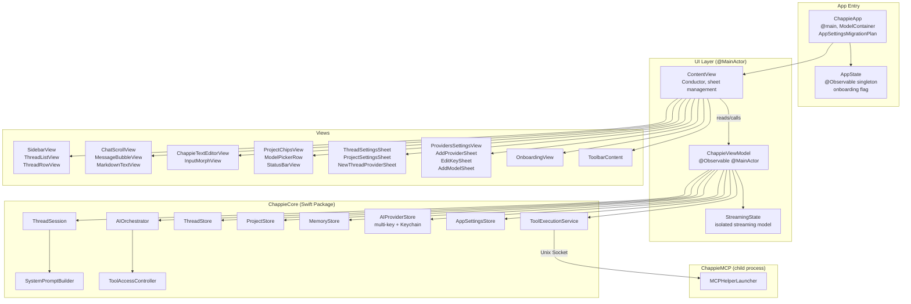

<!--
  Chappie/architecture.md

  ARCHITECTURE DOCUMENT — UI TARGET (Chappie.app)

  This file is the single source of architectural truth for the UI layer.
  Update after every significant architectural change.
-->

# Chappie.app — UI Layer Architecture

## 1. Purpose

**Chappie.app** is a thin SwiftUI shell over ChappieCore.
All business logic lives in ChappieCore. The UI target is responsible only for:
- Rendering data from ViewModel
- Handling user input
- Navigation and animations
- Launching the ChappieMCP helper

---

## 2. File Structure

```
Chappie/
├── ChappieApp.swift                    # @main, ModelContainer, AppDelegate
├── ContentView.swift                   # Conductor: assembles components, manages sheets
├── MCPHelperLauncher.swift             # Launches ChappieMCP child process
├── Models/
│   ├── AppState.swift                  # @Observable singleton: onboarding state (MK-04)
│   ├── ChatMessage.swift               # UI message model (enum: .message / .toolCall)
│   ├── AttachedFile.swift              # Attached file model for input
│   └── AppSettingsMigration.swift      # SwiftData migration: "New.AppSettings" → AppSettings
├── ViewModels/
│   ├── ChappieViewModel.swift          # @Observable @MainActor ViewModel (core state)
│   ├── ChappieViewModel+Send.swift     # send() — AI request pipeline
│   ├── ChappieViewModel+Threads.swift  # Thread CRUD + selectThread()
│   ├── ChappieViewModel+ThreadSession.swift  # ThreadSession lifecycle
│   ├── ChappieViewModel+Providers.swift      # Provider/key switching + balance
│   ├── ChappieViewModel+AppSettings.swift    # AppSettings read/write via AppSettingsStore
│   ├── ChappieViewModel+Memory.swift         # Memory tool callbacks
│   ├── ChappieViewModel+Projects.swift       # Project CRUD + settings
│   └── StreamingState.swift            # Streaming state model (isolated from ViewModel)
├── Settings/
│   └── SettingsView.swift              # App settings sheet (+ onboarding reset button)
└── Views/
    ├── Chat/
    │   ├── ChatScrollView.swift         # Message feed (LazyVStack, anti-jump streaming)
    │   ├── MessageBubbleView.swift      # Single message bubble (+ cost chip)
    │   ├── ModelPickerRow.swift         # Provider/model picker + balance chip
    │   ├── StatusBarView.swift          # Status bar (current tool)
    │   ├── ProjectChipsView.swift       # Project chips + gear chip for thread settings
    │   ├── ProjectSettingsSheet.swift   # Project settings sheet
    │   ├── ThreadSettingsSheet.swift    # Thread settings: name, provider+key+model, context
    │   └── Markdown/
    │       ├── MarkdownModels.swift
    │       ├── MarkdownTextView.swift
    │       ├── CodeBlockView.swift
    │       ├── SyntaxEngine.swift
    │       ├── SyntaxTheme.swift
    │       └── SyntaxNSTheme.swift
    ├── Input/
    │   ├── ChappieTextEditorView.swift  # Multi-line text input
    │   ├── InputMorphView.swift         # Morphing input container
    │   ├── AttachmentViews.swift        # File attachment UI
    │   ├── EmojiPickerView.swift        # Emoji picker
    │   ├── ThinkingGearIcon.swift       # Animated thinking indicator
    │   └── InputLayoutConstants.swift  # Layout constants
    ├── Providers/
    │   ├── ProvidersSettingsView.swift  # Provider list + ProviderDetailView (keys + models)
    │   ├── AddProviderSheet.swift       # Add/edit provider (2-step: endpoint → models)
    │   ├── EditKeySheet.swift           # Add/edit a named API key on a provider
    │   ├── AddModelSheet.swift          # Add models to a provider (fetch list + manual)
    │   └── NewThreadProviderSheet.swift # Provider+key+model picker when creating a thread
    ├── Sidebar/
    │   ├── SidebarView.swift            # Sidebar container
    │   ├── ThreadListView.swift         # Thread list
    │   └── ThreadRowView.swift          # Single thread row (gear + trash on hover)
    ├── Toolbar/
    │   └── ToolbarContent.swift         # Toolbar: sidebar toggle + thread title + settings gear
    ├── Shared/
    │   ├── ProviderModelPickerRows.swift # Shared: ProviderPickRow, ModelPickRow
    │   ├── ShakeEffect.swift            # Shake animation modifier
    │   └── FlowLayout.swift             # Flow layout for chips
    └── Onboarding/
        └── OnboardingView.swift         # Onboarding: welcome step + provider setup step
```

---

## 3. Architecture Diagram



---

## 4. ChappieApp — Entry Point

`@main struct ChappieApp` owns the single `ModelContainer` for the entire app lifetime.
Creating multiple containers for the same schema causes conflicts and data loss.

**SwiftData schema:**
```swift
Schema(AppSettingsSchemaV1.models)
// Contains: ThreadEntity, ProjectEntity, MemoryEntity, AIProviderEntity, AppSettings
```

**Migration:** `AppSettingsMigrationPlan` maps `"New.AppSettings"` → `AppSettings` on first launch.
See `Chappie/Models/AppSettingsMigration.swift` — **DO NOT REMOVE** this migration plan.

**AppDelegate:** `applicationWillTerminate` → `MCPHelperLauncher.shared.terminateHelper()`.
Without this the helper stays alive as an orphan and the next launch fails on socket bind.

---

## 5. AppState (MK-04)

`@Observable final class AppState` — singleton, `AppState.shared`.

```swift
var onboardingCompleted: Bool   // persisted in UserDefaults
var debugForceOnboarding: Bool  // in-memory, debug only

var shouldShowOnboarding: Bool { !onboardingCompleted || debugForceOnboarding }

func completeOnboarding()       // sets onboardingCompleted = true
func resetOnboarding()          // sets onboardingCompleted = false (debug/settings)
```

`ContentView` reads `appState.shouldShowOnboarding` to switch between `OnboardingView` and main content.
`@State var appState = AppState.shared` in ContentView ensures SwiftUI subscribes to @Observable changes.

---

## 6. ChappieViewModel

`@Observable @MainActor final class ChappieViewModel`

Split across multiple extensions for maintainability:

| File | Responsibility |
|------|----------------|
| `ChappieViewModel.swift` | Core state, init, `setModelContainer()` |
| `+Send.swift` | `send()` — AI request pipeline |
| `+Threads.swift` | Thread CRUD, `selectThread()`, `loadThreadsAndSelectActive()` |
| `+ThreadSession.swift` | `ThreadSession` lifecycle — activate, invalidate |
| `+Providers.swift` | Provider/key switching, balance loading, invalidation |
| `+AppSettings.swift` | `AppSettingsStore` read/write |
| `+Memory.swift` | Memory tool callbacks |
| `+Projects.swift` | Project CRUD, `updateProjectSettings()` |

### Key Properties

| Property | Type | Purpose |
|----------|------|---------|
| `threads` | `[ThreadMetadata]` | All threads for the sidebar |
| `activeThread` | `ThreadMetadata?` | Currently active thread |
| `activeProjects` | `[ProjectMetadata]` | Projects of the active thread |
| `messages` | `[ChatMessage]` | Full history |
| `visibleMessages` | `[ChatMessage]` | Depth-limited list (contextDepth × 10) |
| `isThinking` | `Bool` | Loading indicator |
| `streamingText` | `String` | Current streaming response |
| `runningCost` | `Double` | Accumulated request cost |
| `currentBalance` | `Double?` | Active provider balance |
| `activeProvider` | `AIProvider?` | Active AI provider |
| `activeKeyId` | `UUID?` | Active API key ID (multi-key) |
| `activeModelName` | `String?` | Selected model |
| `activeThreadSettings` | `ThreadSettings` | Settings of the active thread |

### Provider / Key / Model Selection

`switchProvider(_ provider:, keyId:, modelName:)` is the single entry point for all provider changes.

- Both `keyId` and `modelName` MUST be non-nil to create an `AIClient`/`AIOrchestrator`.
- Missing either → `applyProviderWithoutModel()` → blocks orchestrator, shows orange banner.
- `persistSettings: Bool` flag — when true (default), writes `(providerId, keyId, modelName)` to thread settings in DB.

**Invalidation methods** (called synchronously before async delete):
- `invalidateProviderIfDeleted(id:)` — clears everything if active provider deleted
- `invalidateModelIfDeleted(name:providerId:)` — clears aiClient/orchestrator if active model deleted
- `invalidateKeyIfDeleted(keyId:providerId:)` — clears aiClient/orchestrator if active key deleted

### Data Flow on Thread Switch

```
selectThread()
  → loadProjectsForThread()              ← ProjectStore → activeProjects
  → activateThreadSession()              ← ThreadSession.init() → builds PromptContext
  → switchProvider(savedOrDefault)       ← ALWAYS, even if provider didn't change
      → loadBalance(for: provider)       ← AppSettingsStore
  → save(lastActiveThreadId:)            ← AppSettingsStore
```

### Critical Rule: selectThread() ALWAYS calls switchProvider()

Previously `switchProvider()` was skipped if `activeProvider != nil`.
This caused the AI model to be set globally instead of per-thread.
Now: always called with the thread's saved provider — guarantees correct model, key and balance per thread.

---

## 7. Multi-Key Provider System (MK-01..MK-09)

### Data Model

```
AIProvider
  └── keys: [APIKey]          — named keys, secrets in Keychain
  └── models: [String]        — saved model names

APIKey
  ├── id: UUID                — Keychain entry key = apiKey.id.uuidString
  └── name: String            — user-defined label ("Work", "Personal", "Client X")

ThreadSettings
  ├── activeProviderId: UUID?
  ├── activeKeyId: UUID?      — which key to use for this thread
  └── activeModelName: String?
```

### Deduplication Rules (enforced in UI, not in store)

| Check | Where | Action |
|-------|-------|--------|
| Duplicate provider host | AddProviderSheet (directory) | Alert, block save |
| Duplicate key value (same provider) | EditKeySheet, AddProviderSheet (edit) | Alert/inline error |
| Duplicate key name (same provider) | EditKeySheet, AddProviderSheet (edit) | Alert/inline error |
| Duplicate model name (same provider) | AddModelSheet | Greyed out in list |

**Merge rules (onboarding / `mergeProvider`):**
- Provider: match by host → update name, reuse id
- Key: match by Keychain value → update name only; name collision → auto-suffix (Key 2, Key 3…)
- Models: add only those not already present

### Key Selection UX

Three-column picker appears in:
- `NewThreadProviderSheet` — when creating a new thread
- `ThreadSettingsSheet` — when editing thread settings
- `ModelPickerRow` popover — inline in the top bar

Auto-select: if provider has exactly one key → it is pre-selected automatically.
No auto-select when provider has multiple keys — user must choose explicitly.

### Onboarding Trigger

`AppState.shouldShowOnboarding` drives the gate in `ContentView`.
`AddProviderSheet(isOnboarding: true)` → multi-key UI + `mergeProvider` save.
`SettingsView` has a debug section to reset onboarding via `AppState.resetOnboarding()`.

---

## 8. AppSettingsMigration.swift

**⚠️ DO NOT REMOVE** — SwiftData stores the entity name history in the database.
Removing `AppSettingsMigrationPlan` causes a schema conflict crash on next launch for existing users.

This migration maps `"New.AppSettings"` (old namespace) → `AppSettings` (current name).
It runs once on first launch after the rename and is a no-op on all subsequent launches.

---

## 9. Provider Balance

**Storage:** `AppSettings.balancesJSON` via `AppSettingsStore`
**Load:** `switchProvider()` → `AppSettingsStore.loadBalances()`
**Real-time update:** `onBalanceUpdate` callback in `AIOrchestrator.process()`
**Display:** `ModelPickerRow` — balance chip to the right of the model picker

---

## 10. ChatScrollView — LazyVStack + Anti-Jump Streaming

**Problem:** during streaming, `withAnimation` on every token triggered layout recalculation → jumps.

**Solution:**
- Streaming (`onChange(of: streamingText)`) → `proxy.scrollTo("bottom")` **without animation**
- Discrete events (new message, thread switch, isThinking) → `withAnimation(.easeOut)`
- `LazyVStack` — renders only visible messages (critical at 10,000 messages)
- Transparent spacers at top/bottom — first/last message not hidden behind floating panels

**Visible message depth rule:**
- `visibleMessages = last (contextDepth × 10) messages`
- When `isUnlimitedContext = true` → all messages

---

## 11. ProjectSettingsSheet

**Pattern:** "dumb component" — knows nothing about SwiftData.
- Receives `ProjectMetadata` and `onSave: (ProjectSettings) -> Void`
- Edits `@State draft: ProjectSettings` (a copy, not the original)
- On "Save" → `onSave(draft)` → `viewModel.updateProjectSettings()`

**Unlock logic:**
```
.advisor → role + language only
.executor + !isProgrammingProject → role + language + project type flag
.executor + isProgrammingProject → everything: git, tests, architecture, comments
```

**Role indicator in chip:**
- 🔒 (lock.fill) = advisor
- ⚡ (bolt.fill) = executor

---

## 12. ThreadSettingsSheet

**Pattern:** "dumb component" — receives `ThreadMetadata` + `[AIProvider]`, returns via `onSave`.

```swift
onSave: (String, ThreadSettings, UUID?, UUID?, String?) -> Void
//        title   settings        providerId keyId   modelName
```

**Settings:**
- Thread name (inline TextField)
- Provider + Key + Model (3-column picker)
- Context depth: slider 10...1000 messages (adaptive step: 5 / 10 / 50)
- Unlimited context toggle
- Info box: token budget (messages × 500) and chat display depth (messages × 10)

---

## 13. Last Active Thread Restore

`selectThread()` saves `thread.id` via `AppSettingsStore.save(lastActiveThreadId:)`.
`loadThreadsAndSelectActive()` on startup:
1. Tries to find thread by `lastActiveThreadId` → selects it.
2. Falls back to most recently updated thread (index 0, sorted by `updatedAt DESC`).

---

## 14. ContentView — Sheet Management

```swift
.sheet(isPresented: $showSettings) { SettingsView() }

.sheet(item: $selectedProjectForSettings) { project in
    ProjectSettingsSheet(onSave: { viewModel.updateProjectSettings(...) }, ...)
}

.sheet(item: $selectedThreadForSettings) { thread in
    // MK-06: onSave receives keyId — full provider+key+model selection
    ThreadSettingsSheet(onSave: { title, settings, providerId, keyId, modelName in
        viewModel.updateThreadSettings(settings, newTitle: title, forThreadId: thread.id,
            newProviderId: providerId, newKeyId: newKeyId, newModelName: modelName)
    }, ...)
}

.sheet(isPresented: $viewModel.showNewThreadProviderPicker) {
    // MK-07: onConfirm receives keyId
    NewThreadProviderSheet(onConfirm: { providerId, keyId, modelName, title, settings in
        viewModel.confirmNewThread(with: providerId, keyId: keyId, ...)
    }, ...)
}
```

---

## 15. MCPHelperLauncher

Manages the lifecycle of the ChappieMCP child process.

**Rule:** launched ONLY when the workspace path is known:
- `loadWorkspaceWithSecurityScope()` → `launch(workspacePath:)`
- `setWorkspace()` → `restartWithWorkspace()`
- `ChappieApp.onAppear` does NOT call launch() (path not yet known)

---

## 16. Security-Scoped Bookmarks

A security-scoped bookmark is created for each project folder.
Stored in `ProjectEntity.bookmarkData` (SwiftData).
When added via `add_project_to_thread` tool — bookmark is empty (Data()).
User adds via UI with a real bookmark.

---

## 📚 Changelog

| Date | Change |
|------|--------|
| 2026-07-XX | MK-01..09 complete: multi-key provider system — APIKey struct, per-thread key selection, onboarding with mergeProvider, full deduplication across all entry points |
| 2026-07-XX | M-10 complete: removed SettingsManager, KeychainManager, FeatureFlags, all V1 branches; AppSettings migrated from New namespace |
| 2026-07-XX | Added AppSettingsMigration.swift section; updated storage map to AppSettingsStore |
| 2026-07-XX | ViewModel split into extensions (+Send, +Threads, +ThreadSession, +Providers, +AppSettings, +Memory, +Projects) |
| 2026-05-28 | IT-11 ✅: ThreadSettingsSheet, toolbar thread title, last-thread restore, gear in ThreadRowView + ProjectChipsView |
| 2026-05-26 | IT-09 ✅: ProjectSettingsSheet, ProjectChipsView.onOpenSettings |
| 2026-05-XX | Bug fixed: selectThread() now ALWAYS calls switchProvider() (MODEL-PER-THREAD) |
| 2026-05-XX | LazyVStack + anti-jump streaming in ChatScrollView |
