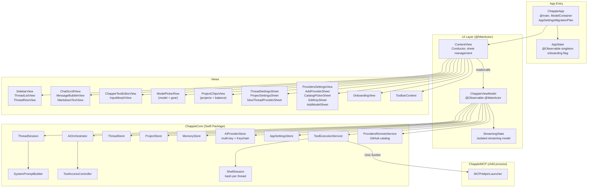

<!--
  Chappie/architecture.md

  ARCHITECTURE DOCUMENT — UI TARGET (Chappie.app)

  This file is the single source of architectural truth for the UI layer.
  Update after every significant architectural change.
-->

# Chappie.app — UI Layer Architecture

## 1. Purpose

**Chappie.app** is a thin SwiftUI shell over ChappieCore.
All business logic lives in ChappieCore. The UI target is responsible only for:
- Rendering data from ViewModel
- Handling user input
- Navigation and animations
- Launching the ChappieMCP helper

---

## 2. File Structure

```
Chappie/
├── ChappieApp.swift                    # @main, ModelContainer, AppDelegate
├── ContentView.swift                   # Conductor: assembles components, manages sheets
├── MCPHelperLauncher.swift             # Launches ChappieMCP child process
├── Models/
│   ├── AppState.swift                  # @Observable singleton: onboarding state
│   ├── ChatMessage.swift               # UI message model (enum: .message / .toolCall / .terminalConfirmation)
│   ├── AttachedFile.swift              # Attached file model for input
│   └── AppSettingsMigration.swift      # SwiftData migration: "New.AppSettings" → AppSettings
├── ViewModels/
│   ├── ChappieViewModel.swift          # @Observable @MainActor ViewModel (core state)
│   ├── ChappieViewModel+Send.swift     # send() — AI request pipeline
│   ├── ChappieViewModel+Threads.swift  # Thread CRUD + selectThread()
│   ├── ChappieViewModel+ThreadSession.swift  # ThreadSession lifecycle
│   ├── ChappieViewModel+Providers.swift      # Provider/key switching + balance
│   ├── ChappieViewModel+AppSettings.swift    # AppSettings read/write via AppSettingsStore
│   ├── ChappieViewModel+Memory.swift         # Memory tool callbacks
│   ├── ChappieViewModel+Projects.swift       # Project CRUD + settings
│   ├── ChappieViewModel+Terminal.swift       # Terminal confirmation flow (approve/reject)
│   ├── ChappieViewModel+PersonaBlock.swift   # v2PersonaBlock + baseSystemPrompt constants
│   └── StreamingState.swift            # Streaming state model (isolated from ViewModel)
├── Settings/
│   └── SettingsView.swift              # App settings sheet (+ onboarding reset button)
└── Views/
    ├── Chat/
    │   ├── ChatScrollView.swift         # Message feed (LazyVStack, anti-jump streaming)
    │   ├── MessageBubbleView.swift      # Single message bubble (+ terminal confirmation UI)
    │   ├── ModelPickerRow.swift         # Model picker (top row) + thread settings gear
    │   ├── StatusBarView.swift          # Status bar (current tool)
    │   ├── ProjectChipsView.swift       # Project chips + balance chip (bottom row)
    │   ├── ProjectSettingsSheet.swift   # Project settings sheet
    │   ├── ThreadSettingsSheet.swift    # Thread settings: name, provider+key+model, context
    │   └── Markdown/
    │       ├── MarkdownModels.swift
    │       ├── MarkdownTextView.swift
    │       ├── CodeBlockView.swift
    │       ├── SyntaxEngine.swift
    │       ├── SyntaxTheme.swift
    │       └── SyntaxNSTheme.swift
    ├── Input/
    │   ├── ChappieTextEditorView.swift  # Multi-line text input
    │   ├── InputMorphView.swift         # Morphing input container
    │   ├── AttachmentViews.swift        # File attachment UI
    │   ├── EmojiPickerView.swift        # Emoji picker
    │   └── InputLayoutConstants.swift  # Layout constants
    ├── Providers/
    │   ├── ProvidersSettingsView.swift  # Provider list + ProviderDetailView (keys + models)
    │   ├── AddProviderSheet.swift       # Add/edit provider (2-step: endpoint → models)
    │   ├── CatalogPickerSheet.swift     # Catalog browser: pick provider or "Ручная настройка"
    │   ├── EditKeySheet.swift           # Add/edit a named API key on a provider
    │   ├── AddModelSheet.swift          # Add models to a provider (fetch list + manual)
    │   └── NewThreadProviderSheet.swift # Provider+key+model picker when creating a thread
    ├── Sidebar/
    │   ├── SidebarView.swift            # Sidebar container
    │   ├── ThreadListView.swift         # Thread list
    │   └── ThreadRowView.swift          # Single thread row (gear + trash on hover)
    ├── Toolbar/
    │   └── ToolbarContent.swift         # Toolbar: sidebar toggle + thread title + settings gear
    ├── Shared/
    │   ├── ProviderModelPickerRows.swift # Shared: ProviderPickRow, ModelPickRow
    │   ├── ShakeEffect.swift            # Shake animation modifier
    │   └── FlowLayout.swift             # Flow layout for chips
    └── Onboarding/
        └── OnboardingView.swift         # Onboarding: welcome step + provider setup step
```

---

## 3. Architecture Diagram



---

## 4. ChappieApp — Entry Point

`@main struct ChappieApp` owns the single `ModelContainer` for the entire app lifetime.

**SwiftData schema:**
```swift
Schema(AppSettingsSchemaV1.models)
// Contains: ThreadEntity, ProjectEntity, MemoryEntity, AIProviderEntity, AppSettings
```

**Migration:** `AppSettingsMigrationPlan` maps `"New.AppSettings"` → `AppSettings` on first launch.
See `Chappie/Models/AppSettingsMigration.swift` — **DO NOT REMOVE** this migration plan.

**AppDelegate:** `applicationWillTerminate` → `MCPHelperLauncher.shared.terminateHelper()`.

**Critical rule:** every window that uses the main ViewModel MUST have:
```swift
.environment(viewModel)
viewModel.setModelContainer(modelContainer)
```

---

## 5. Top Bar Layout

Two rows in the top panel of `ContentView`:

| Row | Left | Right |
|-----|------|-------|
| Top | `ModelPickerRow` — model selector | Thread settings gear (⚙) |
| Bottom | `ProjectChipsView` — project chips | Balance chip (hidden if nil) |

---

## 6. ChappieViewModel

`@Observable @MainActor final class ChappieViewModel`

| File | Responsibility |
|------|----------------|
| `ChappieViewModel.swift` | Core state, init, `setModelContainer()` |
| `+Send.swift` | `send()` — AI request pipeline |
| `+Threads.swift` | Thread CRUD, `selectThread()`, `loadThreadsAndSelectActive()` |
| `+ThreadSession.swift` | `ThreadSession` lifecycle — activate, invalidate |
| `+Providers.swift` | Provider/key switching, balance loading, invalidation |
| `+AppSettings.swift` | `AppSettingsStore` read/write |
| `+Memory.swift` | Memory tool callbacks |
| `+Projects.swift` | Project CRUD, `updateProjectSettings()` |
| `+Terminal.swift` | Terminal confirmation flow — approve/reject pending commands |
| `+PersonaBlock.swift` | `v2PersonaBlock` + `baseSystemPrompt` constants |

### Provider / Key / Model Selection

`switchProvider(_ provider:, keyId:, modelName:)` is the single entry point for all provider changes.

- Both `keyId` and `modelName` MUST be non-nil to create an `AIClient`/`AIOrchestrator`.
- Missing either → `applyProviderWithoutModel()` → blocks orchestrator, shows orange banner.
- `AIClientFactory.make(for:apiKey:model:)` picks `AIClient` or `AnthropicClient` by `model.providerProtocol`.

**Invalidation methods:**
- `invalidateProviderIfDeleted(id:)` — clears everything if active provider deleted
- `invalidateModelIfDeleted(name:providerId:)` — clears aiClient/orchestrator if active model deleted
- `invalidateKeyIfDeleted(keyId:providerId:)` — clears aiClient/orchestrator if active key deleted

---

## 7. Terminal Confirmation Flow

When `TerminalAccessLevel == .confirmAll`, the `run_terminal` tool inserts a
`.terminalConfirmation` message into the chat before executing.

```
AI calls run_terminal
  → TerminalTools detects .confirmAll
  → inserts PendingTerminalCommand marker into result
  → +Send intercepts marker
  → appends ChatMessage(.terminalConfirmation) to messages
  → waits for user action

User taps "Run" → ChappieViewModel+Terminal.approveTerminalCommand()
  → executes command via ShellSession
  → resumes streaming

User taps "Cancel" → rejectTerminalCommand()
  → returns cancellation message to AI
```

`MessageBubbleView` renders `.terminalConfirmation` as an orange confirmation bubble with Run/Cancel buttons.

---

## 8. Provider Catalog Flow

```
ProvidersSettingsView / OnboardingView
  → "Добавить провайдера" button
  → CatalogPickerSheet
      → ProvidersRemoteService.fetchCatalog()
      → shows list of RemoteProvider entries
      → user picks one → AddProviderSheet(prefilledRemote:)
      → user picks "Ручная настройка" → AddProviderSheet(prefilledRemote: nil)

AddProviderSheet (catalog mode):
  Step 1 — pre-filled name + baseURL (locked), key entry
  Step 2 — catalog models pre-selected, user can deselect or fetch live list

AddProviderSheet (custom mode):
  Step 1 — blank, user enters everything manually
  Step 2 — no pre-selection, fetch live list or add manually
```

---

## 9. Multi-Key Provider System

```
AIProvider
  └── keys: [APIKey]     — named keys, secrets in Keychain
  └── models: [AIModel]  — saved models with endpoint + protocol

ThreadSettings
  ├── activeProviderId: UUID?
  ├── activeKeyId: UUID?      — which key to use for this thread
  └── activeModelName: String?
```

Key selection UX appears in: `NewThreadProviderSheet`, `ThreadSettingsSheet`, `ModelPickerRow` popover.

Auto-select: if provider has exactly one key → pre-selected automatically.

---

## 10. ProjectSettingsSheet

**Pattern:** "dumb component" — knows nothing about SwiftData.
- Receives `ProjectMetadata` and `onSave: (ProjectSettings) -> Void`
- Edits `@State draft: ProjectSettings` (a copy, not the original)
- On "Save" → `onSave(draft)` → `viewModel.updateProjectSettings()`

**Terminal access picker** (programming projects only):
- `Нет доступа` / `С подтверждением` / `Автоматически`
- Uses `.labelsHidden()` + `.pickerStyle(.segmented)` to avoid label crowding

**Role indicator in chip:**
- 🔒 (lock.fill) = advisor
- ⚡ (bolt.fill) = executor

---

## 11. AppSettingsMigration.swift

**⚠️ DO NOT REMOVE** — maps `"New.AppSettings"` → `AppSettings`.
Removing causes schema conflict crash on next launch for existing users.

---

## 12. ChatScrollView — LazyVStack + Anti-Jump Streaming

- Streaming → `proxy.scrollTo("bottom")` **without animation**
- Discrete events → `withAnimation(.easeOut)`
- `LazyVStack` — renders only visible messages

---

## 13. ContentView — Sheet Management

```swift
.sheet(isPresented: $showSettings) { SettingsView() }
.sheet(item: $selectedProjectForSettings) { ProjectSettingsSheet(...) }
.sheet(item: $selectedThreadForSettings) { ThreadSettingsSheet(...) }
.sheet(isPresented: $viewModel.showNewThreadProviderPicker) { NewThreadProviderSheet(...) }
.sheet(isPresented: $showProvidersSettings) { ProvidersSettingsView(...) }
```

---

## 14. MCPHelperLauncher

Launched ONLY when workspace path is known. `applicationWillTerminate` terminates the helper.

---

## 📚 Changelog

| Date | Change |
|------|--------|
| 2025-07 | Provider catalog system: RemoteProviderCatalog, ProvidersRemoteService, CatalogPickerSheet, AIClientProtocol, AnthropicClient, AIClientFactory |
| 2025-07 | run_terminal tool: ShellSession, TerminalTools, TerminalAccessLevel, confirmation flow |
| 2025-07 | Top bar reorganized: ModelPickerRow (model+gear) top, ProjectChipsView (projects+balance) bottom |
| 2025-07 | Hot role reload: rebuildThreadSessionOnly() — no restart needed on settings change |
| 2025-07 | MK-01..09 complete: multi-key provider system |
| 2025-07 | M-10 complete: removed legacy MigrationService, ChatHistoryManager |
