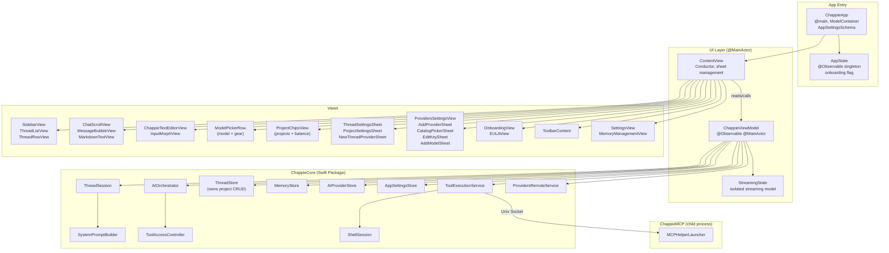

<!--
  Chappie/architecture.md
  ARCHITECTURE DOCUMENT — UI TARGET (Chappie.app)
  Update after every significant architectural change.
-->

# Chappie.app — UI Layer Architecture

## 1. Purpose

**Chappie.app** is a thin SwiftUI shell over ChappieCore.
All business logic lives in ChappieCore. The UI target is responsible only for:
- Rendering data from ViewModel
- Handling user input
- Navigation and animations
- Launching the ChappieMCP helper

---

## 2. File Structure

```
Chappie/
├── ChappieApp.swift                    # @main, ModelContainer (AppSettingsSchema), AppDelegate
├── ContentView.swift                   # Conductor: assembles components, manages sheets
├── DropHandler.swift                   # Drag-and-drop: files AND project folders
├── MCPHelperLauncher.swift             # Launches ChappieMCP child process
├── Models/
│   ├── AppState.swift                  # @Observable singleton: onboarding state
│   ├── ChatMessage.swift               # UI message model (enum: .message / .toolCall / .terminalConfirmation)
│   ├── AttachedFile.swift              # Attached file model for input
│   └── AppSettingsMigration.swift      # SwiftData schema: AppSettingsSchema (StoredRecord only)
├── ViewModels/
│   ├── ChappieViewModel.swift          # @Observable @MainActor ViewModel (core state)
│   ├── ChappieViewModel+Send.swift     # send() — AI request pipeline
│   ├── ChappieViewModel+Threads.swift  # Thread CRUD + selectThread()
│   ├── ChappieViewModel+ThreadSession.swift  # ThreadSession lifecycle
│   ├── ChappieViewModel+Providers.swift      # Provider/key switching + balance
│   ├── ChappieViewModel+AppSettings.swift    # AppSettings read/write via AppSettingsStore
│   ├── ChappieViewModel+Memory.swift         # Memory tool callbacks
│   ├── ChappieViewModel+Projects.swift       # Project add/remove/settings — user-only, via ThreadStore
│   ├── ChappieViewModel+Terminal.swift       # Terminal confirmation flow (approve/reject)
│   ├── ChappieViewModel+PersonaBlock.swift   # v2PersonaBlock + baseSystemPrompt constants
│   └── StreamingState.swift            # Streaming state model (isolated from ViewModel)
├── Settings/
│   ├── SettingsView.swift              # App settings sheet (+ onboarding reset button)
│   └── MemoryManagementView.swift      # Memory browser/editor sheet
└── Views/
    ├── Chat/
    │   ├── ChatScrollView.swift         # Message feed (LazyVStack, anti-jump streaming)
    │   ├── MessageBubbleView.swift      # Single message bubble (+ terminal confirmation UI)
    │   ├── ModelPickerRow.swift         # Model picker (top row) + thread settings gear
    │   ├── StatusBarView.swift          # Status bar (current tool)
    │   ├── ProjectChipsView.swift       # Project chips + balance chip (bottom row)
    │   ├── ProjectSettingsSheet.swift   # Project settings sheet
    │   ├── ThreadSettingsSheet.swift    # Thread settings: name, provider+key+model, context
    │   └── Markdown/
    │       ├── MarkdownModels.swift
    │       ├── MarkdownTextView.swift
    │       ├── CodeBlockView.swift
    │       ├── SyntaxEngine.swift
    │       ├── SyntaxTheme.swift
    │       └── SyntaxNSTheme.swift
    ├── Input/
    │   ├── ChappieTextEditorView.swift  # Multi-line text input
    │   ├── InputMorphView.swift         # Morphing input container
    │   ├── AttachmentViews.swift        # File attachment UI
    │   ├── EmojiPickerView.swift        # Emoji picker
    │   └── InputLayoutConstants.swift  # Layout constants
    ├── Providers/
    │   ├── ProvidersSettingsView.swift  # Provider list + ProviderDetailView (keys + models)
    │   ├── AddProviderSheet.swift       # Add/edit provider (2-step: endpoint → models)
    │   ├── CatalogPickerSheet.swift     # Catalog browser: pick provider or manual setup
    │   ├── EditKeySheet.swift           # Add/edit a named API key on a provider
    │   ├── AddModelSheet.swift          # Add models to a provider (fetch list + manual)
    │   └── NewThreadProviderSheet.swift # Provider+key+model picker when creating a thread
    ├── Sidebar/
    │   ├── SidebarView.swift            # Sidebar container
    │   ├── ThreadListView.swift         # Thread list
    │   └── ThreadRowView.swift          # Single thread row (gear + trash on hover)
    ├── Toolbar/
    │   └── ToolbarContent.swift         # Toolbar: sidebar toggle + thread title + settings gear
    ├── Shared/
    │   ├── ProviderModelPickerRows.swift # Shared: ProviderPickRow, ModelPickRow
    │   ├── ProviderIconView.swift        # Provider logo/icon view
    │   ├── ShakeEffect.swift            # Shake animation modifier
    │   └── FlowLayout.swift             # Flow layout for chips
    └── Onboarding/
        ├── OnboardingView.swift         # Onboarding: welcome step + provider setup step
        └── EULAView.swift               # EULA/terms sheet
```

---

## 3. Architecture Diagram



---

## 4. ChappieApp — Entry Point

`@main struct ChappieApp` owns the single `ModelContainer` for the entire app lifetime.

**SwiftData schema:**
```swift
// AppSettingsSchema — StoredRecord is the only @Model. Schema is frozen.
// No migrations needed — domain structs evolve as Codable, not as @Model.
let schema = Schema(versionedSchema: AppSettingsSchema.self)
```

**AppDelegate:** `applicationWillTerminate` → `MCPHelperLauncher.shared.terminateHelper()`.

**Critical rule:** every window that uses the main ViewModel MUST have:
```swift
.environment(viewModel)
viewModel.setModelContainer(modelContainer)  // called once in .onAppear
```

---

## 5. Top Bar Layout

| Row | Left | Right |
|-----|------|-------|
| Top | `ModelPickerRow` — model selector | Thread settings gear (⚙) |
| Bottom | `ProjectChipsView` — project chips | Balance chip (hidden if nil) |

---

## 6. ChappieViewModel

`@Observable @MainActor final class ChappieViewModel`

| File | Responsibility |
|------|----------------|
| `ChappieViewModel.swift` | Core state, init, `setModelContainer()` |
| `+Send.swift` | `send()` — AI request pipeline |
| `+Threads.swift` | Thread CRUD, `selectThread()`, `loadThreadsAndSelectActive()` |
| `+ThreadSession.swift` | `ThreadSession` lifecycle — activate, invalidate |
| `+Providers.swift` | Provider/key switching, balance loading, invalidation |
| `+AppSettings.swift` | `AppSettingsStore` read/write |
| `+Memory.swift` | Memory tool callbacks |
| `+Projects.swift` | Project add/remove/settings via `ThreadStore` — **user-only, no AI** |
| `+Terminal.swift` | Terminal confirmation flow — approve/reject pending commands |
| `+PersonaBlock.swift` | `v2PersonaBlock` + `baseSystemPrompt` constants |

### Project Attachment Rules

Projects are attached **exclusively by the user** — via `+` button or drag & drop.
AI cannot add or remove projects. `add_project_to_thread` / `remove_project_from_thread` tools do not exist.

```
User picks folder (NSOpenPanel or drop)
  → ChappieViewModel+Projects.addProject(url:)
  → ThreadStore.addProject(threadId:entry:)  — duplicate absolutePath → no-op
  → loadProjectsForThread() → UI updates
  → syncFileSystemForActiveThread() — reads absolutePath directly, no bookmark
```

### Provider / Key / Model Selection

`switchProvider(_ provider:, keyId:, modelName:)` is the single entry point for all provider changes.

- Both `keyId` and `modelName` MUST be non-nil to create an `AIClient`/`AIOrchestrator`.
- Missing either → `applyProviderWithoutModel()` → blocks orchestrator, shows orange banner.
- `AIClientFactory.make(for:apiKey:model:)` picks `AIClient` or `AnthropicClient` by `model.providerProtocol`.

---

## 7. Terminal Confirmation Flow

When `TerminalAccessLevel == .confirmAll`, the `run_terminal` tool inserts a
`.terminalConfirmation` message into the chat before executing.

```
AI calls run_terminal
  → TerminalTools detects .confirmAll
  → inserts PendingTerminalCommand marker into result
  → +Send intercepts marker
  → appends ChatMessage(.terminalConfirmation) to messages
  → waits for user action

User taps "Run"    → approveTerminalCommand() → executes → resumes streaming
User taps "Cancel" → rejectTerminalCommand() → returns cancellation to AI
```

---

## 8. Provider Catalog Flow

```
ProvidersSettingsView / OnboardingView
  → CatalogPickerSheet → ProvidersRemoteService.fetchCatalog()
      → user picks catalog entry → AddProviderSheet(prefilledRemote:)
      → user picks "Manual setup" → AddProviderSheet(prefilledRemote: nil)

AddProviderSheet (catalog): pre-filled name + baseURL (locked), key entry, models pre-selected
AddProviderSheet (custom):  blank, user enters everything manually
```

---

## 9. Multi-Key Provider System

```
AIProvider
  └── keys: [APIKey]     — named keys, secrets in Keychain
  └── models: [AIModel]  — saved models with endpoint + protocol

ThreadSettings
  ├── activeProviderId: UUID?
  ├── activeKeyId: UUID?
  └── activeModelName: String?
```

Auto-select: if provider has exactly one key → pre-selected automatically.

---

## 10. ProjectSettingsSheet

**Pattern:** "dumb component" — knows nothing about SwiftData.
- Receives `ProjectMetadata` and `onSave: (ProjectSettings) -> Void`
- Edits `@State draft: ProjectSettings` (copy, not original)
- On "Save" → `onSave(draft)` → `viewModel.updateProjectSettings()`

---

## 11. ContentView — Sheet Management

```swift
.sheet(isPresented: $showSettings) { SettingsView() }
.sheet(item: $selectedProjectForSettings) { ProjectSettingsSheet(...) }
.sheet(item: $selectedThreadForSettings) { ThreadSettingsSheet(...) }
.sheet(isPresented: $viewModel.showNewThreadProviderPicker) { NewThreadProviderSheet(...) }
.sheet(isPresented: $showProvidersSettings) { ProvidersSettingsView(...) }
```

---

## 📚 Changelog

| Date | Change |
|------|--------|
| 2025-07 | Provider catalog, AnthropicClient, run_terminal, multi-key provider system |
| 2026-06 | Storage cleanup: removed DataStoreMigration, V2/V3 schema stubs |
| 2026-06 | Onboarding: skip provider step if provider already exists |
| 2026-07 | T-06: architecture files actualized (added DropHandler, EULAView, MemoryManagementView, ProviderIconView) |
| 2026-07 | Projects refactor: removed ProjectStore CRUD, bookmark logic, AI add/remove tools. Projects now thread-local via ThreadProjectEntry.absolutePath. ChappieViewModel+Projects uses ThreadStore only. |
