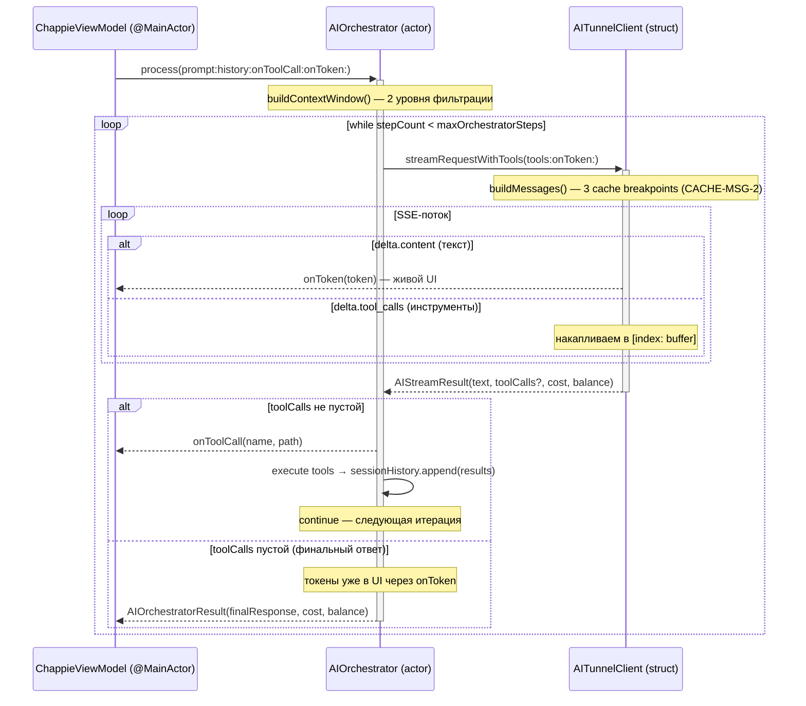

<!--
  ChappieCore/AI_Docs/architecture.md

  ДОКУМЕНТ АРХИТЕКТУРЫ — CHAPPIECORE

  Обновлён после ТД-7 (2026-05-28): добавлен стриминг токенов через SSE.
  Обновлён после ТД-COST (2026-05-28): добавлен Prompt Caching для экономии токенов.
  Обновлён после SINGLE-STREAM (2026-05-29): убран двойной запрос (probe + stream),
    единый streamRequestWithTools() на каждый шаг цикла.
  Обновлён после CTX-OPT (2026-05-29): добавлен maxMessagesInContext (12) как жёсткий
    лимит поверх токенного бюджета.
  Обновлён после CACHE-MSG (2026-05-29): второй cache breakpoint теперь ставится на
    ПОСЛЕДНИЙ user-элемент в истории, а не на последнее сообщение.
  Обновлён после CACHE-MSG-2 (2026-05-29): третий cache breakpoint на ПОСЛЕДНЕЕ
    сообщение истории — кэширует "хвост" из tool-ответов текущего шага цикла.
  Обновляй при каждом значимом архитектурном изменении.
-->

# ChappieCore — Архитектура системы

## 1. Философия и назначение

**ChappieCore** — автономный Swift Package, реализующий всю бизнес-логику AI-ассистента Чаппи.
Намеренно отделён от UI-слоя по нескольким критическим причинам:

1. **Тестируемость.** Бизнес-логика покрывается тестами без запуска UI.
2. **Переиспользуемость.** Пакет можно подключить к CLI, тестовому харнессу, iOS-приложению.
3. **Чёткая граница ответственности.** UI не знает, как работает AI. AI не знает, как выглядит UI.
4. **Безопасность macOS Sandbox.** Вся работа с файлами изолирована в одном месте.

---

## 2. Реальная структура файлов

```
ChappieCore/
├── Package.swift
├── AI_Docs/
│   ├── semantic.json
│   ├── architecture.md                 # Этот файл
│   └── project_map.md
└── Sources/ChappieCore/
    ├── ChappieCore.swift
    ├── Models/
    │   ├── AITunnelModels.swift        # AIStreamChunk, AICacheControl, AIStreamResult (SINGLE-STREAM)
    │   ├── AppConfig.swift             # + maxMessagesInContext (CTX-OPT)
    │   └── ChappieError.swift
    └── Services/
        ├── AITunnelClient.swift        # 3 cache breakpoint'а (CACHE-MSG-2)
        ├── AIOrchestrator.swift        # Единый цикл без probe (SINGLE-STREAM)
        ├── ToolExecutionService.swift
        ├── FileSystemManager.swift
        ├── MemoryManager.swift
        └── ChatHistoryManager.swift
```

---

## 3. Единый стриминговый цикл (SINGLE-STREAM)

### Проблема: двойной запрос (probe + stream)

Старая стратегия агентного цикла делала **два запроса** для каждого финального ответа:
1. `sendRequest()` — probe-запрос с инструментами, чтобы определить: tool_call или финал?
2. `streamRequest()` — повторный запрос того же содержимого, но через SSE для живого UI.

Это удваивало стоимость и задержку финального ответа. Реальные цифры:
- Первый запрос: 6,956 токенов in / 133 out
- Второй запрос: 5,441 токенов in / 131 out
- Итого: ~12,400 токенов вместо ~6,400 необходимых.

### Решение: streamRequestWithTools()

**Новый метод `AITunnelClient.streamRequestWithTools()`** делает один стриминговый запрос
с инструментами и возвращает `AIStreamResult`:

```swift
public struct AIStreamResult: Sendable {
    let text: String          // накопленный текстовый ответ
    let toolCalls: [AIToolCall]?  // собранные из SSE-дельт вызовы инструментов
    let cost: Double?
    let balance: Double?
}
```

**Как накапливаются tool_calls из SSE:**
Anthropic API в стриминге отдаёт tool_calls по кусочкам через `delta.tool_calls[index]`:
- Первый чанк для индекса N: `{index: 0, id: "call_abc", function: {name: "write_file", arguments: "{"}}`
- Последующие: `{index: 0, function: {arguments: "\"path\": \"file.swift\""}}`

AITunnelClient накапливает аргументы в словаре `[Int: (id, name, arguments)]` и после
завершения потока собирает полные `AIToolCall` объекты.

**Агентный цикл теперь:**
```
loop:
  result = await streamRequestWithTools(tools: tools, onToken: onToken)
  if result.toolCalls → executeTools → continue
  else → финальный ответ, токены уже ушли в UI через onToken → return
```

Один запрос на шаг. Экономия ~50% стоимости финального ответа.

---

## 4. Оптимизация контекстного окна (CTX-OPT)

### Проблема: 32 сообщения при 6000 токенах

После исправления формулы estimateTokens() и снижения бюджета до 6,000 —
buildContextWindow() всё равно отбирал 32 сообщения. Причина: большинство из них
были короткими саммари (~185 токенов каждое), которые помещались в бюджет.

Модели не нужна длинная цепочка из 30 коротких реплик — ей нужен **смысловой контекст задачи**.

### Решение: двухуровневые ограничения

**AppConfig.maxMessagesInContext = 12** — жёсткий лимит по количеству.

Применяется ПЕРВЫМ, до токенного подсчёта:
```swift
let cappedHistory = history.count > maxMessages
    ? Array(history.suffix(maxMessages))
    : history
```

Затем токенный бюджет применяется к уже обрезанной истории.

**Итоговые параметры контекстного окна:**
| Параметр | Значение | Смысл |
|---|---|---|
| `maxMessagesInContext` | 12 | Жёсткий лимит: последние 12 сообщений (~6 обменов) |
| `tokenBudget` | 6,000 | Мягкий лимит по объёму (≈10,000 реальных токенов) |
| `recentFullMessages` | 3 | Последние 3 — всегда полностью, без сжатия |
| `summaryThreshold` | 200 | Сжимать только сообщения длиннее этого порога |

---

## 5. Prompt Caching (ТД-COST + CACHE-MSG + CACHE-MSG-2)

### Проблема

Системный промпт Чаппи (~800-1000 слов) отправляется с **каждым запросом** агентного цикла.
При сложных задачах (10+ шагов) это даёт огромное количество повторных токенов.

### Решение: Anthropic Prompt Caching

Кэшированные токены при повторном использовании стоят **~10% от обычной цены** (экономия 90%).
Кэш живёт **5 минут** с момента последнего использования.

### Три cache breakpoint'а в каждом запросе (CACHE-MSG-2)

**Breakpoint 1 — системный промпт (стабильный, всегда работает):**
```
system: [{type:"text", text:"...", cache_control:{type:"ephemeral"}}]
```
ПОДТВЕРЖДЕНО: ~2384 токена кэшируется стабильно на каждом запросе.

**Breakpoint 2 — последний user-элемент в истории (CACHE-MSG):**

Ищем последний `role="user"` с конца истории. Кэшируем system + всю историю до него.
Работает даже когда последнее сообщение role="tool" (агентный цикл).

**Breakpoint 3 — последнее сообщение истории (CACHE-MSG-2):**

**Проблема которую решает:** после breakpoint 2 накапливаются tool-сообщения нового шага.
Они не кэшируются → на каждом следующем шаге пересчитываются заново.

Из реального лога (до CACHE-MSG-2):
```
Шаг 1: user[idx:12], 0 после → created: 3711  (записали в кэш)
Шаг 2: user[idx:12], 3 после → created: 0     ✅ идеал (3 tool-msg прочитаны из кэша)
Шаг 3: user[idx:12], 6 после → created: 5006  ← ПРОБЛЕМА: 3 новых tool-msg пересчитаны
Шаг 4: user[idx:12], 9 после → created: 5006  ← ПРОБЛЕМА: снова пересчитываются
```

**Решение:** ставим третий breakpoint на последнее сообщение истории.
На следующем шаге цикла этот "хвост" уже будет в кэше → created ≈ 0.

**Ограничения третьего breakpoint'а:**
- Ставится только если последнее сообщение ≠ последнему user-сообщению (иначе дублирование)
- Ставится только на `role="tool"` или `role="user"` (у них есть текстовый contentString)
- `role="assistant"` с tool_calls имеет `contentString=nil` → кэшировать нечего

**Итоговая схема (агентный цикл, шаг 3):**
```
system [cache✅]                        ← breakpoint 1
user: "напиши код"
assistant: "сейчас"
tool: "результат read_file"
user: "продолжи" [cache✅]              ← breakpoint 2: последний user
assistant: "ещё инструмент"
tool: "результат write_file" [cache✅]  ← breakpoint 3: последнее сообщение
user: "текущий запрос"                  ← добавляется buildContextWindow() (не кэшируется)
```

**Ожидаемый эффект после CACHE-MSG-2:**
```
Шаг 1: created: ~3700 (записали в кэш), read: 2384
Шаг 2: created: ~500  (только новый запрос), read: ~6000  ✅
Шаг 3: created: ~500  (только новый запрос), read: ~6000  ✅
Шаг 4: created: ~500  (только новый запрос), read: ~6000  ✅
```

Кэширование инкапсулировано в `AITunnelClient.buildMessages()`.
Оркестратор и остальная логика не знают о кэшировании.

---

## 6. Оценка токенов (ИСПРАВЛЕНИЕ)

### Проблема

Старая формула `text.count / 4` считала **символы / 4**.
Кириллица в UTF-8 = 2 байта на символ → занижение в ~2 раза для русского текста.

### Решение

```swift
private func estimateTokens(_ message: AIMessage) -> Int {
    let text = message.contentString ?? ""
    let utf8ByteCount = text.utf8.count
    // UTF-8 байты / 4 × 1.5 = реалистичная оценка с запасом безопасности
    let estimated = Int(Double(utf8ByteCount) / 4.0 * 1.5)
    return max(1, estimated)
}
```

**Почему работает:**
- Русский текст: символ = 2 байта → 2/4×1.5 = 0.75 токена/символ ✓
- Английский: символ = 1 байт → 1/4×1.5 = 0.375 токена/символ ✓
- Код: смешанный → приблизительно правильно ✓

---

## 7. Детальный AI-цикл (единый стриминговый)



---

## 8. Инструменты Чаппи (Function Calling)

`ToolExecutionService` предоставляет 8 инструментов.

### Инструменты файловой системы

| Инструмент | Аргументы | Возвращает |
|---|---|---|
| `list_files` | — | JSON-массив путей |
| `read_file` | `path` | Содержимое файла |
| `write_file` | `path`, `content` | Статус |
| `delete_file` | `path` | Статус |

### Инструменты памяти

| Инструмент | Обязательные | Опциональные |
|---|---|---|
| `memorize` | `key`, `type`, `jsonString` | `scope`, `targetName` |
| `recall` | `key` | `targetName` |
| `search_memory` | `type` | `targetName` |
| `delete_memory` | `key` | `targetName` |

---

## 9. Swift 6 Concurrency

### Схема изоляции

```
┌──────────────────────────────────────────────────────────┐
│  Main Thread (@MainActor)                                │
│  ChappieViewModel — все обновления UI здесь             │
│  streamingText += token (через Task { @MainActor in })  │
└──────────────────┬───────────────────────────────────────┘
                   │ await
┌──────────────────▼───────────────────────────────────────┐
│  Swift Cooperative Thread Pool                           │
│                                                          │
│  AIOrchestrator (actor) — агентный цикл                 │
│       │                                                  │
│       └──► AITunnelClient.streamRequestWithTools()       │
│                 └── URLSession.bytes() — SSE-поток       │
│                 └── накопление tool_calls по index        │
│       └──► ToolExecutionService (actor)                  │
│                │                                         │
│                ├──► FileSystemManager (actor)            │
│                └──► MemoryManager (actor)                │
└──────────────────────────────────────────────────────────┘
```

---

## 10. Безопасность: защита от Path Traversal

`FileSystemManager.validateAndResolvePath(_:)`:
1. `workspaceURL.resolvingSymlinksInPath()` — стандартизируем корень.
2. `appendingPathComponent(relativePath)` → `.standardized` — раскрываем `..`.
3. Проверяем `hasPrefix(workspacePath + "/")` — если нет → throw.

---

## 11. AppConfig — единственный источник истины

```swift
public struct AppConfig: Codable, Equatable, Sendable {
    public static let shared = AppConfig()
    public let maxOrchestratorSteps: Int           // 100
    public let tokenBudget: Int                    // 6,000
    public let maxMessagesInContext: Int            // 12  ← CTX-OPT
    public let recentFullMessages: Int             // 3
    public let summaryThreshold: Int               // 200
    public let requestTimeoutSeconds: TimeInterval  // 300
    public let connectionTimeoutSeconds: TimeInterval // 30
}
```

---

## 12. Технический долг (актуальный)

| # | Описание | Приоритет | Статус |
|---|---|---|---|
| ТД-7 | Стриминг токенов | 🟡 | ✅ Закрыт |
| ТД-COST | Prompt Caching для экономии токенов | 🔴 | ✅ Закрыт |
| SINGLE-STREAM | Убран двойной запрос (probe + stream) | 🔴 | ✅ Закрыт |
| CTX-OPT | maxMessagesInContext — лимит по количеству | 🟡 | ✅ Закрыт |
| CACHE-MSG | Умное позиционирование 2-го cache breakpoint'а | 🔴 | ✅ Закрыт |
| CACHE-MSG-2 | Третий breakpoint на последнее сообщение истории | 🔴 | ✅ Закрыт |
| ТД-5 | API-ключ в UserDefaults → перенести в Keychain | 🟡 | Открыт |
| ТД-8 | Нет тестового таргета в Package.swift | 🟡 | Открыт |

---

## 📚 Changelog

| Date | Change | Author |
|------|--------|--------|
| 2026-05-21 | Initial creation | Chappie AI |
| 2026-05-27 | Полная переработка: реальное состояние кода | Chappie AI |
| 2026-05-28 | ТД-7: Стриминг токенов | Chappie AI |
| 2026-05-28 | ТД-COST: Prompt Caching | Chappie AI |
| 2026-05-29 | SINGLE-STREAM: убран probe+stream, единый streamRequestWithTools() | Chappie AI |
| 2026-05-29 | CTX-OPT: добавлен maxMessagesInContext=12 в AppConfig и buildContextWindow() | Chappie AI |
| 2026-05-29 | CACHE-MSG: второй breakpoint на последний user-элемент истории | Chappie AI |
| 2026-05-29 | CACHE-MSG-2: третий breakpoint на последнее сообщение истории | Chappie AI |
