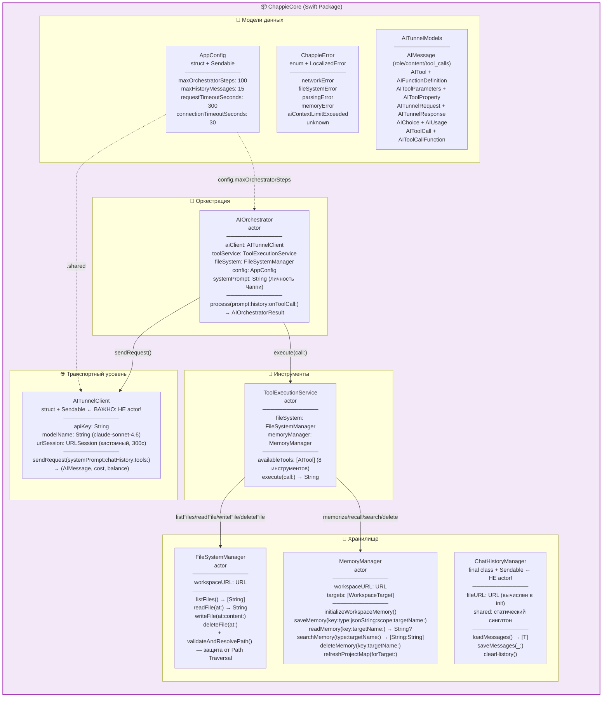
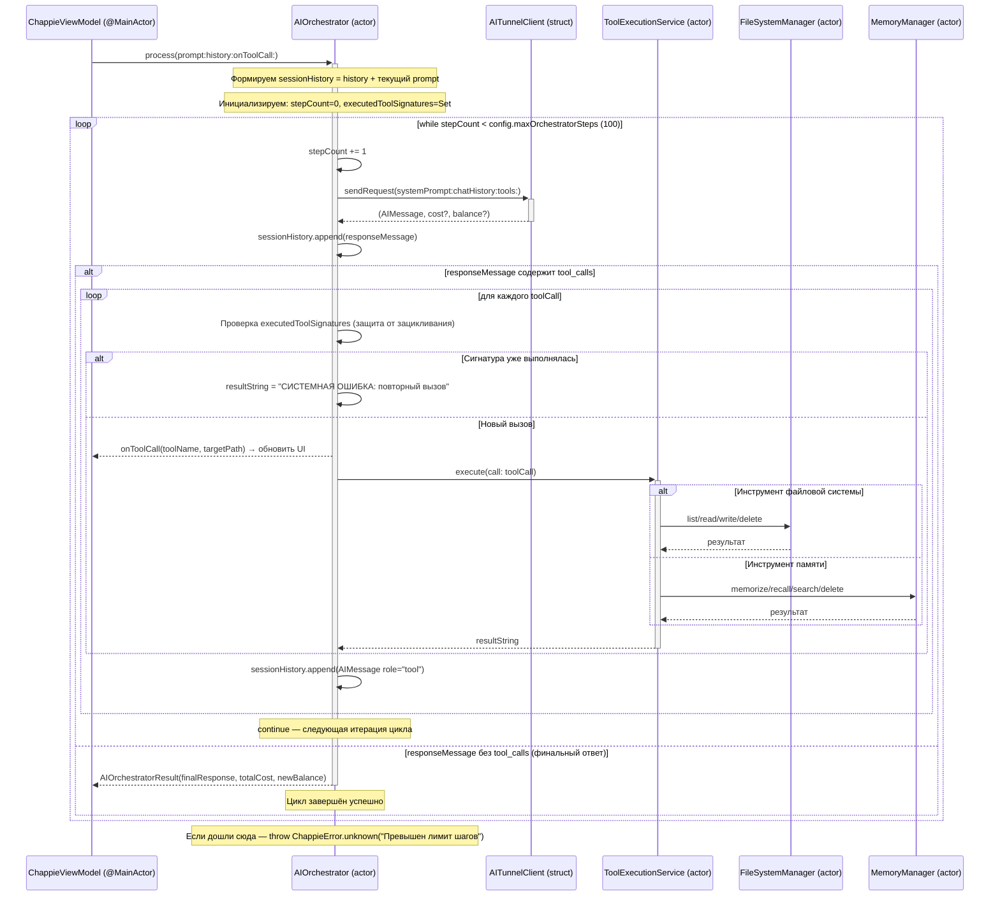

<!--
  ChappieCore/AI_Docs/architecture.md

  ДОКУМЕНТ АРХИТЕКТУРЫ — CHAPPIECORE

  Этот файл является главным источником истины об архитектуре ChappieCore.
  Обновлён в ходе полной инспекции кода — отражает фактическое состояние на 2026-05-27.
  Обновляй при каждом значимом архитектурном изменении.
-->

# ChappieCore — Архитектура системы

## 1. Философия и назначение

**ChappieCore** — автономный Swift Package, реализующий всю бизнес-логику AI-ассистента Чаппи.
Намеренно отделён от UI-слоя по нескольким критическим причинам:

1. **Тестируемость.** Бизнес-логика покрывается тестами без запуска UI.
2. **Переиспользуемость.** Пакет можно подключить к CLI, тестовому харнессу, iOS-приложению.
3. **Чёткая граница ответственности.** UI не знает, как работает AI. AI не знает, как выглядит UI.
4. **Безопасность macOS Sandbox.** Вся работа с файлами изолирована в одном месте.

---

## 2. Реальная структура файлов

```
ChappieCore/
├── Package.swift                           # SPM манифест: Swift 6, macOS 15+
├── AI_Docs/
│   ├── semantic.json                       # Семантическая память Library-таргета
│   ├── architecture.md                     # Этот файл
│   └── project_map.md                      # Карта файлов пакета
└── Sources/ChappieCore/
    ├── ChappieCore.swift                   # Фасад пакета: документация публичного API + coreVersion
    ├── Models/
    │   ├── AITunnelModels.swift            # Codable-модели для API (запросы, ответы, инструменты)
    │   ├── AppConfig.swift                 # Централизованная конфигурация (struct, singleton)
    │   └── ChappieError.swift              # Единый перечислитель ошибок (LocalizedError)
    └── Services/
        ├── AITunnelClient.swift            # HTTP-клиент (struct, Sendable) — НЕ actor!
        ├── AIOrchestrator.swift            # Главный агентный цикл (actor)
        ├── ToolExecutionService.swift      # Реестр и исполнитель инструментов (actor)
        ├── FileSystemManager.swift         # Безопасная работа с файлами (actor)
        ├── MemoryManager.swift             # Долгосрочная память (actor)
        └── ChatHistoryManager.swift        # История чата (final class, Sendable)
```

---

## 3. Общая архитектура: реальная схема



---

## 4. Детальный AI-цикл (Агентный Loop)

Это сердце системы. `AIOrchestrator.process()` — главный метод.



---

## 5. Инструменты Чаппи (Function Calling)

`ToolExecutionService` предоставляет 8 инструментов, зарегистрированных в `availableTools`.

### Инструменты файловой системы

| Инструмент | Аргументы | Возвращает |
|---|---|---|
| `list_files` | — | JSON-массив относительных путей |
| `read_file` | `path: String` | Содержимое файла (String) |
| `write_file` | `path: String`, `content: String` | "Успешно: Файл X записан." |
| `delete_file` | `path: String` | "Успешно: Файл X удалён." |

### Инструменты долгосрочной памяти

| Инструмент | Обязательные аргументы | Опциональные |
|---|---|---|
| `memorize` | `key`, `type`, `jsonString` | `scope` (project/global), `targetName` |
| `recall` | `key` | `targetName` |
| `search_memory` | `type` | `targetName` |
| `delete_memory` | `key` | `targetName` |

### Архитектура памяти

```
~/Documents/Chappie/semantic.json          ← scope: global
<workspace>/
├── Chappie/AI_Docs/semantic.json          ← scope: project, targetName: "Chappie" (App-таргет)
└── ChappieCore/AI_Docs/semantic.json      ← scope: project, targetName: "ChappieCore"
```

**Порядок поиска при `recall` без `targetName`:**
App-таргет → остальные таргеты → глобальная память.

---

## 6. Swift 6 Concurrency: реальная картина

### Почему `AITunnelClient` — struct, а не actor?

`AITunnelClient` не имеет изменяемого состояния — все свойства `let`.
`struct` с `let`-свойствами автоматически `Sendable` в Swift 6 без дополнительных аннотаций.
`URLSession` — потокобезопасна и является `Sendable`.
Использование `actor` было бы избыточным усложнением без какой-либо пользы.

### Почему `ChatHistoryManager` — class, а не actor?

`ChatHistoryManager` — `final class` с единственным `let fileURL`.
Все публичные методы не изменяют состояние объекта (только пишут/читают файл).
`Sendable` достигается через `let`-свойства и `final`.
Синглтон `shared` используется как фолбэк без воркспейса.

### Схема изоляции

```
┌──────────────────────────────────────────────────────────┐
│  Main Thread (@MainActor)                                │
│  ChappieViewModel — все обновления UI здесь             │
└──────────────────┬───────────────────────────────────────┘
                   │ await (hop off main thread)
┌──────────────────▼───────────────────────────────────────┐
│  Swift Cooperative Thread Pool                           │
│                                                          │
│  AIOrchestrator (actor) — агентный цикл                 │
│       │                                                  │
│       ├──► AITunnelClient (struct) — HTTP запросы        │
│       │                                                  │
│       └──► ToolExecutionService (actor)                  │
│                │                                         │
│                ├──► FileSystemManager (actor) — файлы    │
│                └──► MemoryManager (actor) — память       │
│                                                          │
│  ChatHistoryManager (class, Sendable) — история          │
└──────────────────────────────────────────────────────────┘
```

---

## 7. Безопасность: защита от Path Traversal

`FileSystemManager` защищает от атак типа `../../etc/passwd`.

**Алгоритм `validateAndResolvePath(_:)`:**
1. `workspaceURL.resolvingSymlinksInPath()` — стандартизируем корень.
2. `resolvedWorkspace.appendingPathComponent(relativePath)` — строим абсолютный URL.
3. `.standardized` — раскрываем все `..` и `.` лексически.
4. Проверяем: `targetPath.hasPrefix(workspacePath + "/")`.
5. Если нет — `throw ChappieError.fileSystemError("Нарушение безопасности...")`.

**Почему это критично:** ИИ получает пути от LLM — внешнего источника. LLM может сгенерировать вредоносный путь намеренно или по ошибке.

---

## 8. AppConfig — единственный источник истины

```swift
public struct AppConfig: Codable, Equatable, Sendable {
    public static let shared = AppConfig()

    public let maxOrchestratorSteps: Int    // 100 — лимит итераций агентного цикла
    public let maxHistoryMessages: Int       // 15  — лимит сообщений в контексте API
    public let requestTimeoutSeconds: TimeInterval  // 300 — таймаут запроса (5 минут)
    public let connectionTimeoutSeconds: TimeInterval // 30 — таймаут соединения
}
```

`AIOrchestrator` читает `config.maxOrchestratorSteps` — не захардкоженное число.
`AITunnelClient` читает `AppConfig.shared.requestTimeoutSeconds` для URLSession и URLRequest.

---

## 9. MemoryManager — детальная архитектура

### Структура таргетов

```swift
public struct WorkspaceTarget: Sendable {
    let name: String              // "Chappie" или "ChappieCore"
    let directoryURL: URL         // <workspace>/Chappie/
    let aiDocsURL: URL            // <workspace>/Chappie/AI_Docs/
    let semanticFileURL: URL      // <workspace>/Chappie/AI_Docs/semantic.json
    let architectureFileURL: URL  // <workspace>/Chappie/AI_Docs/architecture.md
    let projectMapFileURL: URL    // <workspace>/Chappie/AI_Docs/project_map.md
    let kind: TargetKind          // .appTarget или .library
}
```

### Классификация таргетов

App-таргет определяется по наличию файла `*App.swift` (признак `@main` точки входа SwiftUI).

### Фильтрация при сканировании

Исключаются: скрытые папки, `build`, `DerivedData`, `Pods`, `Frameworks`, `.git`, `.swiftpm`,
а также **директории с расширением в имени** (`.xcodeproj`, `.xcworkspace`, `.playground`).

### Инициализация (идемпотентна)

```
initializeWorkspaceMemory()
├── cleanupInvalidAIDocs()      — удаляет ошибочные AI_Docs внутри .xcodeproj и т.д.
├── setupGlobalMemory()         — создаёт ~/Documents/Chappie/semantic.json
├── discoverTargets()           — сканирует первый уровень workspace
├── setupAIDocs(for:)           — создаёт AI_Docs + шаблоны для каждого таргета
│   └── scanTargetDirectory()   — реальные файлы для project_map.md
└── migrateOldRootAIDocs()      — миграция из старого корневого AI_Docs
```

---

## 10. ChatHistoryManager — хранение истории

### Пути хранения

| Режим | Путь |
|---|---|
| С воркспейсом | `<workspace>/AI_Docs/chat_history.json` |
| Без воркспейса (фолбэк) | `~/Documents/Chappie/global_chat_history.json` |

### Generic API

Методы `loadMessages<T: Codable>()` и `saveMessages<T: Codable>(_:)` используют дженерики,
чтобы ChappieCore не зависел от конкретного типа `ChatMessage`, определённого в UI-слое.

---

## 11. Ключевые инварианты системы

> Нарушение любого из этих инвариантов означает архитектурный баг.

1. **AIOrchestrator — единственный инициатор AI-запросов.** Никто другой не вызывает `AITunnelClient.sendRequest()` напрямую.

2. **ToolExecutionService — единственный исполнитель инструментов.** AIOrchestrator передаёт `AIToolCall` и получает `String`.

3. **FileSystemManager — единственная точка доступа к файловой системе.** Никакого прямого `FileManager` в других сервисах.

4. **AppConfig — единственный источник всех "магических чисел".** Никаких захардкоженных лимитов в коде.

5. **Все сервисы с изменяемым состоянием — акторы.** Исключения (`AITunnelClient`, `ChatHistoryManager`) — только если они не имеют изменяемого состояния.

6. **Все модели данных — Sendable.** Передача между акторами безопасна.

7. **Нет `@MainActor` в ChappieCore.** Это чистая бизнес-логика без UI.

---

## 12. Технический долг (актуальный)

| # | Описание | Приоритет |
|---|---|---|
| ТД-7 | Нет стриминга токенов — `sendRequest()` блокирующий | 🟡 |
| ТД-8 | Нет тестового таргета в `Package.swift` | 🟡 |
| ТД-6 | ToolCall-сообщения — `ChatMessage` с эмодзи-префиксом вместо типизации | 🟡 |

---

## 📚 Changelog

| Date | Change | Author |
|------|--------|--------|
| 2026-05-21 | Initial creation | Chappie AI |
| 2026-05-27 | Полная переработка: документ приведён в соответствие с реальным кодом. Исправлены типы (AITunnelClient: struct, ChatHistoryManager: class), убраны несуществующие саб-агенты и delegate_task, добавлена реальная схема агентного цикла, инструменты, AppConfig, Path Traversal защита | Chappie AI |
