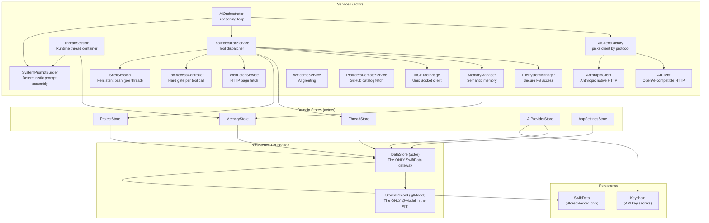

# ChappieCore — Business Logic Package Architecture

## 1. Purpose

All business logic of Chappie. Completely independent of SwiftUI — testable without UI.

**Dependency rule:** ChappieCore → Foundation, SwiftData only. No SwiftUI or AppKit.

---

## 2. Package Structure

```
ChappieCore/
├── Package.swift
└── Sources/ChappieCore/
    ├── ChappieCore.swift               # Public API re-exports
    ├── DataStore/
    │   └── DataStore.swift             # THE ONLY file that imports SwiftData. StoredRecord @Model lives here.
    ├── Models/
    │   ├── AIProviderModels.swift       # AIProvider, APIKey, AIModel + AIProviderEntity (legacy, to be removed)
    │   ├── AITunnelModels.swift         # AIMessage, AIStreamChunk, AIUsage
    │   ├── AppConfig.swift             # Centralized config (dynamic, per-thread)
    │   ├── AppSettings.swift           # AppSettings (legacy @Model, to be removed after DB-04)
    │   ├── ChappieError.swift          # ChappieError enum
    │   ├── MemoryModels.swift          # MemoryEntity (legacy), MemoryEntry, MemoryContext
    │   ├── ProjectModels.swift         # ProjectEntity (legacy), ProjectMetadata, ProjectSettings
    │   ├── RemoteProviderCatalog.swift  # DTOs for providers.json (GitHub-hosted catalog)
    │   └── ThreadModels.swift          # ThreadEntity (legacy), ThreadSettings, ThreadMetadata
    └── Services/
        ├── AIClient.swift              # HTTP client for OpenAI-compatible APIs
        ├── AIClientProtocol.swift      # Protocol: validateProvider, streamChat, fetchModels
        ├── AIClientFactory.swift       # Factory: picks AIClient or AnthropicClient by protocol
        ├── AnthropicClient.swift       # HTTP client for native Anthropic API (/v1/messages)
        ├── AIOrchestrator.swift        # Reasoning loop: prompt → tools → response
        ├── AIProviderStore.swift       # CRUD for AI providers + Keychain (multi-key)
        ├── AppSettingsStore.swift      # Actor-based CRUD for singleton AppSettings
        ├── FileSystemManager.swift     # Secure file system access (sandbox)
        ├── MCPToolBridge.swift         # Bridge to ChappieMCP via Unix socket
        ├── MemoryManager.swift         # Semantic memory (read/write/search)
        ├── MemoryStore.swift           # Persistence CRUD for memory scopes
        ├── ProjectStore.swift          # CRUD for projects
        ├── ProvidersRemoteService.swift # Fetches + caches providers.json from GitHub
        ├── ShellSession.swift          # Persistent bash session (per-thread, run_terminal)
        ├── StallWatchdog.swift         # Cancels stalled AI streams after timeout
        ├── SystemPromptBuilder.swift   # Deterministic system prompt assembler
        ├── ThreadSession.swift         # Runtime container for an active thread
        ├── ThreadStore.swift           # CRUD for threads
        ├── ToolAccessController.swift  # Hard gate before every tool execution
        ├── WebFetchService.swift       # Fetches web pages and extracts clean text
        ├── WelcomeService.swift        # Generates AI welcome message for new threads
        └── ToolExecution/
            ├── ToolAccessControl.swift     # Access control rules per tool category
            ├── ToolDefinitions.swift       # Tool schema definitions (JSON for AI)
            ├── ToolExecutionService.swift  # Dispatches tool calls from AIOrchestrator
            ├── FileTools.swift             # File tool implementations
            ├── GitBuildTools.swift         # Git/build tool implementations
            ├── MemoryTools.swift           # Memory tool implementations
            └── TerminalTools.swift         # run_terminal implementation (ShellSession)
```

---

## 3. DataStore — The Persistence Foundation

**Rule: DataStore.swift is the ONLY file in the project that imports SwiftData.**
No other file may declare `@Model` or import SwiftData.

### StoredRecord — The Only @Model

```swift
@Model final class StoredRecord {
    @Attribute(.unique) var relation: String  // DataStore.Relation.rawValue
    var payload: Data                          // JSONEncoder output of any Codable
}
```

The schema is frozen. It will never change. No SwiftData migrations are ever needed.

### DataStore.Relation

```swift
enum Relation: String {
    case threads      = "threads"
    case projects     = "projects"
    case memory       = "memory"
    case providers    = "providers"
    case appSettings  = "app_settings"
}
```

One row per relation. The payload is a JSON-encoded domain collection.

### DataStore API

```swift
public actor DataStore {
    func load<T: Codable>(_ relation: Relation) throws -> T?
    func save<T: Codable>(_ value: T, for relation: Relation) throws
    func delete(_ relation: Relation) throws
    func exists(_ relation: Relation) throws -> Bool
}
```

### Data Flow

```
Write:  DomainStruct (Codable) → JSONEncoder → Data → StoredRecord.payload → SwiftData
Read:   SwiftData → StoredRecord.payload → Data → JSONDecoder → DomainStruct (Codable)
```

Decode failure is non-fatal. Callers receive `nil` or `[]` and recover gracefully.

---

## 4. Codable Compatibility Rules

**These rules apply to ALL structs stored via DataStore. Violation = silent data corruption.**

1. **Never rename a stored property without adding `CodingKeys`.**
   Old JSON has the old key name. Renaming without `CodingKeys` silently returns nil/default.

2. **Never remove a stored property.**
   Mark it `optional` with a default value. Old records must still decode cleanly.

3. **Always give new properties a default value.**
   Old records don't have the new key — decoder must not fail.

Structs that must follow these rules:

| Struct | Stored under |
|---|---|
| `[ThreadPayload]` | `DataStore.Relation.threads` |
| `[ProjectPayload]` | `DataStore.Relation.projects` |
| `[MemoryScope]` | `DataStore.Relation.memory` |
| `[AIProvider]` | `DataStore.Relation.providers` |
| `AppSettingsPayload` | `DataStore.Relation.appSettings` |
| `ThreadSettings` | inside `ThreadPayload` |
| `ProjectSettings` | inside `ProjectPayload` |
| `[MemoryEntry]` | inside `MemoryScope` |

---

## 5. Architecture Diagram



---

## 6. Key Models

### AIProvider / APIKey / AIModel

```swift
struct AIProvider: Codable {
    var id: UUID
    var name: String
    var baseURL: String
    var catalogId: String?
    var providerProtocol: ProviderProtocol
    var keys: [APIKey]
    var models: [AIModel]
}

struct APIKey: Codable {
    var id: UUID                  // Keychain entry key = apiKey.id.uuidString
    var name: String
}

struct AIModel: Codable {
    var id: String
    var name: String
    var endpoint: String
    var providerProtocol: ProviderProtocol
}
```

### ThreadSettings (Codable)

```swift
struct ThreadSettings: Codable, Sendable {
    var maxMessagesInContext: Int   // 10...1000, default 100
    var isUnlimitedContext: Bool
    var activeProviderId: UUID?
    var activeKeyId: UUID?
    var activeModelName: String?
}
```

### AppSettings (Codable, stored via DataStore)

```swift
struct AppSettingsPayload: Codable {
    var workspaceBookmark: Data?
    var lastActiveThreadIdString: String?
    var balancesJSON: Data
}
```

---

## 7. AI Client Architecture

```
AIClientProtocol
    ├── validateProvider() async throws
    ├── streamChat(messages:config:onChunk:) async throws -> AIUsage
    └── fetchAvailableModels() async -> [String]

AIClientFactory
    ├── make(for provider: AIProvider, apiKey: String, model: AIModel) -> any AIClientProtocol
    └── makeForValidation(...) -> any AIClientProtocol

AIClient          — OpenAI-compatible (/v1/chat/completions, /v1/models)
AnthropicClient   — Anthropic native (/v1/messages)
```

---

## 8. AIOrchestrator — Reasoning Loop

```
process(prompt, history, config, memoryContext)
  → systemPrompt (via ThreadSession)
  → buildContextWindow(history, config)
  → loop (maxOrchestratorSteps = 100):
      → aiClient.streamChat()
      → if tool_use → ToolAccessController.check() → toolService.execute()
      → if text → accumulate tokens
      → if stop → return result
```

---

## 9. SystemPromptBuilder

Pure value transformer — no async, no SwiftData, no side effects.

**Injection order:**
1. Persona block
2. `userName` if set
3. Global memory block if not empty
4. Thread memory block if not empty
5. Per-project: `ProjectSettings.formatForSystemPrompt()` + project memory
6. Tool manifest (injected separately by AIOrchestrator)

---

## 10. ToolAccessController

Hard gate before every tool execution.

```swift
public enum AccessResult: Sendable {
    case allowed
    case denied(reason: String)
}
```

`git_diff` is permanently blocked — cannot be overridden by any settings.

---

## 11. ShellSession + TerminalTools

`ShellSession` — persistent bash process per thread ID.

**Access control (TerminalAccessLevel):**
- `.none` — terminal not available (default)
- `.confirm` — every command requires user approval
- `.auto` — commands execute immediately

---

## 12. Provider Catalog (GitHub-hosted)

Hosted at: `https://raw.githubusercontent.com/iOSIvanovS/chappieai/main/docs/providers.json`
Updated monthly via: `providers_1_clear.sh` → `providers_2_append.sh` → `providers_3_push.sh`
