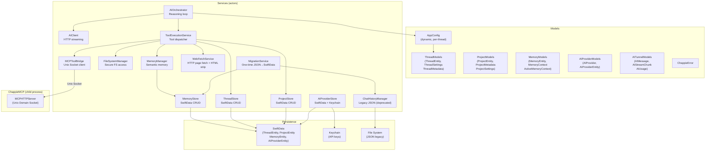

<!--
  ChappieCore/architecture.md

  ARCHITECTURE DOCUMENT — ChappieCore Swift Package

  This file is the single source of architectural truth for the ChappieCore module.
  Update after every significant architectural change.
-->

# ChappieCore — Business Logic Package Architecture

## 1. Purpose

**ChappieCore** is a Swift Package containing all business logic of the Chappie application.
Completely independent of SwiftUI — can be tested without a UI.

**Dependency rule:** ChappieCore → Foundation, SwiftData only.
No SwiftUI, AppKit, or any UI framework imports.

---

## 2. Package Structure

```
ChappieCore/
├── Package.swift
└── Sources/ChappieCore/
    ├── ChappieCore.swift               # Public API re-exports
    ├── Models/
    │   ├── AIProviderModels.swift       # AIProvider, AIProviderEntity (SwiftData)
    │   ├── AITunnelModels.swift         # AIMessage, AIStreamChunk, AIUsage
    │   ├── AppConfig.swift             # Centralized config (dynamic, per-thread)
    │   ├── ChappieError.swift          # ChappieError enum
    │   ├── MemoryModels.swift          # MemoryEntity, MemoryContext, ActiveMemoryContext
    │   ├── ProjectModels.swift         # ProjectEntity, ProjectMetadata, ProjectSettings
    │   └── ThreadModels.swift          # ThreadEntity, ThreadSettings, ThreadMetadata
    └── Services/
        ├── AIClient.swift              # HTTP client for AI APIs (provider-agnostic)
        ├── AIOrchestrator.swift        # Reasoning loop: prompt → tools → response
        ├── AIProviderStore.swift       # CRUD for AIProviderEntity in SwiftData
        ├── AITunnelClient.swift        # Legacy tunnel client (deprecated)
        ├── ChatHistoryManager.swift    # JSON-based message history (legacy + migration)
        ├── FileSystemManager.swift     # Secure file system access (sandbox)
        ├── MCPToolBridge.swift         # Bridge to ChappieMCP via Unix socket
        ├── MemoryManager.swift         # Semantic memory (read/write/search)
        ├── MemoryStore.swift           # SwiftData CRUD for MemoryEntity
        ├── MigrationService.swift      # One-time migration: JSON files → SwiftData
        ├── ProjectStore.swift          # CRUD for ProjectEntity in SwiftData
        ├── ThreadStore.swift           # CRUD for ThreadEntity in SwiftData
        ├── ToolExecutionService.swift  # Dispatches tool calls from AIOrchestrator
        └── WebFetchService.swift       # Fetches web pages and extracts clean text
```

---

## 3. Architecture Diagram



---

## 4. Key Models

### ThreadEntity (SwiftData)

```swift
@Model final class ThreadEntity {
    var id: UUID
    var title: String
    var createdAt: Date
    var updatedAt: Date
    var messagesJSON: Data      // [ChatMessage] serialized
    var settingsJSON: Data      // ThreadSettings serialized
    var projectBindingsJSON: Data // [UUID] serialized
}
```

**Why only primitives and Data:**
SwiftData has limited support for custom Codable types in @Model.
All complex objects are serialized to Data via JSONEncoder — full freedom to evolve without migrations.

### ThreadSettings (Codable)

```swift
struct ThreadSettings: Codable, Sendable {
    var maxMessagesInContext: Int   // 10...1000, default 20
    var isUnlimitedContext: Bool    // bypass all trimming
    var activeProviderId: UUID?     // per-thread provider selection
    var activeModelName: String?    // per-thread model selection

    var tokenBudget: Int { isUnlimitedContext ? Int.max : maxMessagesInContext * 500 }
}
```

### ThreadMetadata (Sendable DTO)

```swift
struct ThreadMetadata: Sendable, Identifiable, Hashable {
    let id: UUID
    let title: String
    let createdAt: Date
    let updatedAt: Date
    let projectIds: [UUID]
    let settings: ThreadSettings    // IT-11: included for direct UI access
}
```

**Why settings in ThreadMetadata (IT-11):**
ThreadSettingsSheet needs current settings without an extra ThreadStore call.
`ThreadStore.loadThreads()` always deserializes `settingsJSON` into `ThreadMetadata.settings`.

### AppConfig (dynamic, per-thread)

```swift
struct AppConfig: Codable, Equatable, Sendable {
    let maxOrchestratorSteps: Int   // 100 (hardcoded)
    let tokenBudget: Int            // maxMessages × 500, or Int.max
    let maxMessagesInContext: Int    // 10...1000, or Int.max
    let isUnlimitedContext: Bool
    // ...
}
```

**Context depth formula:**
- `tokenBudget = maxMessagesInContext × 500`
- Range: 10 → 5,000 tokens | 20 → 10,000 | 1000 → 500,000 | unlimited → Int.max

---

## 5. SwiftData Schema

```swift
Schema([
    ThreadEntity.self,
    ProjectEntity.self,
    MemoryEntity.self,
    AIProviderEntity.self
])
```

**Migration strategy:** none needed.
All complex objects are serialized to JSON strings/Data.
When a model evolves — only the Codable structs change; the SwiftData schema stays the same.

---

## 6. ThreadStore (actor)

```swift
public actor ThreadStore {
    func createThread(title:settings:) throws -> UUID
    func loadThreads() throws -> [ThreadMetadata]           // includes settings (IT-11)
    func saveMessages<T: Codable>(_:toThreadId:) throws
    func loadMessages<T: Codable>(fromThreadId:as:) throws -> [T]
    func updateSettings(_:forThreadId:) throws
    func loadSettings(forThreadId:) throws -> ThreadSettings
    func updateProjectBindings(_:forThreadId:) throws
    func renameThread(id:title:) throws
    func deleteThread(id:) throws
}
```

**Why actor:** ModelContext is not Sendable and must be used on one thread.
Actor guarantees sequential access — ideal for a thread-safe SwiftData wrapper.

**ThreadMetadata location (IT-11):** moved from `ThreadStore.swift` to `ThreadModels.swift`.
`ThreadStore` now only contains the actor + CRUD methods.

---

## 7. AIOrchestrator — Reasoning Loop

```
process(prompt, history, config, memoryContext)
  → buildSystemPrompt(memoryContext)     // injects memory into system prompt
  → buildContextWindow(history, config)  // trims history to tokenBudget + maxMessages
  → loop (maxOrchestratorSteps):
      → aiClient.streamChat()
      → if tool_use → toolService.execute()
      → if text → accumulate streaming tokens
      → if stop → return result
```

**Context trimming (buildContextWindow):**
1. Take last `maxMessagesInContext` messages
2. If total tokens > `tokenBudget` → trim oldest until fits
3. If `isUnlimitedContext = true` → skip all trimming

---

## 8. AIProviderStore

Manages AI provider configurations in SwiftData.

```swift
public actor AIProviderStore {
    func loadProviders() throws -> [AIProvider]
    func addProvider(_:apiKey:) throws -> UUID
    func deleteProvider(id:) throws
    func updateProvider(_:) throws
    func loadApiKey(for:) async -> String?
    func loadDefaultProvider() async throws -> AIProvider?
}
```

**API keys** are stored in Keychain (not SwiftData) — `KeychainManager`.
`AIProviderEntity` stores only the key reference (provider UUID as Keychain key).

---

## 9. MemoryStore (three-level memory)

Three scopes: `global`, `project`, `thread`.
Stored in `MemoryEntity` (SwiftData): `key + type + jsonString + scope + targetId`.

```swift
public actor MemoryStore {
    func saveEntry(key:type:jsonString:scope:targetId:) throws
    func readEntry(key:scope:targetId:) throws -> String?
    func deleteEntry(key:scope:targetId:) throws
    func searchEntries(type:scope:targetId:) throws -> [MemoryEntry]
    func importEntries(_:scope:) throws
}
```

---

## 10. ToolExecutionService

Dispatches tool calls from AIOrchestrator to concrete implementations.

**Tool categories:**
- File system: `read_file`, `write_file`, `delete_file`, `list_files`
- Web: `web_fetch` — fetches a URL and returns clean stripped text (via WebFetchService)
- Memory: `memorize`, `recall`, `search_memory`, `delete_memory`
- Git (via MCP): `git_status`, `git_add`, `git_commit`, `git_log`, `git_reset`
- Build (via MCP): `build_project`, `run_tests`, `read_build_log`
- Projects: `add_project_to_thread`, `remove_project_from_thread`, `list_projects`

**Permission check:** `ToolExecutionService` checks `ProjectSettings` before executing.
`git_diff` is always blocked regardless of settings.

**Cyrillic barrier:** `containsCyrillic()` blocks Cyrillic in memory writes —
all memory must be in English (global rule: memory_language_barrier).

**WebFetchService injection:**
`WebFetchService` is passed via `init(webFetch:)` — optional, defaults to `nil`.
When `nil`, `web_fetch` tool returns a clear error. This keeps backward compatibility
for test initializers that don't need web fetch.

---

## 11. WebFetchService (actor)

Fetches public web pages and extracts meaningful plain text for the AI agent.

```swift
public actor WebFetchService {
    public init(maxOutputLength: Int = 100_000, timeoutSeconds: TimeInterval = 30)
    public func fetch(urlString: String, selector: String? = nil) async -> String
}
```

**Design decisions:**
- Foundation only — no external dependencies
- Smart HTML stripping: removes nav/header/footer/aside/script/style, keeps main/article/p/headings
- Optional CSS-like selector: filter by tag (`article`), `.class`, or `#id` before stripping
- Size limit: 100,000 chars after strip; truncated from end with `[content truncated: N chars removed]`
- Timeout: 30 seconds (configurable)
- Encoding detection: Content-Type header → UTF-8 → ISO-8859-1 → lossy UTF-8
- All errors return strings starting with `❌` — no throws, consistent with other tools

---

## 12. MigrationService (IT-04)

One-time migration from JSON files to SwiftData.
Flag stored in UserDefaults: `"migrationIT04Completed"`.

**Migration steps:**
1. Read `chat_history.json` → create thread "Основной" + save messages
2. Read `semantic.json` → import memory entries into MemoryStore (scope=global)
3. Set migration flag → skip on next launch

---

## 📚 Changelog

| Date | Change |
|------|--------|
| 2026-05-29 | Web Fetch Tool ✅: WebFetchService added; registered in ToolExecutionService as web_fetch tool; injected via DI from ChappieViewModel |
| 2026-07-XX | Added Mermaid architecture diagram (section 3) per new architecture file rules |
| 2026-05-28 | IT-11 ✅: ThreadMetadata.settings field added; ThreadMetadata moved to ThreadModels.swift; ThreadStore.loadThreads() deserializes settingsJSON into metadata |
| 2026-05-XX | IT-10 ✅: AIProviderStore, AIProviderEntity, AIProvider, per-thread provider/model selection |
| 2026-05-XX | IT-09 ✅: ProjectSettings in MemoryContext; ToolExecutionService.setProjectSettings() |
| 2026-05-XX | IT-08 ✅: Three-level memory (global/project/thread); MemoryStore SwiftData |
| 2026-05-XX | IT-07 ✅: Project tool handlers (add/remove/list_projects) |
| 2026-05-XX | IT-06 ✅: ProjectStore, ProjectEntity, projectBindingsJSON in ThreadEntity |
| 2026-05-XX | IT-05 ✅: ThreadStore, ThreadEntity, ThreadMetadata, multi-thread system |
| 2026-05-XX | IT-04 ✅: MigrationService (JSON → SwiftData) |
| 2026-05-XX | IT-02 ✅: Dynamic AppConfig from ThreadSettings; tokenBudget formula |
| 2026-05-XX | IT-01 ✅: SwiftData schema (ThreadEntity, ProjectEntity, MemoryEntity) |
