# ChappieCore — Business Logic Package Architecture

## 1. Purpose

All business logic of Chappie. Completely independent of SwiftUI — testable without UI.

**Dependency rule:** ChappieCore → Foundation only. No SwiftUI, AppKit, or SwiftData.

---

## 2. Package Structure

```
ChappieCore/
├── Package.swift
└── Sources/ChappieCore/
    ├── ChappieCore.swift               # Public API table of contents
    ├── DataStore/
    │   ├── ChappieStorage.swift        # Protocol + ChappieStorageRelation (typesafe keys)
    │   └── SQLiteStorage.swift         # GRDB-based backend — sole production implementor (+ corrupt-record backup)
    ├── Models/
    │   ├── AIProviderModels.swift       # AIProvider, APIKey, AIModel, ProviderProtocol
    │   ├── AITunnelModels.swift         # AIMessage, AIUsage, AIMessageContent, AITunnelRequest (no temperature field by design: o-series/gpt-5 reject non-default values with HTTP 400, provider default is used)
    │   ├── AITunnelStreamModels.swift   # AIStreamChunk, SSE parsing models
    │   ├── AITunnelContentModels.swift  # Content block types (text, tool_use, tool_result)
    │   ├── AITunnelToolModels.swift     # Tool call/result wire models
    │   ├── AITunnelCacheModels.swift    # Cache control models (Anthropic prompt caching)
    │   ├── AppConfig.swift             # Centralized config (dynamic, per-thread). Default: 100 messages.
    │   ├── ChappieError.swift          # ChappieError enum
    │   ├── MemoryModels.swift          # MemoryEntry, MemoryScope, MemoryStorage
    │   ├── CurlChappie/                # Curl-Chappie data model (HTTP request tool)
    │   │   ├── CurlHost.swift          #   Thread allow-list entry (origin + permission readOnly/readAndLogin/full + loginPath); CurlOrigin = the one definition of "same host"
    │   │   ├── CurlSecret.swift        #   Project secret METADATA (name, kind, host origin); values are never stored here
    │   │   └── CurlSecretCatalog.swift #   Names/kinds/hosts/ref syntax of EXECUTOR projects' secrets, appended to the curl tool descriptions so the model knows what to pass as `session` (never values; flags parts with no stored value)
    │   ├── ProjectModels.swift         # ProjectSettings (incl. curlSecrets), ProjectMetadata, ThreadProjectEntry
    │   ├── RemoteProviderCatalog.swift  # DTOs for providers.json (GitHub-hosted catalog)
    │   ├── StorageIntegrity.swift      # StorageIntegrityIssue (damaged data report), LossyElement
    │   └── ThreadModels.swift          # ThreadSettings (incl. curlEnabled, curlHosts; manual Codable), ThreadMetadata, ThreadPayload
    └── Services/
        ├── CurlEngine/                 # Curl-Chappie engine (pass 2), app-wide actor (CurlEngine.shared)
        │   ├── CurlEngine.swift        #   actor: send/extract/sessionInfo/reset, rate limit (60/min), 401 -> one re-login, response building
        │   ├── CurlEngine+Prepare.swift #  placeholder substitution, allow-list gate on the FINAL url, header/body/query building, session auth
        │   ├── CurlEngine+Login.swift  #   login recipe (extract rules + apply rules), single-flight, generation counter
        │   ├── CurlGate.swift          #   method x host permission x login path decision (pure)
        │   ├── CurlTemplate.swift      #   {{secret:name.field}} / {{var:name}}, single-pass, escaping per destination; names may hold spaces and any letters
        │   ├── CurlRedactor.swift      #   known values (plain/JSON/percent), credential-looking JSON keys, credential headers
        │   ├── CurlSession.swift       #   CurlSessionKey = origin + SHA-256 fingerprint of credential VALUES; in-memory session state
        │   ├── CurlCookiesAndPaths.swift # cookie jar per session key, JSON path extraction, `pick` (paths + [*] wildcard, applied to the redacted body only)
        │   ├── CurlUnicodeEscapes.swift  #   decodes \uXXXX above ASCII in text bodies before redaction; ASCII escapes stay so JSON structure cannot change
        │   ├── CurlTransport.swift     #   protocol + URLSession impl (no redirects, no cookie storage/cache, 5 MB body cap)
        │   ├── CurlContext.swift       #   hosts of the thread + secret metadata + value provider (Keychain)
        │   ├── CurlRequestModels.swift #   request/recipe/result value types, CurlError
        │   └── CurlResponse.swift      #   redacted result + text rendering for the model
        ├── CurlSecretKeychain/         # Keychain values of Curl-Chappie secrets, account "<secretId>.<field>"; deleted with the project; not in backups (user re-enters after migration). `apply` commits one settings-sheet save (empty typed value = keep stored; parts of a changed kind are dropped); `savedFields` drives "saved" hints without ever reading values into the UI
        │   (Models/CurlChappie/CurlValidation.swift: pure row validation + normalization for the settings tables, save gates `ThreadSettings.curlHostsAreSaveable` / `ProjectSettings.curlSecretsAreSaveable`)
        ├── AIClient.swift              # OpenAI-compatible HTTP client (entry point)
        ├── AIClient+HTTP.swift         # HTTP request building + response parsing
        ├── AIClient+Streaming.swift    # SSE streaming parser
        ├── AIClient+Discovery.swift    # fetchAvailableModels()
        ├── AIClientProtocol.swift      # Protocol: validateProvider, streamChat, fetchModels
        ├── AIClientFactory.swift       # Factory: picks AIClient or AnthropicClient by protocol
        ├── AnthropicClient.swift       # Anthropic native API (/v1/messages)
        ├── AnthropicModels.swift       # Anthropic-specific request/response models
        ├── AIOrchestrator.swift                  # Reasoning loop: core + process()
        ├── AIOrchestrator+Retry.swift            # streamWithRetry: thin adapter over LLMRetryRunner
        ├── LLMRetry/
        │   ├── LLMRetryRunner.swift        # THE retry loop: HTTP 5xx/429, network, timeout, stall, mid-stream cut
        │   ├── LLMFailureClassifier.swift  # error -> retry(reason, Retry-After, partial text) / fatal / cancelled
        │   ├── LLMHTTP.swift               # typed ProviderHTTPError, bounded error-body read for streams, Retry-After
        │   └── RetryPolicy.swift           # 5 retries, 1/2/4/8/16 s (cap 30) + jitter; RetryStatus for the UI
        ├── AIOrchestrator+ContextWindow.swift    # buildContextWindow, estimateTokens
        ├── AIOrchestrator+ToolExecution.swift    # executeToolCalls, parseOutputFilePath
        ├── LoopGuard.swift                       # 3rd identical call with an unchanged result is blocked, with an explanation
        ├── AIProviderStore.swift       # CRUD for AI providers + Keychain (multi-key)
        ├── AppSettingsStore.swift      # Actor-based CRUD for singleton AppSettings
        ├── FileSystemManager.swift             # Secure FS: init, routing, read/write/delete/move
        ├── FileSystemManager+Listing.swift     # listFiles (single + multi-workspace)
        ├── FileSystemManager+Search.swift      # searchInFile, searchInProject, grep helpers
        ├── FileSystemManager+Patch.swift       # patchFile (exactlyOne policy), getFileInfo
        ├── FileSystemManager+Image.swift       # readImageData (view_image) — raw bytes, no UTF-8 decode
        ├── FileSystemManager+Size.swift        # fileByteSize: size check BEFORE read_file loads the file
        ├── PathGuard.swift                     # Project containment: rejects "..", absolute paths, symlinks leaving the root
        ├── MCPToolBridge.swift         # Bridge to ChappieMCP via Unix socket; asks the app to restart the helper and retries once if nobody listens
        ├── MCPHelper/
        │   ├── MCPSocket.swift         # Per-app-instance socket path (PID in name), stale-socket cleanup, connect probe
        │   └── MCPRestartPolicy.swift  # Crash restart back-off (1/2/4/8 s) and give-up rule
        ├── MemoryManager.swift         # Semantic memory (read/write/search) via DataStore
        ├── MemoryStore.swift           # Persistence CRUD for memory scopes
        ├── ProjectStore.swift          # downgradeAllProjectsToAdvisor() only — no CRUD
        ├── ProvidersRemoteService.swift # Fetches + caches providers.json from GitHub
        ├── SaveQueue.swift             # Ordered write queue; failed write pauses until Retry/Skip
        ├── ImagePipeline/
        │   ├── ImageDownscaler.swift   # THE one place an image becomes a request part: long side ≤ 2000 px, JPEG, EXIF + alpha handled, on-disk cache of the downscaled copy
        │   ├── ImageValve.swift        # Emergency valve: past 40 images per request the OLDEST become a text note (normally inactive)
        │   ├── ToolImageResult.swift   # Marker form of "document text + its pictures" (read_document / fetch_attachment of Office files)
        │   └── OfficeMediaIntake.swift # App side of the helper's extracted pictures: validate folder + files, downscale, delete the folder
        ├── CommandSafety/
        │   ├── CommandSafety.swift     # Safety NET against catastrophic command mistakes (rm -r on /, ~, system dirs; mkfs; dd/redirect to disks; shutdown/reboot by name; download | shell; fork bomb)
        │   └── CommandTokenizer.swift  # Small shell lexer: quotes, separators, pipes, heredoc bodies (data, not commands)
        ├── ToolWatchdog/
        │   ├── ToolDeadlines.swift     # THE table of allowed run time per tool class (also read by the UI bar) + timeout message
        │   └── ToolWatchdog.swift      # Races a tool call against its deadline; on expiry cancels it and answers the model
        ├── ToolExecution/CurlTools/    # Curl-Chappie tools (pass 3): curl_request / curl_session / curl_extract
        │   ├── CurlTools.swift         #   executes the three tools on CurlEngine.shared; context = thread hosts + targeted project's secrets + Keychain
        │   └── CurlToolArguments.swift #   flat string args -> engine types (headers/query/form objects, extract/apply rule arrays, body choice)
        ├── ToolExecution/PDFTools/
        │   ├── PDFTools.swift          # pdf_info / pdf_page_as_txt / pdf_page_as_image: picks the file (uuid or project path), calls the helper
        │   └── PDFGuidance.swift       # Refusal text every other reader returns for a PDF, pointing to the pdf_* tools
        ├── OutputGuard/
        │   ├── OutputGuard.swift       # THE size gate for every tool result (200 KB read / 100 KB command), oversize notice
        │   └── OutputCapture.swift     # Memory-capped collector for running commands (keeps head + tail window, counts all bytes)
        ├── ProcessControl/
        │   └── ProcessTree.swift       # Stop a process + descendants (SIGTERM, SIGKILL after grace); ProcessCanceller; copy lives in ChappieMCP
        ├── ShellSession.swift          # Persistent bash session (per-thread, run_terminal)
        ├── StallWatchdog.swift         # Cancels stalled AI streams after timeout
        ├── SystemPromptBuilder.swift   # Deterministic system prompt assembler
        ├── ThreadSession.swift         # Runtime container for an active thread
        ├── ThreadStore.swift               # Core: init, create/rename/delete, payload cache
        ├── ThreadStore+Chunks.swift        # Chunked message storage: read/write/lazy-load/pagination
        ├── ThreadStore+Projects.swift      # Thread-scoped project CRUD
        ├── ThreadStore+Settings.swift      # Settings CRUD, Starter plan enforcement, memory footprint
        ├── ThreadStore+Backup.swift        # exportAllPayloads/exportChunks — read-only, for BackupService
        ├── ThreadStore+Recovery.swift      # Damaged list repair: rebuild threads from message chunks
        ├── BackupService/
        │   ├── BackupModels.swift          # ChappieExportBundle, ExportedProvider, ExportedChunk
        │   ├── BackupCrypto.swift          # PBKDF2 + AES-256-GCM whole-file encryption
        │   └── BackupService.swift         # Assembles bundle from Stores (incl. Keychain secrets), encrypts
        ├── WebFetchService.swift       # Fetches web pages and extracts clean text
        └── ToolExecution/
            ├── ToolPolicy.swift                     # THE access table (deny by default) + pure decide()
            ├── ToolAuthorization.swift              # Target-project resolution, canonical project arg, exposure filter
            ├── ToolArguments.swift                  # Lenient arguments parser: 30 → "30", true → "true", null dropped, nested → JSON text
            ├── ToolDefinitions.swift                # Orchestrator: assembles availableTools from extensions
            ├── ToolDefinitions+FileTools.swift      # File system, search, document, attachment tool defs
            ├── ToolDefinitions+MemoryTools.swift    # Memory tool definitions (IT-08)
            ├── ToolDefinitions+GitTools.swift       # Git tool definitions
            ├── ToolDefinitions+BuildTools.swift     # Build, test, terminal, project mgmt tool defs
            ├── ToolDefinitions+LocalizationTools.swift # loc_* tool definitions (Xcode only)
            ├── ToolExecutionService.swift           # Dispatches tool calls from AIOrchestrator
            ├── FileTools.swift                      # File tool implementations
            ├── GitBuildTools.swift                  # Git/build tool implementations
            ├── MemoryTools.swift                    # Memory tool implementations
            └── TerminalTools.swift                  # run_terminal implementation (ShellSession)
```

---

## 3. DataStore — The Persistence Foundation

### Storage Architecture

SQLiteStorage (GRDB) is the **sole** persistence backend. No SwiftData anywhere.

### ChappieStorage Protocol

```swift
public protocol ChappieStorage: Actor {
    func load<T: Codable & Sendable>(_ relation: ChappieStorageRelation) async throws -> T?
    func loadRawData(_ relation: ChappieStorageRelation) async throws -> Data?
    func save<T: Codable & Sendable>(_ value: T, for relation: ChappieStorageRelation) async throws
    func saveRawData(_ data: Data, for relation: ChappieStorageRelation) async throws
    func delete(_ relation: ChappieStorageRelation) async throws
    func deleteByPrefix(_ prefix: String) async throws   // atomic bulk delete — used by chunk system
    func replaceIndexedRecords(prefix: String, fromIndex: Int, payloads: [Data]) async throws // delete tail + insert, ONE transaction
    func preserveCorruptedRecord(key: String, data: Data) async throws -> String // copy unreadable bytes to "<key>.corrupt.<time>"
    func exists(_ relation: ChappieStorageRelation) async throws -> Bool
    func keys(withPrefix prefix: String) async throws -> [String]
}
```

### SQLiteStorage Schema

```sql
CREATE TABLE stored_records (
    relation TEXT PRIMARY KEY,
    payload  BLOB NOT NULL
)
```

One row per relation. The payload is a JSON-encoded domain collection.

### ChappieStorageRelation Keys

```swift
enum ChappieStorageRelation {
    case threads                            // "threads"
    case projects                           // "projects"
    case memory                             // "memory"
    case providers                          // "providers"
    case appSettings                        // "app_settings"
    case threadMessages(UUID)               // "thread_messages.<uuid>"  ← legacy, migration-only
    case threadMessagesChunk(UUID, Int)     // "thread_messages_chunk.<uuid>.<index>"
}
```

### Data Flow

```
Write:  DomainStruct (Codable) → JSONEncoder → Data → SQLite BLOB
Read:   SQLite BLOB → Data → JSONDecoder → DomainStruct (Codable)
```

Decode failure is non-fatal, but never silent: `SQLiteStorage.load` copies the unreadable bytes to
`<key>.corrupt.<time>` (idempotent per identical bytes) BEFORE returning `nil`, because callers
fall back to defaults and the next save overwrites the original. Applies to memory, providers and
app settings. The thread list has its own, stricter path (see "Integrity & write queue").

### Integrity & write queue

- **Thread list** (`ThreadStore.loadPayloads`): a missing record is an empty list; an unreadable one
  is backed up first (if the backup cannot be written, the call throws — nothing gets overwritten),
  readable elements are salvaged one by one (`LossyElement`), and a `StorageIntegrityIssue` is queued.
  The app layer drains it via `takeIntegrityIssues()` and shows a non-blocking banner.
- **Recovery** (`ThreadStore+Recovery`): chunk keys carry the thread UUID, so threads missing from a
  damaged list are rebuilt with the SAME id — messages and thread memory (scope key = thread UUID)
  re-attach automatically. Title: surviving title field of the broken entry, else the first user message
  (read as raw JSON, no app type needed), else a localized fallback passed to `init`. Lost for good:
  settings, attached projects (their memory scopes stay orphaned), original timestamps (messages have
  none). Runs only when the list is damaged — a healthy list never resurrects chunks of deleted threads.
  The repaired list is written back, so the repair (and the report) happens once; concurrent callers
  share one in-flight repair.
- **`SaveQueue`** (`@MainActor`): serial queue for user-data writes, used by the ViewModel instead of
  `Task { try? await save }`. Strict order; message snapshots with the same `coalesceKey` collapse into
  the newest; a failed write pauses the queue and the UI offers Try Again / Skip. Skip is safe for
  messages because every save writes the whole loaded window — the next save covers the skipped one.
- Rebuilding lost threads from orphan message chunks is a separate step (backlog 2b).

---

## 4. Message Chunk System

### Why Chunks

A single JSON blob for a thread with 1000+ messages can reach 50–150 MB.
Loading it all at once causes UI freezes and high memory pressure.

### Strategy

Messages are split into chunks of **500** per row.

```
thread_messages_chunk.<UUID>.0   → messages   0–499
thread_messages_chunk.<UUID>.1   → messages 500–999
thread_messages_chunk.<UUID>.2   → messages 1000–1499
...
```

Integer index (not zero-padded) — sorted numerically by `chunkIndices()`.

### Lazy Loading

- **Thread open** → only the **last chunk** is loaded into memory (O(1), fast).
- **Scroll to top** → `loadMoreMessages()` loads the previous chunk on demand.
- `hasMoreChunks` / `oldestLoadedChunkIndex` track pagination state in ViewModel.

### Auto-Migration

On first access to any thread, `ThreadStore` checks for a legacy single-blob key
(`thread_messages.<UUID>`). If found, it is split into chunks and the legacy key deleted.
This is **transparent** — callers see no difference.

### API

```swift
// Fast open — returns last chunk + hasMore flag
loadMessages(fromThreadId:as:) → (messages: [T], hasMore: Bool)

// Full history — for AI context building, export, deleteOldMessages
loadAllMessages(fromThreadId:as:) → [T]

// Scroll-up pagination — returns previous chunk
loadMoreMessages(fromThreadId:currentOldestChunkIndex:as:) → (messages, hasMore, newOldestChunkIndex)

// Normal save of the in-memory window: replaces chunks >= fromChunk in ONE transaction,
// older chunks on disk are never touched.
saveLoadedMessages(_:toThreadId:fromChunk:)

// DESTRUCTIVE: replaces the whole history (clear memory, deleteOldMessages, tests).
replaceAllMessages(_:toThreadId:)
```

### Save rule

The UI holds only a window of the history (last chunk + whatever the user scrolled in).
The window start is owned by the ViewModel (`oldestLoadedChunkIndex ?? 0`) and passed
explicitly on every save — the store cannot infer it, because `loadAllMessages` also reads
everything. `oldestLoadedChunkIndex` is reset on thread switch.

Retention: history is **unlimited by design** (the 100-message trim was removed in 2026-06).
The user cleans up manually via Memory Management.

---

## 5. Codable Compatibility Rules

**Violation = silent data corruption.**

1. **Never rename a stored property without `CodingKeys`.**
2. **Never remove a stored property** — mark `optional` with a default.
3. **Always give new properties a default value.**

Structs that must follow these rules:

| Struct | Stored under |
|---|---|
| `[ThreadPayload]` | `.threads` |
| `[MemoryScope]` | `.memory` |
| `[AIProvider]` | `.providers` |
| `AppSettingsPayload` | `.appSettings` |
| `ThreadSettings` | inside `ThreadPayload` |
| `[ThreadProjectEntry]` | inside `ThreadPayload` |
| `ProjectSettings` | inside `ThreadProjectEntry` |
| `[MemoryEntry]` | inside `MemoryScope` |
| `[ChatMessage]` | `.threadMessagesChunk(id, n)` |

---

## 6. Project Model

Projects are **thread-local** — no global registry, no bookmarks.

```swift
struct ThreadProjectEntry: Codable, Identifiable, Sendable {
    var id: UUID
    var displayName: String
    var absolutePath: String       // full path set at attachment time
    var settings: ProjectSettings
}
```

**Rules:**
- Added only by user (via `+` button or drag & drop). AI cannot add/remove.
- Duplicate check: same `absolutePath` → silently ignored.
- `FileSystemManager` reads `absolutePath` directly — no bookmark resolution needed.
- `list_thread_projects` is the only AI tool that touches projects (read-only).

---

## 7. Architecture Diagram

```mermaid
graph TD
    subgraph Foundation["Persistence Foundation"]
        SQL["SQLiteStorage (actor)\nGRDB backend — sole implementor"]
        Proto["ChappieStorage protocol\nAll Stores depend on this"]
        SQL --> Proto
    end

    subgraph Stores["Domain Stores (actors)"]
        TS["ThreadStore\n(chunked messages + project CRUD)"]
        MS["MemoryStore"]
        APS["AIProviderStore"]
        ASS["AppSettingsStore"]
        PS["ProjectStore\n(downgradeAllProjectsToAdvisor only)"]
    end

    TS --> Proto
    MS --> Proto
    APS --> Proto
    ASS --> Proto
    PS --> TS
    BKP["BackupService\nExport bundle + encryption"] --> TS
    BKP --> MS
    BKP --> APS

    subgraph Services["Services (actors)"]
        Orch["AIOrchestrator\nReasoning loop"]
        TES["ToolExecutionService\nTool dispatcher"]
        SPB["SystemPromptBuilder\nDeterministic prompt assembly"]
        TAC["ToolPolicy\nSingle access table, deny by default"]
        TSess["ThreadSession\nRuntime thread container"]
        MemM["MemoryManager\nSemantic memory"]
        FSM["FileSystemManager\nSecure FS access (absolutePath)"]
        SSH["ShellSession\nPersistent bash (per thread)"]
        MCP["MCPToolBridge\nUnix Socket client"]
        WFS["WebFetchService\nHTTP page fetch"]
        PRS["ProvidersRemoteService\nGitHub catalog fetch"]
        AICF["AIClientFactory\npicks client by protocol"]
        AIC["AIClient\nOpenAI-compatible HTTP"]
        AnthC["AnthropicClient\nAnthropic native HTTP"]
    end

    APS --> KC["Keychain\n(API key secrets)"]

    Orch --> AICF
    AICF --> AIC
    AICF --> AnthC
    Orch --> TES
    Orch --> SPB
    TES --> FSM
    TES --> MemM
    TES --> MCP
    TES --> TS
    TES --> WFS
    TES --> TAC
    TES --> SSH
    TSess --> MS
    TSess --> SPB
    MemM --> MS
```



---

## 8. Key Models

### ThreadSettings (default: 30 messages)

```swift
struct ThreadSettings: Codable, Sendable {
    var maxMessagesInContext: Int   // 10...1000, step 10, default 30
    var isUnlimitedContext: Bool
    var activeProviderId: UUID?
    var activeKeyId: UUID?
    var activeModelName: String?
}
```

### AppConfig (default: 100 messages)

```swift
struct AppConfig: Codable {
    static let shared = AppConfig()            // default: 100 messages
    init(settings: ThreadSettings)             // per-thread config
    let maxMessagesInContext: Int              // 10...1000 (Int.max when unlimited)
    let isUnlimitedContext: Bool
    let stallTimeoutSeconds: TimeInterval     // 300s, hardcoded
}
```

**Decision: no token budget and no orchestrator step cap.** Context depth is controlled by message
count only. Reasons: (1) the old `tokenBudget = messages × 500` was never enforced, only displayed in the
settings UI as a misleading number; (2) model windows are ~1M tokens and mandatory task decomposition keeps
real sessions around 200–300K; (3) tool results are not carried between requests (only user/assistant text
and attachments), and within one run provider prompt caching absorbs the growth; (4) the 500-step cap was a
loop guard, but real runaway protection is the repeated-call guard (`LoopGuard`, below), the Stop button
and the retry policy. The agentic loop therefore ends only on a final answer, cancellation or a fatal error.
Oversized single tool results are handled by one gate, `OutputGuard` (section 12b), not by a global cap.

---

## 9. AI Client Architecture

```
AIClientProtocol
    ├── validateProvider() async throws
    ├── streamChat(messages:config:onChunk:) async throws -> AIUsage
    └── fetchAvailableModels() async -> [String]

AIClientFactory.make(for:apiKey:model:) → AIClient | AnthropicClient
```

---

## 10. AIOrchestrator — Reasoning Loop

Split across 4 files:
- `AIOrchestrator.swift` — core actor, init, `process()` agentic loop
- `AIOrchestrator+Retry.swift` — `streamWithRetry`, adapter over `LLMRetryRunner` (see "LLM request retry")
- `AIOrchestrator+ContextWindow.swift` — `buildContextWindow`, `estimateTokens`
- `AIOrchestrator+ToolExecution.swift` — `executeToolCalls`, `parseOutputFilePath`
- `LoopGuard.swift` — repeated-call guard. The 3rd identical call (same tool + arguments) in a row is blocked,
  but only while every previous result was identical (result hash compared); a changed result is progress and
  restarts the count, so polling `git_status` or re-checking a build is fine. A blocked call is not recorded
  (it did not run). The message explains why and what to do. Known gap, accepted: a loop whose result differs
  each time (a timestamp in the output) is not caught — only Stop ends it.

```
process(prompt, history, config, memoryContext)
  → systemPrompt (via ThreadSession)
  → buildContextWindow(history, config)
  → loop (no step cap; ends on final answer, Stop, or a fatal error):
      → streamWithRetry() → aiClient.streamRequestWithTools()
      → if tool_use → toolService.execute() (authorize via ToolPolicy, size-check via OutputGuard)
      → if text → return AIOrchestratorResult
```

---

## 11. SystemPromptBuilder — Injection Order

Pure value transformer — no async, no storage, no side effects.

1. Persona block
2. `userName` if set
3. Global memory block if not empty
4. Thread memory block if not empty
5. Per-project: `ProjectSettings.formatForSystemPrompt()` + project memory
6. Tool manifest (injected separately by AIOrchestrator)

Empty sections are omitted — no wasted tokens.

---

## 12. ToolPolicy — one access table

`ToolPolicy.swift` holds one row per tool (`ToolCapability`): alwaysOn, terminal, forbidden, fileRead, fileWrite,
locRead, locWrite, git, build, tests, buildLog, curl. **A tool without a row is denied.** `ToolPolicy.decide` is a pure
function `(tool, target project's ProjectSettings, thread terminal level, Starter?) → ToolDecision`.

`ToolAuthorization.swift` connects it to the live thread, for both questions with the same function:
- **Execution** — `authorize()` picks the call's target project (explicit `project` arg, else the only attached
  project, else a `ProjectName/` path prefix for file tools; `list_files`/`search_in_project` may span all).
  Several projects and no way to tell → refused with the list, never "the first one". Rights of OTHER projects
  never apply. The canonical project name is written back into the arguments.
- **Exposure** — `availableTools` is filtered by `isToolExposed`: a tool is shown only if some attached project
  (or the thread, for the terminal) lets it run.

Rules worth knowing: ADVISOR reads only (files, search, loc read tools); `build_project` needs only
`buildEnabled`, `run_tests` also needs test access; `git_log` is allowed at the read-only git level; loc_* need an
Xcode project and carry a `project` argument that scopes the helper's path roots; Starter is read-only;
arguments of project tools must be a flat string map (otherwise refused with an explanation).
`git_diff` is permanently blocked. Tests: `ToolPolicyTests` (completeness check against `availableTools`).

**Curl-Chappie (`curl`)**: allowed only when the THREAD switch (`ThreadSettings.curlEnabled`, carried in
`ActiveMemoryContext.curlEnabled`) is on AND the targeted project is an EXECUTOR (the project supplies the secrets;
ADVISOR never gets the tools). Host rules (allow-list, per-host readOnly/readAndLogin/full) are the engine's job,
not the policy's: no per-request confirmation, the per-host permission is the user's consent. `curl_request` and
`curl_session` count as mutating for the watchdog (outcome unknown after a cut-off). Console logs carry method and
host only. `CurlSecret.isValidName` accepts letters of any script, digits, `_ - ` and single inner spaces, in step
with the `CurlTemplate` regex.

---

## 12a. LLM request retry — one system

Every failure of a model request goes through `LLMRetryRunner` (the old stall and timeout special cases are
folded into it). Only the model request is repeated; tools run outside the loop.

- **Classifier** (`LLMFailureClassifier`): retry = HTTP 408/425/429/5xx, `URLError` network/timeout codes,
  in-stream `overloaded_error`, `StallError`; fatal = 400/401/402/403/404/422, context overflow, parsing,
  429 about quota/billing; cancellation is never retried or wrapped.
- **Real error text**: streaming clients now read the (bounded, 4 KB / 5 s) error body, so the user sees the
  provider's message instead of "No response body", and a 400 "context length" is recognised as such.
  Context detection only applies to 400/413/422 — a 429 or 500 mentioning "limit" stays retryable.
- **Schedule** (`RetryPolicy`): 5 retries, pauses 1/2/4/8/16 s (cap 30) with ±20 % jitter; `Retry-After`
  raises the pause (ignored above 120 s). The pause is measured from the moment the error ARRIVED, ticking
  in 1 s steps, so a failure after a minute of model "thinking" does not eat the pause.
- **Slow failures** (timeout, stall) each cost the full request timeout, so they have their own cap
  (`AppConfig.maxStallRetries`) and end with an actionable message (context size, new thread).
- **Continuation**: if text had already reached the user (stall, connection reset, in-stream error), the
  retry appends the partial answer plus a "continue exactly where you left off" prompt and joins the texts;
  real progress resets the retry budget. A half-built tool call is never continued — the step restarts.
- **UI**: `onRetry(RetryStatus?)` → `StreamingState.retryLabel` → shown in the agent action bar
  ("Provider error 500 · retry 2 of 5 in 4s"). Cancellation and thread invalidation interrupt a pause.
- Tests: `LLMRetryTests` (classifier, HTTP parsing, schedule, runner with injected sleep).

---

## 12a. ImagePipeline — images sent to a model

> **RULE: every image that enters a request goes through `ImageDownscaler`.** Providers bill an image by pixels,
> not bytes, so the cap is on the long side (2000 px), and the result is re-encoded as JPEG (alpha flattened on
> white, EXIF rotation applied, animated GIF → first frame). Small images (≤ 2000 px and ≤ 1.5 MB) pass untouched.

- Callers: attachment encoding in the app (`ChappieViewModel+Multimodal.imagePart`, used for both the current
  message and history rebuilds), `view_image`, and `fetch_attachment` for images.
- The original file is never modified. For attachments the downscaled copy is cached at
  `Application Support/Chappie/ImageCache/<attachment id>.jpg` (outside the attachment folder, because
  `AttachmentStore.resolve` returns the first file of that folder) and reused while the original is not newer.
- **All images stay in the history** (decision: the model may compare images across the whole window); the downscale
  is the saving. `ImageValve` is only a safety net against provider limits on image count / request size.
- `view_image` and `fetch_attachment` return an image behind `ToolExecutionService.viewImageMarker`; only the tools in
  `imageResultTools` are honoured, so a text file that imitates the marker is judged as ordinary text.
- `fetch_attachment` for any other binary type returns only size and type, never base64 text.
- **Pictures inside Office documents.** `read_document` (and `fetch_attachment` / attached Word, Excel, PowerPoint,
  ODT) gives the model the document text AND its pictures as real images. The helper extracts the media into its own
  temp folder and reports it in separate response fields (`mediaDir`, `media`) — never inside the text, so document
  text cannot name a file for the app to open. `OfficeMediaIntake` accepts only a folder that is a direct child of
  the shared media root and only regular (non-link) files directly inside it, downscales through `ImageDownscaler`,
  and deletes the folder. The result travels as `ToolImageResult` (marker `__CHAPPIE_DOC_IMAGES__:`); only
  `documentImageTools` are honoured. `AIOrchestrator` turns it into a tool message (text) plus a user message
  (labelled images); the ViewModel does the same for attached documents (`multimodalParts(for:)`). `OutputGuard`
  judges the TEXT by the 200 KB limit; the pictures are bounded by the pipeline (≤ 20 per document) and by a 40 MB
  cap on the whole marker form.
- `read_build_log` returns only the lines containing `error:` or `failed` (deduplicated, with line numbers) plus the
  size of the full log: the full log is progress noise, and `run_tests` already carries the summary.
- Source files up to 50 MB are read (`FileSystemManager.maxImageBytes`); this only guards memory.

Tests: `ImagePipelineTests`.

## 12a2. ToolWatchdog — the one time gate for tool calls

> **Same rule as OutputGuard:** `ToolExecutionService.execute` wraps every call in `ToolWatchdog.run`. A new tool
> is covered automatically (default 2 minutes); give it a row in `ToolDeadlines.seconds` only if it legitimately
> runs longer.

A tool that never answers must not freeze the model's chain of work. On expiry the watchdog cancels the tool's
task (the existing Stop path: the bridge closes its socket, the helper kills the process tree, the shell session
is killed) and returns a message instead. It does not wait for the tool to finish: a call stuck in an
uncancellable system call is abandoned and its late result is dropped.

| Class | Deadline |
|---|---|
| files, search, documents, memory, attachments, web, localization, read_build_log | 2 min |
| git status/log/add/reset/checkout | 3 min |
| run_terminal / run_ssh | 5 min; a longer requested `timeout` is honoured (+30 s grace) up to 30 min |
| build_project / run_tests | 20 min |
| git commit / revert / push | 12 min (above the helper's own 10 min cap, which normally fires first) |

The message tells the model the outcome: mutating tools (`ToolDeadlines.isMutating`) are reported as
"RESULT IS UNKNOWN, check state, no automatic retry"; readers as "nothing was changed". The clock starts at real
execution, so waiting for a manual terminal approval does not count; `approveTerminalCommand` runs the command
through the same watchdog and under `currentRequestTask`, so Stop reaches it. The UI shows the allowed time as a
pie that fills clockwise in the tint colour in place of the spinner of the agent action bar (`StreamingState.toolBudget`;
no number; a bar under the row was rejected because it made the label jump). Tests: `ToolWatchdogTests`.

## 12a2. PDF tools — a PDF is read only page by page

`pdf_info`, `pdf_page_as_txt`, `pdf_page_as_image` (definitions in `ToolDefinitions+PDFTools`, execution in
`ToolExecution/PDFTools/PDFTools.swift`, reading in the helper with PDFKit). Decisions:

- **Every other reader refuses a PDF** (`read_file`, `read_document`, `search_in_file`, `fetch_attachment`) with
  `PDFGuidance.refusal`, which names the three tools (and the attachment uuid when there is one). Reason: the earlier
  one-blob read depended on Homebrew's pdftotext and fell back to a byte scan that produced ~200 KB of garbage for
  compressed files, which the OutputGuard then refused with a misleading "too large".
- **`page` is mandatory** for `pdf_page_as_txt` (single page or range) and `pdf_page_as_image` (single page), checked
  in the app before the helper round trip. `pdf_info` takes none and lists the text volume per page, so the model
  decides what to read. No automatic rendering, no page cap heuristic.
- **Source:** `path` (+ `project`, resolved like other tools, never guessed) or the `uuid` of an attachment. Classified
  `alwaysOn` in `ToolPolicy` because an attached PDF can exist in a thread without a project; project paths stay inside
  the project through the helper's PathGuard.
- **Page picture** returns as a `ToolImageResult` like an Office picture: `pdf_page_as_image` is in
  `documentImageTools`, so the text is judged by OutputGuard and the picture is shown to the model as an image.
- **A chat attachment of a PDF** is inlined as a reference line with its uuid (`pdfReferenceText`) instead of its
  bytes; the model reads it with the pdf tools.
- Standard deadline (2 min), not mutating. Tests: `PDFToolsRoutingTests` (here) and `PDFToolsTests` (helper).

## 12b. OutputGuard — the one size gate for tool results

> **RULE FOR ANY NEW TOOL: its result must leave through `ToolExecutionService.execute`.** That method wraps
> the private `executeUnguarded` and passes every result through `OutputGuard.apply`. Never call a tool's
> implementation (or `mcpBridge.execute`) from somewhere else and hand its text to the model — that would
> bypass the size gate. A tool that runs a process and returns its output (output size unknown until it
> has run) must also be added to `OutputGuard.commandTools`; a test checks that this set stays a subset of the
> classified tools. Everything else is covered automatically as a "read" result.

What is measured is the **prepared result** (UTF-8 bytes of the text that would go to the model), not the size
of a source file: a 10 MB Word file with 100 KB of text passes, a 1 MB plain-text novel does not. Images are not
counted here (`view_image` carries a data URI that the orchestrator turns into a real image part; the image
pipeline has its own rules).

| Kind | Tools | Limit |
|---|---|---|
| read | everything not listed as command: files, documents, search, memory, web, attachments, `read_build_log` | 200 KB |
| command | `run_terminal`, `run_ssh`, `build_project`, `run_tests`, `git_*` | 100 KB |

**Over the limit nothing is cut.** No head/tail/middle: the model gets a notice with the real size and the limit
and is told to ask the user for less data (read) or to narrow the command and check state before re-running
(command: it has already executed, so refusing the result is not "undoing" it). `web_fetch` keeps its own
100 000-character truncation (decided separately).

Memory safety: `read_file` asks `fileByteSize` first, so a 50 MB file is refused without being loaded.
Running commands collect output through `OutputCapture` (`ShellSession`, `run_ssh`): storage stops at
`captureCap` (200 KB), only the byte count keeps growing, and a tail window is kept so the exit code and the
end-of-output sentinel are still found. A cut stream appends `[[CHAPPIE_OUTPUT_TRUNCATED:<bytes>]]`; the gate
sums the markers (stdout + stderr) and judges the real size. `MCPToolBridge` refuses a helper response
over 10 MB with the same notice. The confirmed-terminal path (`executeConfirmedCommand`) is gated too, since
its result becomes a chat message that later travels to the model as history.

Not yet covered (helper side, ChappieMCP has no test target): `ProcessRunner` still reads build/git output
to the end in memory. Its callers already return a bounded summary (build/test: last lines + errors), and
git output is small in practice; a cap there is a candidate for a later pass. Images are item 10b-2.

Tests: `OutputGuardTests` (thresholds on the byte boundary, UTF-8 counting, notices, capture, real shell
runaway, end-to-end through `execute`).

---

## 13. ShellSession + TerminalTools

`ShellSession` — persistent bash process per thread ID.

**TerminalAccessLevel:**
- `.none` — terminal unavailable (default)
- `.confirm` — every command requires user approval
- `.auto` — commands execute immediately

**CommandSafety — a net for mistakes, NOT a security boundary.** Decision (backlog 11): the old substring blocklist
is gone. It blocked harmless commands (`rm -rf /tmp/x` contains "rm -rf /"; "reboot" inside a commit message) and was
bypassed by `rm -fr /`, so it gave a false sense of safety. `CommandSafety.violation(in:)` now lexes the line
(`CommandTokenizer`: quotes, `; && || |` newline, subshells, heredoc bodies treated as data), peels wrappers
(`sudo`, `env`, `nohup`, `xargs`, ...), normalizes flags (`-fr`, `-r -f`, `--recursive` are equal) and looks at the real
command: recursive `rm`/`chmod`/`chown` on `/`, `~`, `$HOME`, or a top-level system folder; `mkfs`/`newfs`;
`dd of=/dev/…` and redirects onto raw disks; destructive `diskutil`; `shutdown|reboot|halt|poweroff` as a command
NAME; `curl|wget … | sh`; fork bomb. `bash -c '…'` and `eval` are analysed recursively (depth-limited); a heredoc fed to
a shell is inspected, any other heredoc is data. Indirection (variables, scripts written then run, `$(…)` in quotes)
is NOT caught and the refusal text says so. The real guard is `TerminalAccessLevel`; do not grow this list to chase
bypasses. Applies to `run_terminal`, confirmed commands and `run_ssh`.


**Cancellation (Stop button).** `cancelCurrentRequest()` cancels the request Task; every long wait honours it:
- `MCPToolBridge.sendRequest` wraps the socket call in `withTaskCancellationHandler`; cancel half-closes the socket (`CancellableCall`), which wakes the blocked `recv` at once. The helper sees the hang-up and kills the tool's processes (see ChappieMCP/architecture.md). A cancelled call is never recovered/retried.
- `ShellSession.readUntilSentinel` returns immediately on cancel and then `killSession()` stops bash **and its children** (`ProcessTree`); the next command starts a fresh bash (cwd comes from the `cd` prefix).
- `run_ssh` stops its ssh process through a `ProcessCanceller` (the detached polling task does not inherit cancellation).
- `AIOrchestrator.executeToolCalls` calls `Task.checkCancellation()` after each tool, so a cancelled tool's text is never sent back to the model and the rest of the step is skipped.

---

## 14. MessageTimestamp — time labels for user messages

`Services/MessageTimestamp/MessageTimestamp.swift`. The model sees no clock, so each USER message gets a label as the
first line of its text: `[2026-10-27 15:03 +03:00 · 23h since previous message · previous reply took 4m]`.

- **Stamped: user messages only.** Stamped assistant replies would teach the model to open its own replies with an
  invented stamp. The run duration (assistant `createdAt` minus the preceding user `createdAt`) rides on the NEXT
  user label instead. Gaps under 1 minute are omitted; the first message has no gap.
- **Computed by the client**, never by the model (models are bad at date subtraction). English, always on, no toggle.
- **Never stored and never shown in the UI.** Built in `ChappieViewModel+History` when a request is assembled, from
  `ChatMessage.createdAt`, so a message always yields the same label and the provider prompt cache stays valid.
  The system prompt is untouched on purpose.
- **Format is hand-built** (fixed gregorian calendar, system time zone) so Mac locale settings cannot change a
  label that was already sent.
- **Gaps are measured over the messages the model actually receives** (local notices filtered out first).
- **Legacy messages** saved before `createdAt` existed have `nil` and get no label; the first stamped message
  after the update has no gap.

### Dates on memory entries

`MemoryEntry` already stored `createdAt`/`updatedAt` (`saveEntry` keeps the first and bumps the second), so
no migration was needed: existing entries carry real dates. They were just never shown. `formatEntriesForPrompt`
now appends `(created 2026-10-20, updated 2026-10-27)`; the update day is omitted when equal to the creation day.
Day granularity on purpose: a stored day never changes between requests, so the system prompt and the provider
cache stay stable. The date is formatted by `MessageTimestamp.entryDates` (same hand-built, locale-independent rule).
Two code paths render memory: `MemoryManager.formatEntriesForPrompt` (legacy) and `SystemPromptBuilder.memoryBlock`
(the one the app actually uses via `ThreadSession`); both go through `entryDates`, so they cannot drift apart.
The "Unknown" case agreed earlier turned out unnecessary: no entry lacks a date.

Tests: `MessageTimestampTests`, `MemoryDatesTests`.

---

## 📚 Changelog

| Date | Change |
|------|--------|
| 2025-07 | Initial architecture |
| 2026-06 | Storage cleanup: removed DataStoreMigration, V2/V3 schema stubs |
| 2026-07 | Projects refactor: removed ProjectPayload, DataStore.Relation.projects, bookmark logic. Projects now live in ThreadPayload as [ThreadProjectEntry] with absolutePath. ThreadStore owns project CRUD. ProjectStore reduced to downgradeAllProjectsToAdvisor() only. |
| 2026-07 | SwiftData removal: deleted DataStore.swift (ChappieDataStore), MigrationService.swift, AppSettingsMigration.swift. SQLiteStorage (GRDB) is now the sole persistence backend. |
| 2026-07 | Chunk system: messages split into 500-message chunks per row. Lazy loading (last chunk on open). Auto-migration from legacy single-blob on first access. deleteByPrefix + keys(withPrefix:) added to ChappieStorage protocol. |
| 2026-07 | ToolDefinitions.swift split into 6 files: orchestrator + FileTools, MemoryTools, GitTools, BuildTools, LocalizationTools extensions. 825 lines → 143 lines orchestrator. |
| 2026-07 | ThreadStore.swift split into 4 files: core + Chunks, Projects, Settings extensions. 513 lines → ~150 lines core. |
| 2026-10 | PathGuard: single containment check used by FileSystemManager. Rejects `..` and absolute paths, and resolves symlinks of the deepest existing ancestor so a link leading outside the project cannot be followed (read/write/delete/move/patch); listing and search skip escaping symlinks. A byte-identical copy lives in ChappieMCP (separate executable); PathGuardTests fails if the copies drift. |
| 2026-08 | view_image tool: AI can now view images saved inside project folders (not just chat attachments). FileSystemManager+Image.swift reads raw bytes (readFile can't — it decodes UTF-8, corrupting binary data). Tool result is a marker-prefixed data URI; AIOrchestrator+ToolExecution detects the marker and injects a synthetic user-role multimodal message right after the tool-result message — this is required because tool-role messages cannot carry image_url content per OpenAI/Anthropic wire format, only user-role messages can. |
| 2026-08 | Project path editable: ThreadStore.updateProjectPath() lets the user manually fix absolutePath in Settings (e.g. after a machine migration) without re-picking the folder via NSOpenPanel. |
| 2026-08 | BackupService (export/import foundation): ChappieExportBundle carries providers (+ Keychain secrets pulled out explicitly), full ThreadPayload list, all message chunks (opaque Data — ChappieCore stays decoupled from app-layer ChatMessage), and the full MemoryStorage blob. Attachments on disk are intentionally excluded (app already degrades gracefully for missing attachment files — no crash). BackupCrypto encrypts the whole serialized bundle with PBKDF2-HMAC-SHA256 (310k iterations) + AES-256-GCM — one password unlocks everything, including secrets. Export wired end-to-end (BackupService.exportEncrypted → ChappieViewModel.exportBackup). |
| 2026-08 | BackupService import (full restore, no merge — agreed with user): ThreadStore.importAll/AIProviderStore.importAll/MemoryStore.importStorage each destructively wipe existing data before writing the imported set (threads+chunks, providers+Keychain secrets, all memory scopes respectively) — matches the "migration/full restore" scenario, selective merge is an explicit non-goal. BackupService.decryptBundle + applyImport orchestrate the full flow. Project folder paths and attachments are NOT part of the bundle — user reconnects project paths manually after import via the editable absolutePath field (ProjectSettingsSheet). Covered by BackupServiceTests (8 tests: export completeness, provider/thread/memory restore + wipe-before-restore, encrypted end-to-end flow, wrong password). |
| 2026-10 | Fixed silent history loss: saving a lazily loaded window used to delete all chunks and write only the in-memory part. New `ChappieStorage.replaceIndexedRecords` (atomic delete-tail + insert) and `ThreadStore.saveLoadedMessages(fromChunk:)`; the old `saveMessages` was renamed `replaceAllMessages` to make its destructive meaning explicit. ViewModel resets `oldestLoadedChunkIndex` on thread switch. Covered by ThreadStoreWindowSaveTests. |
| 2026-10 | Storage integrity (backlog 2a): unreadable thread list is no longer treated as empty-and-overwritten. `ChappieStorage.preserveCorruptedRecord` backs up damaged bytes; `ThreadStore.loadPayloads` salvages threads one by one and queues `StorageIntegrityIssue`; `SQLiteStorage.load` backs up any undecodable record before returning nil. New `SaveQueue` serializes user-data writes and surfaces failures (Retry/Skip) instead of `try?`. Covered by ThreadStoreIntegrityTests (9) and SaveQueueTests (9). |
| 2026-10 | Thread list recovery (backlog 2b): a damaged list is repaired on read — readable threads kept, threads known only from message chunks rebuilt with their original ids, repaired list written back. Banner mentions how many were rebuilt. Covered by ThreadStoreRecoveryTests (9). |
| 2026-10 | Access control unified (backlog 4): `ToolPolicy` (one table, deny by default, per-target-project rights) + `ToolAuthorization` (target resolution, exposure filter) replace `ToolAccessController` (merged "most permissive" rights, fail-open) and `checkToolAccess`. loc_* are now gated by role and Xcode flag and carry a `project` argument that restricts the helper's path roots. Removed: ToolPermissions, ThreadSession.toolPermissions, v2ToolPermissions, the dead `attach_file` case. |
| 2026-10 | Tool arguments (backlog 8): `ToolArguments.parse` replaces strict `[String:String]` decoding in `authorize()`. Numbers/bools are stringified, null dropped, nested values become JSON text, double-encoded objects unwrapped; unreadable JSON / non-objects are refused with an explanation instead of silently becoming empty arguments (which used to lose `project`). Covered by ToolArgumentsTests (11). |
| 2026-10 | Unified LLM retry (backlog 13): `LLMRetryRunner` + classifier replace the stall/timeout special cases; HTTP 5xx/429 and network drops are retried with backoff measured from error arrival; streaming error bodies are read; mid-stream cuts continue the partial answer; progress shown in the action bar. Removed `RequestLog` and the diagnostic request (hardcoded Russian). Covered by LLMRetryTests (33 cases). |
| 2026-10 | ToolWatchdog (backlog 15): `ToolExecutionService.execute` runs every tool under a per-class deadline (`ToolDeadlines`); a hung tool is cancelled and the model gets an explicit message (outcome unknown for mutating tools). Manual terminal approval is under the same watchdog and bound to Stop. Covered by ToolWatchdogTests. |
| 2026-10 | OutputGuard (backlog 10b-1): one gate in `ToolExecutionService.execute` refuses oversized tool results (200 KB read / 100 KB command, measured on prepared UTF-8 text) with a notice instead of a cut piece; `OutputCapture` caps memory for running commands; `read_file` checks size before loading. Covered by OutputGuardTests (18). |
| 2026-10 | ImagePipeline (backlog 10b-2a): `ImageDownscaler` caps every image sent to a model at 2000 px / JPEG with an on-disk cache for attachments; `view_image` and `fetch_attachment` return real images (marker restricted to `imageResultTools`); `fetch_attachment` no longer returns base64 text; `ImageValve` guards provider image-count limits. Covered by ImagePipelineTests (13). |
| 2026-10 | Office pictures (backlog 10b-2b): the helper extracts `word|ppt|xl/media` (and ODT `Pictures/`) pictures into a private temp folder and leaves `<!-- [image N: name] -->` XML comments in the text (valid XML, safe for `write_document`); the app validates, downscales and deletes the folder, and shows the images to the model as separate multimodal parts. `read_build_log` now returns only error/failed lines. Covered by OfficeImagesTests (15). |
| 2026-10 | CommandSafety (backlog 11A): word-level command analysis replaces the substring blocklist (no more false positives on `rm -rf /tmp/x`, no bypass by flag order or `bash -c`); documented as a safety net, not a boundary. Covered by CommandSafetyTests (14 groups, ~190 command cases). |
| 2026-08 | Backup import UI shipped in app layer (Chappie/architecture.md): BackupImportSheet two-step confirmation (decrypt/preview, then explicit destructive "Restore Now"), reachable from SettingsView and from OnboardingView welcome step as a "Restore from Backup" shortcut that skips the whole provider setup wizard. |
| 2026-11 | Localization boundary: ChappieCore holds no catalog-localized strings. Labels of AgentRole/Git/Tests/TerminalAccessLevel and the "unknown" DevEnvironment moved to the app target (Chappie/Views/Shared/ProjectModels+Display.swift), because Xcode extracts catalog keys only from app sources and marks keys used inside a Swift package as stale. `DevEnvironment.displayName` stays a stable English name for prompts; the UI uses `localizedName`. |
