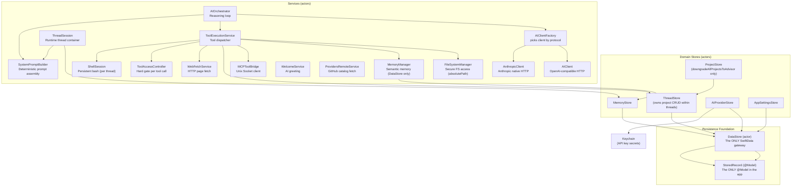

# ChappieCore — Business Logic Package Architecture

## 1. Purpose

All business logic of Chappie. Completely independent of SwiftUI — testable without UI.

**Dependency rule:** ChappieCore → Foundation, SwiftData only. No SwiftUI or AppKit.

---

## 2. Package Structure

```
ChappieCore/
├── Package.swift
└── Sources/ChappieCore/
    ├── ChappieCore.swift               # Public API re-exports
    ├── DataStore/
    │   └── DataStore.swift             # THE ONLY file that imports SwiftData. StoredRecord @Model lives here.
    ├── Models/
    │   ├── AIProviderModels.swift       # AIProvider, APIKey, AIModel, ProviderProtocol
    │   ├── AITunnelModels.swift         # AIMessage, AIUsage, AIMessageContent
    │   ├── AITunnelStreamModels.swift   # AIStreamChunk, SSE parsing models
    │   ├── AITunnelContentModels.swift  # Content block types (text, tool_use, tool_result)
    │   ├── AITunnelToolModels.swift     # Tool call/result wire models
    │   ├── AITunnelCacheModels.swift    # Cache control models (Anthropic prompt caching)
    │   ├── AppConfig.swift             # Centralized config (dynamic, per-thread). Default: 100 messages.
    │   ├── ChappieError.swift          # ChappieError enum
    │   ├── MemoryModels.swift          # MemoryEntry, MemoryScope, MemoryStorage
    │   ├── ProjectModels.swift         # ProjectSettings, ProjectMetadata, ThreadProjectEntry
    │   ├── RemoteProviderCatalog.swift  # DTOs for providers.json (GitHub-hosted catalog)
    │   ├── RequestLog.swift            # Request/response logging model
    │   └── ThreadModels.swift          # ThreadSettings, ThreadMetadata, ThreadPayload (with projects)
    └── Services/
        ├── AIClient.swift              # OpenAI-compatible HTTP client (entry point)
        ├── AIClient+HTTP.swift         # HTTP request building + response parsing
        ├── AIClient+Streaming.swift    # SSE streaming parser
        ├── AIClient+Discovery.swift    # fetchAvailableModels()
        ├── AIClientProtocol.swift      # Protocol: validateProvider, streamChat, fetchModels
        ├── AIClientFactory.swift       # Factory: picks AIClient or AnthropicClient by protocol
        ├── AnthropicClient.swift       # Anthropic native API (/v1/messages)
        ├── AnthropicModels.swift       # Anthropic-specific request/response models
        ├── AIOrchestrator.swift        # Reasoning loop: prompt → tools → response
        ├── AIProviderStore.swift       # CRUD for AI providers + Keychain (multi-key)
        ├── AppSettingsStore.swift      # Actor-based CRUD for singleton AppSettings
        ├── FileSystemManager.swift     # Secure file system access (sandbox)
        ├── MCPToolBridge.swift         # Bridge to ChappieMCP via Unix socket
        ├── MemoryManager.swift         # Semantic memory (read/write/search) via DataStore
        ├── MemoryStore.swift           # Persistence CRUD for memory scopes
        ├── ProjectStore.swift          # downgradeAllProjectsToAdvisor() only — no CRUD
        ├── ProvidersRemoteService.swift # Fetches + caches providers.json from GitHub
        ├── ShellSession.swift          # Persistent bash session (per-thread, run_terminal)
        ├── StallWatchdog.swift         # Cancels stalled AI streams after timeout
        ├── SystemPromptBuilder.swift   # Deterministic system prompt assembler
        ├── ThreadSession.swift         # Runtime container for an active thread
        ├── ThreadStore.swift           # CRUD for threads + project management within threads
        ├── ToolAccessController.swift  # Hard gate before every tool execution
        ├── WebFetchService.swift       # Fetches web pages and extracts clean text
        ├── WelcomeService.swift        # Generates AI welcome message for new threads
        └── ToolExecution/
            ├── ToolAccessControl.swift     # Access control rules per tool category
            ├── ToolDefinitions.swift       # Tool schema definitions (JSON for AI)
            ├── ToolExecutionService.swift  # Dispatches tool calls from AIOrchestrator
            ├── FileTools.swift             # File tool implementations
            ├── GitBuildTools.swift         # Git/build tool implementations
            ├── MemoryTools.swift           # Memory tool implementations
            └── TerminalTools.swift         # run_terminal implementation (ShellSession)
```

---

## 3. DataStore — The Persistence Foundation

**Rule: DataStore.swift is the ONLY file in the project that imports SwiftData.**
No other file may declare `@Model` or import SwiftData.

### StoredRecord — The Only @Model

```swift
@Model final class StoredRecord {
    @Attribute(.unique) var relation: String  // DataStore.Relation.rawValue
    var payload: Data                          // JSONEncoder output of any Codable
}
```

The schema is frozen. It will never change. No SwiftData migrations are ever needed.

### DataStore.Relation

```swift
enum Relation: String {
    case threads      = "threads"
    case memory       = "memory"
    case providers    = "providers"
    case appSettings  = "app_settings"
}
```

One row per relation. The payload is a JSON-encoded domain collection.

> **Note:** `case projects` was removed. Projects now live inside `ThreadPayload.projects`.

### DataStore API

```swift
public actor ChappieDataStore {
    func load<T: Codable>(_ relation: Relation) throws -> T?
    func save<T: Codable>(_ value: T, for relation: Relation) throws
    func delete(_ relation: Relation) throws
    func exists(_ relation: Relation) throws -> Bool
}
```

### Data Flow

```
Write:  DomainStruct (Codable) → JSONEncoder → Data → StoredRecord.payload → SwiftData
Read:   SwiftData → StoredRecord.payload → Data → JSONDecoder → DomainStruct (Codable)
```

Decode failure is non-fatal. Callers receive `nil` or `[]` and recover gracefully.

---

## 4. Codable Compatibility Rules

**Violation = silent data corruption.**

1. **Never rename a stored property without `CodingKeys`.**
2. **Never remove a stored property** — mark `optional` with a default.
3. **Always give new properties a default value.**

Structs that must follow these rules:

| Struct | Stored under |
|---|---|
| `[ThreadPayload]` | `DataStore.Relation.threads` |
| `[MemoryScope]` | `DataStore.Relation.memory` |
| `[AIProvider]` | `DataStore.Relation.providers` |
| `AppSettingsPayload` | `DataStore.Relation.appSettings` |
| `ThreadSettings` | inside `ThreadPayload` |
| `[ThreadProjectEntry]` | inside `ThreadPayload` |
| `ProjectSettings` | inside `ThreadProjectEntry` |
| `[MemoryEntry]` | inside `MemoryScope` |

---

## 5. Project Model

Projects are **thread-local** — no global registry, no bookmarks.

```swift
struct ThreadProjectEntry: Codable, Identifiable, Sendable {
    var id: UUID
    var displayName: String
    var absolutePath: String       // full path set at attachment time
    var settings: ProjectSettings
}
```

**Rules:**
- Added only by user (via `+` button or drag & drop). AI cannot add/remove.
- Duplicate check: same `absolutePath` → silently ignored.
- `FileSystemManager` reads `absolutePath` directly — no bookmark resolution needed.
- `list_thread_projects` is the only AI tool that touches projects (read-only).

---

## 6. Architecture Diagram



---

## 7. Key Models

### ThreadSettings (default: 30 messages)

```swift
struct ThreadSettings: Codable, Sendable {
    var maxMessagesInContext: Int   // 10...1000, step 10, default 30
    var isUnlimitedContext: Bool
    var activeProviderId: UUID?
    var activeKeyId: UUID?
    var activeModelName: String?
}
```

### AppConfig (default: 100 messages)

```swift
struct AppConfig: Codable {
    static let shared = AppConfig()            // default: 100 messages
    init(settings: ThreadSettings)             // per-thread config
    let maxMessagesInContext: Int              // 10...1000
    let tokenBudget: Int                       // maxMessagesInContext × 500
    let isUnlimitedContext: Bool
    let maxOrchestratorSteps: Int             // 100, hardcoded
    let stallTimeoutSeconds: TimeInterval     // 300s, hardcoded
}
```

**Note:** `AppConfig.shared` uses 100 messages. `ThreadSettings` default is 30.
When a thread has no custom settings — `AppConfig.shared` (100) is used.

### AIProvider / APIKey / AIModel

```swift
struct AIProvider: Codable {
    var id: UUID
    var name: String
    var baseURL: String
    var catalogId: String?
    var providerProtocol: ProviderProtocol
    var keys: [APIKey]
    var models: [AIModel]
}
```

---

## 8. AI Client Architecture

```
AIClientProtocol
    ├── validateProvider() async throws
    ├── streamChat(messages:config:onChunk:) async throws -> AIUsage
    └── fetchAvailableModels() async -> [String]

AIClientFactory.make(for:apiKey:model:) → AIClient | AnthropicClient
```

---

## 9. AIOrchestrator — Reasoning Loop

```
process(prompt, history, config, memoryContext)
  → systemPrompt (via ThreadSession)
  → buildContextWindow(history, config)
  → loop (maxOrchestratorSteps = 100):
      → aiClient.streamChat()
      → if tool_use → ToolAccessController.check() → toolService.execute()
      → if text → accumulate tokens
      → if stop → return result
```

---

## 10. SystemPromptBuilder — Injection Order

Pure value transformer — no async, no SwiftData, no side effects.

1. Persona block
2. `userName` if set
3. Global memory block if not empty
4. Thread memory block if not empty
5. Per-project: `ProjectSettings.formatForSystemPrompt()` + project memory
6. Tool manifest (injected separately by AIOrchestrator)

Empty sections are omitted — no wasted tokens.

---

## 11. ToolAccessController

Hard gate before every tool execution.

```swift
public enum AccessResult: Sendable {
    case allowed
    case denied(reason: String)
}
```

`git_diff` is permanently blocked — cannot be overridden by any settings.
`add_project_to_thread` and `remove_project_from_thread` are permanently removed — user-only operations.

---

## 12. ShellSession + TerminalTools

`ShellSession` — persistent bash process per thread ID.

**TerminalAccessLevel:**
- `.none` — terminal unavailable (default)
- `.confirm` — every command requires user approval
- `.auto` — commands execute immediately

---

## 📚 Changelog

| Date | Change |
|------|--------|
| 2025-07 | Initial architecture |
| 2026-06 | Storage cleanup: removed DataStoreMigration, V2/V3 schema stubs |
| 2026-07 | Projects refactor: removed ProjectPayload, DataStore.Relation.projects, bookmark logic. Projects now live in ThreadPayload as [ThreadProjectEntry] with absolutePath. ThreadStore owns project CRUD. ProjectStore reduced to downgradeAllProjectsToAdvisor() only. AI tools add/remove_project_to_thread removed from ToolDefinitions. |
