# ChappieCore — Business Logic Package Architecture

## 1. Purpose

All business logic of Chappie. Completely independent of SwiftUI — testable without UI.

**Dependency rule:** ChappieCore → Foundation, SwiftData only. No SwiftUI or AppKit.

---

## 2. Package Structure

```
ChappieCore/
├── Package.swift
└── Sources/ChappieCore/
    ├── ChappieCore.swift               # Public API re-exports
    ├── Models/
    │   ├── AIProviderModels.swift       # AIProvider, APIKey, AIProviderEntity (SwiftData)
    │   ├── AITunnelModels.swift         # AIMessage, AIStreamChunk, AIUsage
    │   ├── AppConfig.swift             # Centralized config (dynamic, per-thread)
    │   ├── AppSettings.swift           # AppSettings SwiftData model (singleton record)
    │   ├── ChappieError.swift          # ChappieError enum
    │   ├── MemoryModels.swift          # MemoryEntity, MemoryEntry, MemoryContext
    │   ├── ProjectModels.swift         # ProjectEntity, ProjectMetadata, ProjectSettings
    │   └── ThreadModels.swift          # ThreadEntity, ThreadSettings, ThreadMetadata
    └── Services/
        ├── AIClient.swift              # HTTP client for AI APIs (provider-agnostic)
        ├── AIOrchestrator.swift        # Reasoning loop: prompt → tools → response
        ├── AIProviderStore.swift       # CRUD for AIProviderEntity + Keychain (multi-key)
        ├── AppSettingsStore.swift      # Actor-based CRUD for singleton AppSettings
        ├── ChatHistoryManager.swift    # JSON-based message history (legacy + migration)
        ├── FileSystemManager.swift     # Secure file system access (sandbox)
        ├── MCPToolBridge.swift         # Bridge to ChappieMCP via Unix socket
        ├── MemoryManager.swift         # Semantic memory (read/write/search)
        ├── MemoryStore.swift           # SwiftData CRUD for MemoryEntity
        ├── MigrationService.swift      # One-time migration: JSON files → SwiftData
        ├── ProjectStore.swift          # CRUD for ProjectEntity in SwiftData
        ├── SystemPromptBuilder.swift   # Deterministic system prompt assembler
        ├── ThreadSession.swift         # Runtime container for an active thread
        ├── ThreadStore.swift           # CRUD for ThreadEntity in SwiftData
        ├── ToolAccessController.swift  # Hard gate before every tool execution
        ├── WebFetchService.swift       # Fetches web pages and extracts clean text
        ├── WelcomeService.swift        # Generates AI welcome message for new threads
        └── ToolExecution/
            ├── ToolAccessControl.swift     # Legacy access control (superseded by ToolAccessController)
            ├── ToolDefinitions.swift       # Tool schema definitions (JSON for AI)
            ├── ToolExecutionService.swift  # Dispatches tool calls from AIOrchestrator
            ├── FileTools.swift             # File tool implementations
            ├── GitBuildTools.swift         # Git/build tool implementations
            └── MemoryTools.swift           # Memory tool implementations
```

---

## 3. Architecture Diagram

```mermaid
graph TD
    subgraph Models["Models"]
        TM["ThreadModels\n(ThreadEntity, ThreadSettings\nThreadMetadata)"]
        PM["ProjectModels\n(ProjectEntity, ProjectMetadata\nProjectSettings)"]
        MM["MemoryModels\n(MemoryEntity, MemoryEntry)"]
        APM["AIProviderModels\n(AIProvider, APIKey\nAIProviderEntity)"]
        AS["AppSettings\n(singleton SwiftData record)"]
        AC["AppConfig\n(dynamic, per-thread)"]
        ATM["AITunnelModels\n(AIMessage, AIStreamChunk\nAIUsage)"]
        CE["ChappieError"]
    end

    subgraph Services["Services (actors)"]
        Orch["AIOrchestrator\nReasoning loop"]
        AIC["AIClient\nHTTP streaming"]
        TES["ToolExecutionService\nTool dispatcher"]
        TS["ThreadStore\nSwiftData CRUD"]
        PS["ProjectStore\nSwiftData CRUD"]
        MS["MemoryStore\nSwiftData CRUD"]
        APS["AIProviderStore\nSwiftData + Keychain\nmulti-key"]
        ASS["AppSettingsStore\nSingleton AppSettings"]
        MemM["MemoryManager\nSemantic memory"]
        SPB["SystemPromptBuilder\nDeterministic prompt assembly"]
        TAC["ToolAccessController\nHard gate per tool call"]
        TSess["ThreadSession\nRuntime thread container"]
        FSM["FileSystemManager\nSecure FS access"]
        MCP["MCPToolBridge\nUnix Socket client"]
        WFS["WebFetchService\nHTTP page fetch + HTML strip"]
        WS["WelcomeService\nAI greeting on new thread"]
        Mig["MigrationService\nOne-time JSON→SwiftData"]
        CHM["ChatHistoryManager\nLegacy JSON (deprecated)"]
    end

    subgraph Storage["Persistence"]
        SD["SwiftData\n(ThreadEntity, ProjectEntity\nMemoryEntity, AIProviderEntity\nAppSettings)"]
        KC["Keychain\n(API key secrets, keyed by APIKey.id)"]
        FS["File System\n(JSON legacy)"]
    end

    subgraph MCP_Process["ChappieMCP (child process)"]
        MCPS["MCPHTTPServer\n(Unix Domain Socket)"]
    end

    Orch --> AIC
    Orch --> TES
    Orch --> SPB
    TES --> FSM
    TES --> MemM
    TES --> MCP
    TES --> TS
    TES --> PS
    TES --> WFS
    TES --> TAC

    TSess --> MS
    TSess --> SPB

    MemM --> MS
    MS --> SD
    TS --> SD
    PS --> SD
    APS --> SD
    APS --> KC
    ASS --> SD
    CHM --> FS
    Mig --> CHM
    Mig --> MS

    MCP -->|Unix Socket| MCPS

    Orch --> AC
```



---

## 4. Key Models

### AppSettings (SwiftData singleton)

```swift
@Model public final class AppSettings {
    var workspaceBookmark: Data?            // replaces UserDefaults "workspaceBookmark"
    var lastActiveThreadIdString: String?   // replaces UserDefaults "lastActiveThreadId"
    var balancesJSON: Data                  // replaces UserDefaults "balance_<uuid>"
}
```

Exactly one record per container. `AppSettingsStore.load()` creates it on first launch.
Previously stored as `"New.AppSettings"` — `AppSettingsMigrationPlan` handles the rename.

### AIProvider / APIKey (multi-key schema)

```swift
struct AIProvider: Codable {
    var id: UUID
    var name: String          // user-defined display name
    var endpoint: String      // full URL
    var keys: [APIKey]        // named keys; secrets in Keychain
    var models: [String]      // saved model names
}

struct APIKey: Codable {
    var id: UUID              // Keychain entry key = apiKey.id.uuidString
    var name: String          // user-defined label ("Work", "Personal", "Client X")
}
```

**Keychain storage:** each `APIKey` secret stored under `apiKey.id.uuidString`.
**Migration from single-key schema:** `loadProviders()` detects `keys.isEmpty`, reads old secret
from `provider.id.uuidString`, creates `APIKey(name: "Default")`, migrates automatically.

### AIProviderEntity (SwiftData)

```swift
@Model final class AIProviderEntity {
    var id: UUID
    var json: String    // AIProvider serialized as JSON — no graph, no migrations
    var isDefault: Bool
    var createdAt: Date
}
```

JSON pattern: `AIProvider` evolves freely as a `Codable` struct — no SwiftData migrations needed.

### ThreadEntity (SwiftData)

```swift
@Model final class ThreadEntity {
    var id: UUID
    var title: String
    var createdAt: Date
    var updatedAt: Date
    var messagesJSON: Data        // [ChatMessage] serialized
    var settingsJSON: Data        // ThreadSettings serialized
    var projectBindingsJSON: Data // [UUID] serialized
}
```

### ThreadSettings (Codable)

```swift
struct ThreadSettings: Codable, Sendable {
    var maxMessagesInContext: Int   // 10...1000, default 20
    var isUnlimitedContext: Bool
    var activeProviderId: UUID?
    var activeKeyId: UUID?         // which APIKey to use for this thread
    var activeModelName: String?

    var tokenBudget: Int { isUnlimitedContext ? Int.max : maxMessagesInContext * 500 }
}
```

### PromptContext (input to SystemPromptBuilder)

```swift
struct PromptContext: Sendable {
    let userName: String?
    let globalMemory: [MemoryEntry]
    let threadMemory: [MemoryEntry]
    let projects: [ProjectContext]   // one per attached ThreadProject
}
```

### ToolPermissions (output of SystemPromptBuilder.toolPermissions)

```swift
struct ToolPermissions: Sendable {
    let canReadFiles: Bool
    let canWriteFiles: Bool
    let gitLevel: GitAccessLevel    // .none / .statusOnly / .write / .full
    let canRunTests: Bool
    let canWriteTests: Bool
    let canReadBuildLog: Bool
    let alwaysOn: Set<String>       // memory, web_fetch, project tools — always allowed
}
```

---

## 5. SwiftData Schema

```swift
Schema([
    ThreadEntity.self,
    ProjectEntity.self,
    MemoryEntity.self,
    AIProviderEntity.self,
    AppSettings.self
])
```

No migrations needed for most changes — all complex types are JSON-serialized inside `Data` fields.
Exception: `AppSettings` entity was renamed from `New.AppSettings` — handled by `AppSettingsMigrationPlan`.

---

## 6. ThreadStore (actor)

```swift
public actor ThreadStore {
    func createThread(title:settings:) throws -> UUID
    func loadThreads() throws -> [ThreadMetadata]
    func saveMessages<T: Codable>(_:toThreadId:) throws
    func loadMessages<T: Codable>(fromThreadId:as:) throws -> [T]
    func updateSettings(_:forThreadId:) throws
    func loadSettings(forThreadId:) throws -> ThreadSettings
    func updateProjectBindings(_:forThreadId:) throws
    func renameThread(id:title:) throws
    func deleteThread(id:) throws
}
```

Actor guarantees sequential access to `ModelContext` (not Sendable).

---

## 7. AIProviderStore (actor)

```swift
public actor AIProviderStore {
    // Providers
    func loadProviders() async throws -> [AIProvider]        // includes single-key migration
    func addProvider(_:firstKeyName:firstKeyValue:) async throws -> UUID
    func updateProvider(_:) async throws
    func deleteProvider(id:) async throws                    // always allowed, deletes all keys

    // Keys
    func addKey(name:value:toProviderId:) async throws -> APIKey
    func updateKey(_:newValue:forProviderId:) async throws
    func deleteKey(id:fromProviderId:) async throws

    // Models
    func addModel(_:toProviderId:) async throws
    func deleteModel(_:fromProviderId:) async throws

    // Default
    func setDefault(id:) async throws
    func loadDefaultProvider() async throws -> AIProvider?

    // Keychain
    func loadApiKey(for keyId: UUID) -> String?

    // Onboarding upsert
    func mergeProvider(_:keyName:keyValue:models:) async throws -> UUID

    // UI validation helpers
    func providerHostExists(_:) async -> Bool
    func keyValueExists(_:inProviderId:) async -> Bool
}
```

**Cache:** `cachedProviders` in RAM — zero SwiftData hits on hot path. Invalidated on every write.
**Deletion policy:** always allowed, even last provider. Orphaned threads show warning banner.
**mergeProvider:** safe upsert — provider matched by host, key matched by Keychain value, models deduplicated.

---

## 8. AIOrchestrator — Reasoning Loop

```
process(prompt, history, config, memoryContext)
  → systemPrompt (via ThreadSession or legacy MemoryManager)
  → buildContextWindow(history, config)   // trims to tokenBudget + maxMessages
  → loop (maxOrchestratorSteps = 100):
      → aiClient.streamChat()
      → if tool_use → ToolAccessController.check() → toolService.execute()
      → if text → accumulate tokens
      → if stop → return result
```

Context trimming: take last `maxMessagesInContext` messages, drop oldest if over `tokenBudget`.
`isUnlimitedContext = true` skips all trimming.

---

## 9. SystemPromptBuilder

Pure value transformer — no async, no SwiftData, no side effects.

```swift
public struct SystemPromptBuilder {
    func build(context: PromptContext) -> String
    func toolPermissions(for context: PromptContext) -> ToolPermissions
}
```

**Injection order:**
1. Persona block (hardcoded Chappie identity + 14 rules)
2. `userName` if set
3. Global memory block if not empty
4. Thread memory block if not empty
5. Per-project: `ProjectSettings.formatForSystemPrompt()` + project memory
6. Tool manifest injected separately by AIOrchestrator

**toolPermissions logic:** merges across all projects — most permissive wins.
No projects → `ToolPermissions.readOnly` (safe fallback).

---

## 10. ToolAccessController

Hard gate before every tool execution. Pure static function — no async, no side effects.

```swift
public struct ToolAccessController {
    static func check(toolName: String, permissions: ToolPermissions) -> AccessResult
}

public enum AccessResult: Sendable {
    case allowed
    case denied(reason: String)
}
```

`git_diff` is permanently blocked — cannot be overridden by any settings.
Denial is returned as structured JSON: `{"error":"tool_access_denied","tool":"...","reason":"..."}`.
The AI receives this as a tool result and explains the situation to the user naturally.

---

## 11. ThreadSession (actor)

Runtime container for one active thread. NOT persisted — assembled from SwiftData on activation.

```swift
public actor ThreadSession {
    func systemPrompt() async throws -> String       // cached, rebuilt on invalidate
    func toolPermissions() async throws -> ToolPermissions
    func invalidateCache()                           // call after memory/settings change
}
```

**Lifecycle:**
```
User selects thread
    → ThreadSession.init(thread, projectMetas, memoryStore, promptBuilder, userName)
    → first systemPrompt() call → buildPromptContext() → bulk MemoryStore fetch → build()

User switches thread
    → old ThreadSession discarded
    → new ThreadSession activated
    → NO state leaks between sessions
```

**Bulk memory fetch:** loads global + thread + all project scopes in one `readEntriesForScopes()` call.

---

## 12. AppSettingsStore (actor)

```swift
public actor AppSettingsStore {
    func load() throws -> AppSettings
    func save(workspaceBookmark: Data?) throws
    func loadWorkspaceBookmark() throws -> Data?
    func save(lastActiveThreadId: UUID?) throws
    func loadLastActiveThreadId() throws -> UUID?
    func save(balance: Double?, for providerID: UUID) throws
    func loadBalances() throws -> [UUID: Double]
}
```

Singleton record pattern: exactly one `AppSettings` row per container.
All write methods use `fetchOrCreate()` — safe to call in any order.

---

## 13. MemoryStore (three-level memory)

Scopes: `"global"`, `thread.id.uuidString`, `project.id.uuidString`.
Stored in `MemoryEntity`: `key + type + jsonString + scope + targetId`.

```swift
public actor MemoryStore {
    func saveEntry(key:type:jsonString:scope:targetId:) throws
    func readEntry(key:scope:targetId:) throws -> String?
    func deleteEntry(key:scope:targetId:) throws
    func searchEntries(type:scope:targetId:) throws -> [MemoryEntry]
    func importEntries(_:scope:) throws
    func readEntriesForScopes(_: [String]) async throws -> [String: [MemoryEntry]]  // bulk fetch
}
```

---

## 14. ToolExecutionService

Dispatches tool calls from AIOrchestrator. Calls `ToolAccessController.check()` before execution.

**Tool categories:**
- File system: `read_file`, `write_file`, `delete_file`, `list_files`
- Web: `web_fetch` (via WebFetchService)
- Memory: `memorize`, `recall`, `search_memory`, `delete_memory`
- Git (via MCP): `git_status`, `git_add`, `git_commit`, `git_log`, `git_reset`, `git_revert`, `git_checkout`
- Build (via MCP): `build_project`, `run_tests`, `read_build_log`
- Projects: `add_project_to_thread`, `remove_project_from_thread`, `list_thread_projects`

`git_diff` always blocked regardless of settings.

---

## 15. WebFetchService (actor)

```swift
public actor WebFetchService {
    public init(maxOutputLength: Int = 100_000, timeoutSeconds: TimeInterval = 30)
    public func fetch(urlString: String, selector: String? = nil) async -> String
}
```

- Foundation only, no external dependencies
- Strips nav/header/footer/aside/script/style; keeps main/article/p/headings
- Optional CSS-like selector: tag, `.class`, `#id`
- Limit: 100,000 chars after strip; truncated from end with notice
- All errors return `❌`-prefixed strings — no throws

---

## 16. MigrationService

One-time migration from JSON → SwiftData. Flag: `UserDefaults["migrationIT04Completed"]`.

Steps:
1. `chat_history.json` → create thread "Основной" + save messages
2. `semantic.json` → import entries into MemoryStore (scope=global)
3. Set flag → skip on next launch

---

## 17. JSON-in-SwiftData Rule

**⚠️ CRITICAL: Never rename a `Codable` property stored in SwiftData without `CodingKeys`.**
Old JSON has the old key name — renaming silently returns nil/default and corrupts stored data.

When adding a new field — always provide a default value in `init` so old JSON decodes cleanly.
