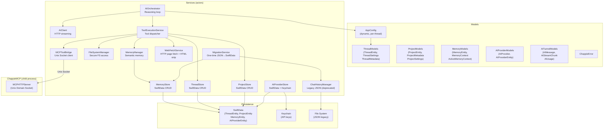

# ChappieCore — Business Logic Package Architecture

## 1. Purpose

All business logic of Chappie. Completely independent of SwiftUI — testable without UI.

**Dependency rule:** ChappieCore → Foundation, SwiftData only. No SwiftUI or AppKit.

---

## 2. Package Structure

```
ChappieCore/
├── Package.swift
└── Sources/ChappieCore/
    ├── ChappieCore.swift               # Public API re-exports
    ├── Models/
    │   ├── AIProviderModels.swift       # AIProvider, AIProviderEntity (SwiftData)
    │   ├── AITunnelModels.swift         # AIMessage, AIStreamChunk, AIUsage
    │   ├── AppConfig.swift             # Centralized config (dynamic, per-thread)
    │   ├── ChappieError.swift          # ChappieError enum
    │   ├── MemoryModels.swift          # MemoryEntity, MemoryContext, ActiveMemoryContext
    │   ├── ProjectModels.swift         # ProjectEntity, ProjectMetadata, ProjectSettings
    │   └── ThreadModels.swift          # ThreadEntity, ThreadSettings, ThreadMetadata
    └── Services/
        ├── AIClient.swift              # HTTP client for AI APIs (provider-agnostic)
        ├── AIOrchestrator.swift        # Reasoning loop: prompt → tools → response
        ├── AIProviderStore.swift       # CRUD for AIProviderEntity in SwiftData
        ├── AITunnelClient.swift        # Legacy tunnel client (deprecated)
        ├── ChatHistoryManager.swift    # JSON-based message history (legacy + migration)
        ├── FileSystemManager.swift     # Secure file system access (sandbox)
        ├── MCPToolBridge.swift         # Bridge to ChappieMCP via Unix socket
        ├── MemoryManager.swift         # Semantic memory (read/write/search)
        ├── MemoryStore.swift           # SwiftData CRUD for MemoryEntity
        ├── MigrationService.swift      # One-time migration: JSON files → SwiftData
        ├── ProjectStore.swift          # CRUD for ProjectEntity in SwiftData
        ├── ThreadStore.swift           # CRUD for ThreadEntity in SwiftData
        ├── ToolExecutionService.swift  # Dispatches tool calls from AIOrchestrator
        └── WebFetchService.swift       # Fetches web pages and extracts clean text
```

---

## 3. Architecture Diagram



---

## 4. Key Models

### ThreadEntity (SwiftData)

```swift
@Model final class ThreadEntity {
    var id: UUID
    var title: String
    var createdAt: Date
    var updatedAt: Date
    var messagesJSON: Data        // [ChatMessage] serialized
    var settingsJSON: Data        // ThreadSettings serialized
    var projectBindingsJSON: Data // [UUID] serialized
}
```

All complex objects serialized to `Data` via JSONEncoder — SwiftData schema stays stable as models evolve.

### ThreadSettings (Codable)

```swift
struct ThreadSettings: Codable, Sendable {
    var maxMessagesInContext: Int   // 10...1000, default 20
    var isUnlimitedContext: Bool
    var activeProviderId: UUID?
    var activeModelName: String?

    var tokenBudget: Int { isUnlimitedContext ? Int.max : maxMessagesInContext * 500 }
}
```

### ThreadMetadata (Sendable DTO)

```swift
struct ThreadMetadata: Sendable, Identifiable, Hashable {
    let id: UUID
    let title: String
    let createdAt: Date
    let updatedAt: Date
    let projectIds: [UUID]
    let settings: ThreadSettings  // included so UI doesn't need extra ThreadStore call
}
```

### AppConfig (dynamic, per-thread)

Context depth formula: `tokenBudget = maxMessagesInContext × 500`.
Range: 10 → 5,000 tokens | 20 → 10,000 | 1000 → 500,000 | unlimited → `Int.max`.

---

## 5. SwiftData Schema

```swift
Schema([ThreadEntity.self, ProjectEntity.self, MemoryEntity.self, AIProviderEntity.self])
```

No migrations needed — all complex types are JSON-serialized inside `Data` fields.

---

## 6. ThreadStore (actor)

```swift
public actor ThreadStore {
    func createThread(title:settings:) throws -> UUID
    func loadThreads() throws -> [ThreadMetadata]
    func saveMessages<T: Codable>(_:toThreadId:) throws
    func loadMessages<T: Codable>(fromThreadId:as:) throws -> [T]
    func updateSettings(_:forThreadId:) throws
    func loadSettings(forThreadId:) throws -> ThreadSettings
    func updateProjectBindings(_:forThreadId:) throws
    func renameThread(id:title:) throws
    func deleteThread(id:) throws
}
```

Actor guarantees sequential access to `ModelContext` (not Sendable).

---

## 7. AIOrchestrator — Reasoning Loop

```
process(prompt, history, config, memoryContext)
  → buildSystemPrompt(memoryContext)
  → buildContextWindow(history, config)   // trims to tokenBudget + maxMessages
  → loop (maxOrchestratorSteps = 100):
      → aiClient.streamChat()
      → if tool_use → toolService.execute()
      → if text → accumulate tokens
      → if stop → return result
```

Context trimming: take last `maxMessagesInContext` messages, drop oldest if over `tokenBudget`.
`isUnlimitedContext = true` skips all trimming.

---

## 8. AIProviderStore

```swift
public actor AIProviderStore {
    func loadProviders() throws -> [AIProvider]
    func addProvider(_:apiKey:) throws -> UUID
    func deleteProvider(id:) throws
    func updateProvider(_:) throws
    func loadApiKey(for:) async -> String?
    func loadDefaultProvider() async throws -> AIProvider?
}
```

API keys stored in Keychain (not SwiftData). `AIProviderEntity` holds only the UUID reference.

---

## 9. MemoryStore (three-level memory)

Scopes: `global`, `<projectId UUID>`, `<threadId UUID>`.
Stored in `MemoryEntity`: `key + type + jsonString + scope + targetId`.

```swift
public actor MemoryStore {
    func saveEntry(key:type:jsonString:scope:targetId:) throws
    func readEntry(key:scope:targetId:) throws -> String?
    func deleteEntry(key:scope:targetId:) throws
    func searchEntries(type:scope:targetId:) throws -> [MemoryEntry]
    func importEntries(_:scope:) throws
}
```

---

## 10. ToolExecutionService

Dispatches tool calls from AIOrchestrator.

**Tool categories:**
- File system: `read_file`, `write_file`, `delete_file`, `list_files`
- Web: `web_fetch` (via WebFetchService)
- Memory: `memorize`, `recall`, `search_memory`, `delete_memory`
- Git (via MCP): `git_status`, `git_add`, `git_commit`, `git_log`, `git_reset`
- Build (via MCP): `build_project`, `run_tests`, `read_build_log`
- Projects: `add_project_to_thread`, `remove_project_from_thread`, `list_projects`

`git_diff` always blocked regardless of settings.
`containsCyrillic()` blocks Cyrillic in memory writes — all memory must be English.
`WebFetchService` injected via `init(webFetch:)`, optional — `nil` returns a clear error.

---

## 11. WebFetchService (actor)

```swift
public actor WebFetchService {
    public init(maxOutputLength: Int = 100_000, timeoutSeconds: TimeInterval = 30)
    public func fetch(urlString: String, selector: String? = nil) async -> String
}
```

- Foundation only, no external dependencies
- Strips nav/header/footer/aside/script/style; keeps main/article/p/headings
- Optional CSS-like selector: tag, `.class`, `#id`
- Limit: 100,000 chars after strip; truncated from end with notice
- All errors return `❌`-prefixed strings — no throws

---

## 12. MigrationService

One-time migration from JSON → SwiftData. Flag: `UserDefaults["migrationIT04Completed"]`.

Steps:
1. `chat_history.json` → create thread "Основной" + save messages
2. `semantic.json` → import entries into MemoryStore (scope=global)
3. Set flag → skip on next launch
