# ChappieCore — Business Logic Package Architecture

## 1. Purpose

All business logic of Chappie. Completely independent of SwiftUI — testable without UI.

**Dependency rule:** ChappieCore → Foundation, SwiftData only. No SwiftUI or AppKit.

---

## 2. Package Structure

```
ChappieCore/
├── Package.swift
└── Sources/ChappieCore/
    ├── ChappieCore.swift               # Public API re-exports
    ├── Models/
    │   ├── AIProviderModels.swift       # AIProvider, APIKey, AIModel, AIProviderEntity
    │   ├── AITunnelModels.swift         # AIMessage, AIStreamChunk, AIUsage
    │   ├── AppConfig.swift             # Centralized config (dynamic, per-thread)
    │   ├── AppSettings.swift           # AppSettings SwiftData model (singleton record)
    │   ├── ChappieError.swift          # ChappieError enum
    │   ├── MemoryModels.swift          # MemoryEntity, MemoryEntry, MemoryContext
    │   ├── ProjectModels.swift         # ProjectEntity, ProjectMetadata, ProjectSettings
    │   ├── RemoteProviderCatalog.swift  # DTOs for providers.json (GitHub-hosted catalog)
    │   └── ThreadModels.swift          # ThreadEntity, ThreadSettings, ThreadMetadata
    └── Services/
        ├── AIClient.swift              # HTTP client for OpenAI-compatible APIs
        ├── AIClientProtocol.swift      # Protocol: validateProvider, streamChat, fetchModels
        ├── AIClientFactory.swift       # Factory: picks AIClient or AnthropicClient by protocol
        ├── AnthropicClient.swift       # HTTP client for native Anthropic API (/v1/messages)
        ├── AIOrchestrator.swift        # Reasoning loop: prompt → tools → response
        ├── AIProviderStore.swift       # CRUD for AIProviderEntity + Keychain (multi-key)
        ├── AppSettingsStore.swift      # Actor-based CRUD for singleton AppSettings
        ├── FileSystemManager.swift     # Secure file system access (sandbox)
        ├── MCPToolBridge.swift         # Bridge to ChappieMCP via Unix socket
        ├── MemoryManager.swift         # Semantic memory (read/write/search)
        ├── MemoryStore.swift           # SwiftData CRUD for MemoryEntity
        ├── ProjectStore.swift          # CRUD for ProjectEntity in SwiftData
        ├── ProvidersRemoteService.swift # Fetches + caches providers.json from GitHub
        ├── ShellSession.swift          # Persistent bash session (per-thread, run_terminal)
        ├── StallWatchdog.swift         # Cancels stalled AI streams after timeout
        ├── SystemPromptBuilder.swift   # Deterministic system prompt assembler
        ├── ThreadSession.swift         # Runtime container for an active thread
        ├── ThreadStore.swift           # CRUD for ThreadEntity in SwiftData
        ├── ToolAccessController.swift  # Hard gate before every tool execution
        ├── WebFetchService.swift       # Fetches web pages and extracts clean text
        ├── WelcomeService.swift        # Generates AI welcome message for new threads
        └── ToolExecution/
            ├── ToolAccessControl.swift     # Access control rules per tool category
            ├── ToolDefinitions.swift       # Tool schema definitions (JSON for AI)
            ├── ToolExecutionService.swift  # Dispatches tool calls from AIOrchestrator
            ├── FileTools.swift             # File tool implementations
            ├── GitBuildTools.swift         # Git/build tool implementations
            ├── MemoryTools.swift           # Memory tool implementations
            └── TerminalTools.swift         # run_terminal implementation (ShellSession)
```

---

## 3. Architecture Diagram

```mermaid
graph TD
    subgraph Models["Models"]
        TM["ThreadModels\n(ThreadEntity, ThreadSettings\nThreadMetadata)"]
        PM["ProjectModels\n(ProjectEntity, ProjectMetadata\nProjectSettings)"]
        MM["MemoryModels\n(MemoryEntity, MemoryEntry)"]
        APM["AIProviderModels\n(AIProvider, APIKey, AIModel\nAIProviderEntity)"]
        RPC["RemoteProviderCatalog\n(DTOs for providers.json)"]
        AS["AppSettings\n(singleton SwiftData record)"]
        AC["AppConfig\n(dynamic, per-thread)"]
        ATM["AITunnelModels\n(AIMessage, AIStreamChunk\nAIUsage)"]
        CE["ChappieError"]
    end

    subgraph Services["Services (actors)"]
        Orch["AIOrchestrator\nReasoning loop"]
        AICP["AIClientProtocol\nprotocol"]
        AIC["AIClient\nOpenAI-compatible HTTP"]
        AnthC["AnthropicClient\nAnthropic native HTTP"]
        AICF["AIClientFactory\npicks client by protocol"]
        TES["ToolExecutionService\nTool dispatcher"]
        TS["ThreadStore\nSwiftData CRUD"]
        PS["ProjectStore\nSwiftData CRUD"]
        MS["MemoryStore\nSwiftData CRUD"]
        APS["AIProviderStore\nSwiftData + Keychain\nmulti-key"]
        ASS["AppSettingsStore\nSingleton AppSettings"]
        PRS["ProvidersRemoteService\nGitHub catalog fetch + cache"]
        MemM["MemoryManager\nSemantic memory"]
        SPB["SystemPromptBuilder\nDeterministic prompt assembly"]
        TAC["ToolAccessController\nHard gate per tool call"]
        TSess["ThreadSession\nRuntime thread container"]
        FSM["FileSystemManager\nSecure FS access"]
        SSH["ShellSession\nPersistent bash (per thread)"]
        MCP["MCPToolBridge\nUnix Socket client"]
        WFS["WebFetchService\nHTTP page fetch + HTML strip"]
        WS["WelcomeService\nAI greeting on new thread"]
    end

    subgraph Storage["Persistence"]
        SD["SwiftData\n(ThreadEntity, ProjectEntity\nMemoryEntity, AIProviderEntity\nAppSettings)"]
        KC["Keychain\n(API key secrets, keyed by APIKey.id)"]
    end

    subgraph MCP_Process["ChappieMCP (child process)"]
        MCPS["MCPHTTPServer\n(Unix Domain Socket)"]
    end

    subgraph Remote["Remote"]
        GH["GitHub\nproviders.json"]
    end

    AICF --> AIC
    AICF --> AnthC
    AIC -.->|implements| AICP
    AnthC -.->|implements| AICP

    Orch --> AICP
    Orch --> TES
    Orch --> SPB
    TES --> FSM
    TES --> MemM
    TES --> MCP
    TES --> TS
    TES --> PS
    TES --> WFS
    TES --> TAC
    TES --> SSH

    TSess --> MS
    TSess --> SPB

    MemM --> MS
    MS --> SD
    TS --> SD
    PS --> SD
    APS --> SD
    APS --> KC
    ASS --> SD

    PRS -->|HTTP GET| GH

    MCP -->|Unix Socket| MCPS

    Orch --> AC
```



---

## 4. Key Models

### AIProvider / APIKey / AIModel (current schema)

```swift
struct AIProvider: Codable {
    var id: UUID
    var name: String              // user-defined display name
    var baseURL: String           // base URL without path, e.g. "https://api.openai.com"
    var catalogId: String?        // links to RemoteProvider.id; nil = custom provider
    var providerProtocol: ProviderProtocol  // default wire protocol for this provider
    var keys: [APIKey]            // named keys; secrets in Keychain
    var models: [AIModel]         // saved models with endpoint + protocol per model
}

struct APIKey: Codable {
    var id: UUID                  // Keychain entry key = apiKey.id.uuidString
    var name: String              // user-defined label ("Work", "Personal", "Client X")
}

struct AIModel: Codable {
    var id: String                // model ID as expected by API, e.g. "gpt-4o"
    var name: String              // human-readable display name
    var endpoint: String          // path component, e.g. "/v1/chat/completions"
    var providerProtocol: ProviderProtocol  // wire protocol for this model
}

enum ProviderProtocol: String, Codable {
    case openai     // OpenAI-compatible REST API
    case anthropic  // Anthropic native API (/v1/messages)
}
```

**Key points:**
- `AIModel` carries its own `endpoint` and `providerProtocol` — no guessing at call site.
- `catalogId` links a user-added provider to a `RemoteProvider` entry from the GitHub catalog.
- `nil` catalogId = manually added custom provider (no catalog entry).
- `AIClientFactory.make(for:apiKey:model:)` picks the right client based on `model.providerProtocol`.

**Keychain storage:** each `APIKey` secret stored under `apiKey.id.uuidString`.
**Migration from single-key schema:** `loadProviders()` detects `keys.isEmpty`, reads old secret
from `provider.id.uuidString`, creates `APIKey(name: "Default")`, migrates automatically.

### AIProviderEntity (SwiftData)

```swift
@Model final class AIProviderEntity {
    var id: UUID
    var json: String    // AIProvider serialized as JSON — no graph, no migrations
    var isDefault: Bool
    var createdAt: Date
}
```

JSON pattern: `AIProvider` evolves freely as a `Codable` struct — no SwiftData migrations needed.

### RemoteProviderCatalog (GitHub-hosted)

```swift
struct RemoteProviderCatalog: Codable {
    let meta: RemoteCatalogMeta       // version, updated_at, counts
    let providers: [RemoteProvider]
}

struct RemoteProvider: Codable, Identifiable {
    let id: String                    // stable slug, e.g. "openai", "groq"
    let name: String
    let baseURL: String
    let models: [RemoteModel]
}

struct RemoteModel: Codable, Identifiable {
    let id: String                    // model ID for API calls
    let name: String                  // human-readable
    let endpoint: String              // e.g. "/v1/chat/completions", "/v1/messages"
    let `protocol`: String            // "openai" or "anthropic"
}
```

Hosted at: `https://raw.githubusercontent.com/iOSIvanovS/chappieai/main/docs/providers.json`
Updated monthly via pipeline (Scripts/providers_1_clear.sh → providers_2_append.sh → providers_3_push.sh).

### AppSettings (SwiftData singleton)

```swift
@Model public final class AppSettings {
    var workspaceBookmark: Data?
    var lastActiveThreadIdString: String?
    var balancesJSON: Data
}
```

Exactly one record per container. `AppSettingsStore.load()` creates it on first launch.

### ThreadSettings (Codable)

```swift
struct ThreadSettings: Codable, Sendable {
    var maxMessagesInContext: Int   // 10...1000, default 20
    var isUnlimitedContext: Bool
    var activeProviderId: UUID?
    var activeKeyId: UUID?         // which APIKey to use for this thread
    var activeModelName: String?

    var tokenBudget: Int { isUnlimitedContext ? Int.max : maxMessagesInContext * 500 }
}
```

---

## 5. SwiftData Schema

```swift
Schema([
    ThreadEntity.self,
    ProjectEntity.self,
    MemoryEntity.self,
    AIProviderEntity.self,
    AppSettings.self
])
```

No migrations needed for most changes — all complex types are JSON-serialized inside `Data` fields.
Exception: `AppSettings` entity was renamed from `New.AppSettings` — handled by `AppSettingsMigrationPlan`.

---

## 6. AI Client Architecture

```
AIClientProtocol
    ├── validateProvider() async throws
    ├── streamChat(messages:config:onChunk:) async throws -> AIUsage
    └── fetchAvailableModels() async -> [String]

AIClientFactory
    ├── make(for provider: AIProvider, apiKey: String, model: AIModel) -> any AIClientProtocol
    └── makeForValidation(baseURL: String, apiKey: String, providerProtocol: ProviderProtocol) -> any AIClientProtocol

AIClient          — OpenAI-compatible (/v1/chat/completions, /v1/models)
AnthropicClient   — Anthropic native (/v1/messages; no /v1/models endpoint)
```

**Factory logic:** `AIClientFactory.make()` reads `model.providerProtocol`:
- `.openai` → `AIClient(baseURL:apiKey:model:)`
- `.anthropic` → `AnthropicClient(apiKey:model:)`

Call sites never instantiate clients directly — always go through `AIClientFactory`.

---

## 7. ProvidersRemoteService (actor)

```swift
public actor ProvidersRemoteService {
    func fetchCatalog() async throws -> RemoteProviderCatalog
}
```

- Fetches `providers.json` from GitHub on every app launch (no persistent cache — always fresh).
- In-memory cache per session: subsequent calls return cached result.
- Used by `CatalogPickerSheet` to populate the provider catalog list.

---

## 8. ShellSession + TerminalTools

`ShellSession` — persistent bash process per thread ID. Managed as a dictionary in `TerminalTools`.

```swift
public actor ShellSession {
    func execute(_ command: String, timeout: TimeInterval) async -> String
    func terminate()
}
```

**Access control (TerminalAccessLevel in ProjectSettings):**
- `.none` — terminal tool not available (default)
- `.confirmAll` — every command requires user approval before execution
- `.autoAll` — commands execute immediately without confirmation

**Security:** `run_terminal` is only available in programming projects with `executor` role.
`git_diff` is permanently blocked regardless of terminal access level.

---

## 9. AIOrchestrator — Reasoning Loop

```
process(prompt, history, config, memoryContext)
  → systemPrompt (via ThreadSession)
  → buildContextWindow(history, config)   // trims to tokenBudget + maxMessages
  → loop (maxOrchestratorSteps = 100):
      → aiClient.streamChat()
      → if tool_use → ToolAccessController.check() → toolService.execute()
      → if text → accumulate tokens
      → if stop → return result
```

Context trimming: take last `maxMessagesInContext` messages, drop oldest if over `tokenBudget`.
`isUnlimitedContext = true` skips all trimming.

---

## 10. SystemPromptBuilder

Pure value transformer — no async, no SwiftData, no side effects.

```swift
public struct SystemPromptBuilder {
    func build(context: PromptContext) -> String
    func toolPermissions(for context: PromptContext) -> ToolPermissions
}
```

**Injection order:**
1. Persona block (hardcoded Chappie identity + rules, from `ChappieViewModel+PersonaBlock.swift`)
2. `userName` if set
3. Global memory block if not empty
4. Thread memory block if not empty
5. Per-project: `ProjectSettings.formatForSystemPrompt()` + project memory
6. Tool manifest injected separately by AIOrchestrator

**toolPermissions logic:** merges across all projects — most permissive wins.
No projects → `ToolPermissions.readOnly` (safe fallback).

---

## 11. ToolAccessController

Hard gate before every tool execution. Pure static function — no async, no side effects.

```swift
public struct ToolAccessController {
    static func check(toolName: String, permissions: ToolPermissions) -> AccessResult
}

public enum AccessResult: Sendable {
    case allowed
    case denied(reason: String)
}
```

`git_diff` is permanently blocked — cannot be overridden by any settings.
Denial is returned as structured JSON: `{"error":"tool_access_denied","tool":"...","reason":"..."}`.

---

## 12. ThreadStore (actor)

```swift
public actor ThreadStore {
    func createThread(title:settings:) throws -> UUID
    func loadThreads() throws -> [ThreadMetadata]
    func saveMessages<T: Codable>(_:toThreadId:) throws
    func loadMessages<T: Codable>(fromThreadId:as:) throws -> [T]
    func updateSettings(_:forThreadId:) throws
    func loadSettings(forThreadId:) throws -> ThreadSettings
    func updateProjectBindings(_:forThreadId:) throws
    func renameThread(id:title:) throws
    func deleteThread(id:) throws
}
```

---

## 13. AIProviderStore (actor)

```swift
public actor AIProviderStore {
    // Providers
    func loadProviders() async throws -> [AIProvider]
    func addProvider(_:firstKeyName:firstKeyValue:) async throws -> UUID
    func addFromCatalog(_:keyName:keyValue:selectedModelIds:) async throws -> UUID
    func mergeProvider(_:keyName:keyValue:models:) async throws -> UUID  // onboarding upsert
    func updateProvider(_:) async throws
    func deleteProvider(id:) async throws

    // Keys
    func addKey(name:value:toProviderId:) async throws -> APIKey
    func updateKey(_:newValue:forProviderId:) async throws
    func deleteKey(id:fromProviderId:) async throws

    // Models
    func addModel(_:toProviderId:) async throws
    func deleteModel(_:fromProviderId:) async throws

    // Default
    func setDefault(id:) async throws
    func loadDefaultProvider() async throws -> AIProvider?

    // Keychain
    func loadApiKey(for keyId: UUID) -> String?

    // Validation helpers
    func providerHostExists(_:) async -> Bool
    func providerCatalogIdExists(_:) async -> Bool
    func keyValueExists(_:inProviderId:) async -> Bool
}
```

**addFromCatalog:** creates provider from `RemoteProvider`, converts all `RemoteModel` → `AIModel`
(preserving endpoint + protocol). If same `catalogId` exists → merges key + models instead.

---

## 14. ThreadSession (actor)

Runtime container for one active thread. NOT persisted — assembled from SwiftData on activation.

```swift
public actor ThreadSession {
    func systemPrompt() async throws -> String
    func toolPermissions() async throws -> ToolPermissions
    func invalidateCache()
    func rebuildThreadSessionOnly()  // lightweight rebuild — no bookmark resolution
}
```

`rebuildThreadSessionOnly()` is called when project settings change mid-session
(e.g. role switch) — updates prompt without restarting the full session.

---

## 15. MemoryStore (three-level memory)

Scopes: `"global"`, `thread.id.uuidString`, `project.id.uuidString`.

```swift
public actor MemoryStore {
    func saveEntry(key:type:jsonString:scope:targetId:) throws
    func readEntry(key:scope:targetId:) throws -> String?
    func deleteEntry(key:scope:targetId:) throws
    func searchEntries(type:scope:targetId:) throws -> [MemoryEntry]
    func readEntriesForScopes(_: [String]) async throws -> [String: [MemoryEntry]]
}
```

---

## 16. ToolExecutionService

Tool categories:
- File system: `read_file`, `write_file`, `delete_file`, `list_files`
- Web: `web_fetch`
- Memory: `memorize`, `recall`, `search_memory`, `delete_memory`
- Git (via MCP): `git_status`, `git_add`, `git_commit`, `git_log`, `git_reset`, `git_revert`, `git_checkout`
- Build (via MCP): `build_project`, `run_tests`, `read_build_log`
- Projects: `add_project_to_thread`, `remove_project_from_thread`, `list_thread_projects`
- Terminal: `run_terminal` (via ShellSession — programming projects, executor role only)

`git_diff` always blocked regardless of settings.

---

## 17. JSON-in-SwiftData Rule

**⚠️ CRITICAL: Never rename a `Codable` property stored in SwiftData without `CodingKeys`.**
Old JSON has the old key name — renaming silently returns nil/default and corrupts stored data.

When adding a new field — always provide a default value in `init` so old JSON decodes cleanly.

Persisted structs (must follow the rename rule):

| Struct | Stored in |
|---|---|
| `ThreadSettings` | `ThreadEntity.settingsJSON` |
| `ProjectSettings` | `ProjectEntity.settingsJSON` |
| `AIProvider` | `AIProviderEntity.json` |
| `[ChatMessage]` | `ThreadEntity.messagesJSON` |
