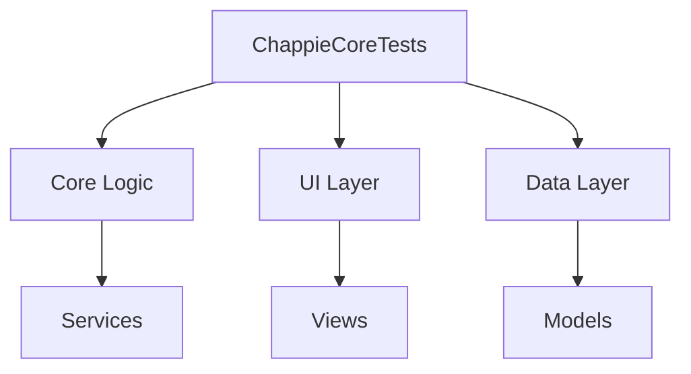

# Architecture — ChappieCoreTests

> **Target type:** Library Target
> **Created:** 2026-05-24T10:56:30Z
> **Managed by:** Chappie AI Assistant

---

## Overview

_Describe the high-level purpose and responsibilities of this target here._

---

## Component Diagram

---

## Key Design Decisions

| Decision | Rationale | Date |
|----------|-----------|------|
| _Add decisions here_ | _Why was this chosen?_ | 2026-05-24T10:56:30Z |

---

## Dependencies

_List external dependencies and their purpose._

---

## Notes

_Additional architectural notes, constraints, or future plans._