<!--
  ChappieCoreTests/architecture.md
  ARCHITECTURE DOCUMENT — CHAPPICORETESTS
  Update after every significant change to the test architecture.
-->

# ChappieCoreTests — Test Target Architecture

## 1. Purpose

Unit Test Bundle for `ChappieCore` business logic.
Uses Swift Testing framework (`import Testing`, `@Suite`, `@Test`, `#expect`).

**Key principles:**
- Each test creates its own isolated storage — no shared state
- `scope: .global` in tests is forbidden — writes to real memory
- UUID suffixes in keys/types to avoid cross-test conflicts

---

## 2. File Structure

```
ChappieCoreTests/
├── architecture.md
├── AppConfigTests.swift                # AppConfig defaults + clamping logic
├── AITunnelModelsTests.swift           # Codable roundtrip for AI wire models
├── ChappieErrorTests.swift             # ChappieError enum coverage
├── FileSystemManagerTests.swift        # FS ops + path traversal protection
├── PathGuardTests.swift                # "..", absolute, symlink escapes, sibling prefix, unusable roots ("/", empty, symlink to "/"), Core/MCP copy parity
├── MCPHelperLifecycleTests.swift       # Per-instance socket naming, stale-socket cleanup, restart back-off, bridge recover-and-retry
├── CancellationTests.swift             # ProcessTree (tree kill, SIGTERM-ignoring child, pid identity, early cancel, Core/MCP parity), ShellSession cancel, MCPToolBridge cancel
├── CommandSafetyTests.swift            # Catastrophes blocked in every spelling (rm -fr /, sudo, bash -c, ...), harmless look-alikes allowed (rm -rf /tmp/x, "reboot" in text/heredoc), tokenizer
├── LoopGuardTests.swift                # 3rd identical call blocked only while results are identical; changed result / different call resets; message explains
├── MessageTimestampTests.swift         # Time label format, gap + previous-run duration, omitted short gaps, legacy nil dates, determinism
├── MemoryDatesTests.swift              # Memory entry dates in the prompt: created/updated, same-day form, time zone, stability, createdAt kept on re-save, real SystemPromptBuilder path
├── CurlModelsTests.swift               # Curl-Chappie model: origin/path normalization, old JSON decodes with defaults, secret naming and duplicates, Keychain round trip (unique service per test)
├── CurlValidationTests.swift           # Curl-Chappie settings rows: host/secret issues, blank rows dropped, normalization on save, save gate, Keychain apply (write/keep/remove/kind switch)
├── CurlPureTests.swift                 # Curl-Chappie pure parts: gate (permissions, login path, dot segments), templates (single pass, escaping, unicode names), redaction, JSON path, cookie jar, fingerprint
├── CurlEngineTests.swift               # Curl-Chappie engine on a stub transport: login flow, token never shown, shared sessions across projects, single-flight, 401 re-login, host binding, injection guards, rate limit, three users on one host (Cyrillic names with spaces = three independent sessions)
├── CurlResponseShapingTests.swift      # Curl-Chappie response shaping: \uXXXX decoding (surrogates, ASCII escapes kept, malformed left), `pick` paths with [*] and {a,b} projection (malformed forms, scalar, redaction kept), skip on 4xx/5xx, top-level keys hint, fallback on non-JSON, engine end to end, redaction after decoding, routine-header folding and show_headers=all
├── CurlScenarioModelTests.swift        # Curl scenarios: strict decoding (unknown keys, all problems at once, step kinds, bodies) and validator (placeholders in order, actors/slots, call contract, mutates propagation, cycles, depth 5, returns, duplicate ids)
├── CurlScenarioToolsTests.swift        # Curl scenarios on a temp project: folder safety (.., absolute, .git, .xcodeproj, symlink escape), save/replace/info, invalid not written, name guard, delete protection, contract-break warning, cycle on save
├── CurlScenarioRunnerTests.swift       # Curl scenario RUNS on a stateful stub server (Stroykontrol chain Authorization -> Remark_create -> Remark_with_comment): root-only cleanup, nested cleanup never runs, cleanup skipped without a value, preflight refusals (host permission, ROOT cleanup DELETE, unmapped slots/inputs/missing secret values), dry run, shared-session reuse, two actors, report redaction, injection guard, check semantics
├── ToolWatchdogTests.swift             # ToolDeadlines table + messages; watchdog: fast path, hung tool cancelled, uncancellable tool abandoned, Stop forwarded
├── OutputGuardTests.swift              # Size gate: 200/100 KB boundaries on UTF-8 bytes, notices, OutputCapture, runaway shell command, end-to-end through execute()
├── ImagePipelineTests.swift            # ImageDownscaler (2000 px cap, JPEG, alpha, pass-through, cache reuse/invalidation), ImageValve, image marker restriction
├── OfficeImagesTests.swift             # ToolImageResult marker, OfficeMediaIntake (foreign folder/file/symlink refused, folder deleted), OutputGuard on documents with pictures
├── PDFToolsRoutingTests.swift          # pdf_* classified/exposed, page mandatory, other readers refuse a PDF, picture result through OutputGuard
├── MemoryManagerTests.swift            # Semantic memory CRUD via SQLiteStorage
├── ThreadIsolationTests.swift          # SystemPromptBuilder: sections, memory isolation, terminal lines
├── ToolArgumentsTests.swift            # Lenient argument parsing: scalars, null, nested, double-encoded, errors
├── ToolPolicyTests.swift               # Access table: roles, plans, git/build rules, per-project resolution, exposure completeness
├── ThreadStoreTests.swift              # Chunk system: roundtrip, lazy load, pagination, boundary, delete
├── ThreadStoreWindowSaveTests.swift    # saveLoadedMessages: older chunks survive, atomic failure, boundaries
├── ThreadStoreIntegrityTests.swift     # Damaged thread list: backup, per-thread salvage, report-once; corrupt-record backup
├── ThreadStoreRecoveryTests.swift      # Rebuild threads from chunks: same ids, titles, memory, repair-once, concurrency
├── SaveQueueTests.swift                # Write order, failure pauses queue, Retry/Skip, coalescing
└── WebFetchServiceTests.swift          # WebFetchService HTTP + parsing

Project root:
└── ChappieCoreTests.xctestplan         # Test plan (NOT inside ChappieCoreTests/)
```

---

## 3. Architecture Diagram

```mermaid
graph TD
    subgraph TestTarget["ChappieCoreTests (Unit Test Bundle)"]
        ACT["AppConfigTests"]
        ATMT["AITunnelModelsTests"]
        CET["ChappieErrorTests"]
        FSMT["FileSystemManagerTests"]
        PGT["PathGuardTests"]
        MMT["MemoryManagerTests"]
        TIT["ThreadIsolationTests"]
        TSTT["ThreadStoreTests"]
        WFST["WebFetchServiceTests"]
    end

    subgraph Core["ChappieCore (under test)"]
        AC["AppConfig"]
        ATM["AITunnelModels"]
        CE["ChappieError"]
        FSM["FileSystemManager"]
        MemM["MemoryStore + SQLiteStorage"]
        TS["ThreadSession + ToolPolicy"]
        TST["ThreadStore + SQLiteStorage (chunk system)"]
        WFS["WebFetchService"]
    end

    ACT --> AC
    ATMT --> ATM
    CET --> CE
    FSMT --> FSM
    MMT --> MemM
    TIT --> TS
    TSTT --> TST
    WFST --> WFS

    subgraph Isolation["Test Isolation"]
        TmpDir["FileManager.temporaryDirectory + UUID subfolder"]
        InMemDB["In-memory SQLiteStorage (GRDB :memory: path)"]
    end

    MMT --> InMemDB
    FSMT --> TmpDir
```



---

## 4. Running Tests

### Via Xcode (primary method)
1. Switch scheme to **"ChappieCoreTests"** in toolbar
2. Press **⌘+U**

### ⚠️ run_tests(target:) works correctly
`run_tests(target: "ChappieCoreTests")` calls `xcodebuild test` — tests run green.

---

## 5. Test Writing Rules

1. **Never use `scope: .global`** — writes to real memory
2. **UUID suffixes for types/keys** — `"testType_\(UUID().uuidString)"`
3. **Temp directory** — `FileManager.default.temporaryDirectory.appendingPathComponent(UUID().uuidString)`
4. **In-memory SQLite** — `SQLiteStorage(url: URL(fileURLWithPath: ":memory:"))` — no file created
5. **Swift Testing only** — no `XCTestCase`
6. **Comments in English**

---

## 6. Build Settings

```
SDKROOT = macosx
MACOSX_DEPLOYMENT_TARGET = 26.5
SUPPORTED_PLATFORMS = macosx
SWIFT_VERSION = 6.0
```
