<!--
  ChappieCoreTests/architecture.md
  ARCHITECTURE DOCUMENT — CHAPPICORETESTS
  Update after every significant change to the test architecture.
-->

# ChappieCoreTests — Test Target Architecture

## 1. Purpose

Unit Test Bundle for `ChappieCore` business logic.
Uses Swift Testing framework (`import Testing`, `@Suite`, `@Test`, `#expect`).

**Key principles:**
- Each test creates its own isolated storage — no shared state
- `scope: .global` in tests is forbidden — writes to real memory
- UUID suffixes in keys/types to avoid cross-test conflicts

---

## 2. File Structure

```
ChappieCoreTests/
├── architecture.md
├── AppConfigTests.swift                # AppConfig defaults + clamping logic
├── AITunnelModelsTests.swift           # Codable roundtrip for AI wire models
├── ChappieErrorTests.swift             # ChappieError enum coverage
├── FileSystemManagerTests.swift        # FS ops + path traversal protection
├── MemoryManagerTests.swift            # Semantic memory CRUD via SQLiteStorage
├── ThreadIsolationTests.swift          # SystemPromptBuilder + ToolAccessController rules
├── ThreadStoreTests.swift              # Chunk system: roundtrip, lazy load, pagination, boundary, delete
├── ThreadStoreWindowSaveTests.swift    # saveLoadedMessages: older chunks survive, atomic failure, boundaries
├── ThreadStoreIntegrityTests.swift     # Damaged thread list: backup, per-thread salvage, report-once; corrupt-record backup
├── SaveQueueTests.swift                # Write order, failure pauses queue, Retry/Skip, coalescing
└── WebFetchServiceTests.swift          # WebFetchService HTTP + parsing

Project root:
└── ChappieCoreTests.xctestplan         # Test plan (NOT inside ChappieCoreTests/)
```

---

## 3. Architecture Diagram

```mermaid
graph TD
    subgraph TestTarget["ChappieCoreTests (Unit Test Bundle)"]
        ACT["AppConfigTests"]
        ATMT["AITunnelModelsTests"]
        CET["ChappieErrorTests"]
        FSMT["FileSystemManagerTests"]
        MMT["MemoryManagerTests"]
        TIT["ThreadIsolationTests"]
        TSTT["ThreadStoreTests"]
        WFST["WebFetchServiceTests"]
    end

    subgraph Core["ChappieCore (under test)"]
        AC["AppConfig"]
        ATM["AITunnelModels"]
        CE["ChappieError"]
        FSM["FileSystemManager"]
        MemM["MemoryStore + SQLiteStorage"]
        TS["ThreadSession + ToolAccessController"]
        TST["ThreadStore + SQLiteStorage (chunk system)"]
        WFS["WebFetchService"]
    end

    ACT --> AC
    ATMT --> ATM
    CET --> CE
    FSMT --> FSM
    MMT --> MemM
    TIT --> TS
    TSTT --> TST
    WFST --> WFS

    subgraph Isolation["Test Isolation"]
        TmpDir["FileManager.temporaryDirectory + UUID subfolder"]
        InMemDB["In-memory SQLiteStorage (GRDB :memory: path)"]
    end

    MMT --> InMemDB
    FSMT --> TmpDir
```



---

## 4. Running Tests

### Via Xcode (primary method)
1. Switch scheme to **"ChappieCoreTests"** in toolbar
2. Press **⌘+U**

### ⚠️ run_tests(target:) works correctly
`run_tests(target: "ChappieCoreTests")` calls `xcodebuild test` — tests run green.

---

## 5. Test Writing Rules

1. **Never use `scope: .global`** — writes to real memory
2. **UUID suffixes for types/keys** — `"testType_\(UUID().uuidString)"`
3. **Temp directory** — `FileManager.default.temporaryDirectory.appendingPathComponent(UUID().uuidString)`
4. **In-memory SQLite** — `SQLiteStorage(url: URL(fileURLWithPath: ":memory:"))` — no file created
5. **Swift Testing only** — no `XCTestCase`
6. **Comments in English**

---

## 6. Build Settings

```
SDKROOT = macosx
MACOSX_DEPLOYMENT_TARGET = 26.5
SUPPORTED_PLATFORMS = macosx
SWIFT_VERSION = 6.0
```
