<!--
  ChappieCoreTests/architecture.md

  ARCHITECTURE DOCUMENT — CHAPPICORETESTS

  This file replaces the AI_Docs folder (architecture.md + project_map.md + semantic.json).
  Update after every significant change to the test architecture.

  Last update: fixed xcscheme files — eliminated (unknown) 0 Excluded Tests and window closing
-->

# ChappieCoreTests — Test Target Architecture

## 1. Purpose

**ChappieCoreTests** is a Unit Test Bundle for testing `ChappieCore` business logic.
Runs via the `ChappieCoreTests.xctestplan` test plan in the project root.

### Key Principles

- **Isolation:** each test creates its own temporary directory via `FileManager.default.temporaryDirectory`
- **No global state:** `scope: .global` in tests is forbidden — only `scope: .project` with an isolated workspace
- **UUID suffixes:** types and keys contain UUIDs so tests don't conflict through shared files
- **Swift Testing framework:** use `import Testing`, `@Suite`, `@Test`, `#expect` (not XCTest)

---

## 2. File Structure

```
ChappieCoreTests/
├── architecture.md                     # This file
├── AppConfigTests.swift                # Configuration tests
├── AITunnelModelsTests.swift           # Codable model tests
├── ChatHistoryManagerTests.swift       # Chat history manager tests
├── FileSystemManagerTests.swift        # File system + security tests
├── MigrationServiceTests.swift         # Migration service tests
└── MemoryManagerTests.swift            # Semantic memory tests

Project root:
└── ChappieCoreTests.xctestplan         # Test plan (NOT inside ChappieCoreTests/)
```

### IMPORTANT: Single Source of Tests

Tests live ONLY in `ChappieCoreTests/` and run via `ChappieCoreTests.xctestplan`.

The folder `ChappieCore/Tests/ChappieCoreTests/` is **not used**. `ChappieCore/Package.swift`
intentionally has no `testTarget` to avoid duplication and desync.

---

## 3. Architecture Diagram

```mermaid
graph TD
    subgraph TestTarget["ChappieCoreTests (Unit Test Bundle)"]
        ACT["AppConfigTests\nAppConfig defaults + logic"]
        ATMT["AITunnelModelsTests\nCodable roundtrip"]
        CHMT["ChatHistoryManagerTests\nSave/load/clear history"]
        FSMT["FileSystemManagerTests\nFS ops + path traversal"]
        MST["MigrationServiceTests\nJSON → SwiftData migration"]
        MMT["MemoryManagerTests\nSemantic memory CRUD"]
    end

    subgraph Core["ChappieCore (under test)"]
        AC["AppConfig"]
        ATM["AITunnelModels"]
        CHM["ChatHistoryManager"]
        FSM["FileSystemManager"]
        Mig["MigrationService"]
        MemM["MemoryManager + MemoryStore"]
    end

    subgraph Isolation["Test Isolation"]
        TmpDir["FileManager.temporaryDirectory\n+ UUID subfolder per test"]
        SD["In-memory SwiftData\n(ModelContainer for tests)"]
    end

    ACT --> AC
    ATMT --> ATM
    CHMT --> CHM
    FSMT --> FSM
    MST --> Mig
    MMT --> MemM

    CHMT --> TmpDir
    FSMT --> TmpDir
    MST --> SD
    MMT --> TmpDir

    subgraph Runner["Test Runner"]
        Plan["ChappieCoreTests.xctestplan\n(project root)"]
        Scheme["ChappieCoreTests.xcscheme\n(switch in Xcode toolbar)"]
        Plan --> Scheme
    end
```



---

## 4. xcscheme Rules (CRITICAL — do not violate!)

### Problems that existed and how they were solved:

#### Problem 1: `(unknown) 0 Excluded Tests` in Test Navigator
**Cause:** `Chappie.xcscheme` had an empty `<TestAction>` block. Xcode registers
ANY TestAction in Test Navigator — even an empty one — as an anonymous "(unknown)" container.

**Fix:** `<TestAction>` fully removed from `Chappie.xcscheme`. Now it only has
`BuildAction` and `LaunchAction` for running the app.

#### Problem 2: ⌘+U closed the Chappie window
**Cause:** In `ChappieCoreTests.xcscheme`, `<LaunchAction>` had a `<BuildableProductRunnable>`
pointing to `Chappie.app`. Xcode killed that app's process before running tests.

**Fix:** `<LaunchAction>` in `ChappieCoreTests.xcscheme` now has **no** `<BuildableProductRunnable>`.
Empty LaunchAction = "don't launch or kill any app". The xctest runner
runs in its own process, leaving the running Chappie.app untouched.

### Correct test run workflow:
1. Switch the scheme in Xcode toolbar to **"ChappieCoreTests"**
2. Press **⌘+U** — tests run, Chappie window stays open
3. Switch scheme back to **"Chappie"** for normal work

---

## 5. Test Files

### `AppConfigTests.swift`
Tests the `AppConfig` struct — single source of truth for system parameters.

| Test | What it checks |
|------|----------------|
| `defaultValues` | All default values are in sensible ranges |
| `tokenBudget` | `tokenBudget > 0` |
| `recentFullMessages` | `recentFullMessages > 0` |
| `summaryThreshold` | `summaryThreshold > 0` |
| `logicalConsistency` | `recentFullMessages * summaryThreshold <= tokenBudget` |
| `sharedIsSingleton` | `AppConfig.shared === AppConfig.shared` |

### `AITunnelModelsTests.swift`
Tests Codable models for the AITunnel API.

| Test | What it checks |
|------|----------------|
| `aIMessageEncodingDecoding` | AIMessage JSON roundtrip |
| `aIMessageContentText` | `.text` case of AIMessageContent |
| `aIMessageContentBlocks` | `.blocks` case with cache_control |
| `aICacheControl` | AICacheControl serialization |
| `aIStreamChunkDecoding` | SSE chunk parsing |
| `chatMessageWithSummary` | ChatMessage with summary field |
| `aITunnelRequestStream` | AITunnelRequest with stream: true |

### `ChatHistoryManagerTests.swift`
Tests chat history save and load.

| Test | What it checks |
|------|----------------|
| `loadEmptyHistoryOnFirstRun` | Empty array when file doesn't exist |
| `saveAndLoadMessages` | Save/load roundtrip |
| `appendMessages` | Appending messages to existing history |
| `clearHistory` | Clearing history |
| `persistenceAcrossSessions` | Data persists across instances |
| `workspaceIsolation` | Different workspaces are isolated |

### `FileSystemManagerTests.swift`
Tests file system operations and Path Traversal protection.

| Test | What it checks |
|------|----------------|
| `readExistingFile` | Reading an existing file |
| `writeAndReadFile` | Write and read a file |
| `deleteFile` | Deleting a file |
| `pathTraversalProtection` | `../secret` → security error |
| `listFilesReturnsAllFiles` | File list in directory |
| `readNonExistentFile` | Clear error for missing file |
| `writeToSubdirectory` | Write with auto-created subdirectory |

**macOS note:** `/tmp` is a symlink to `/private/tmp`. Path checks
use `hasSuffix` instead of exact match.

### `MemoryManagerTests.swift`
Tests the AI assistant's semantic memory.

| Test | What it checks |
|------|----------------|
| `saveAndLoadRecord` | Save and load a record |
| `deleteRecord` | Delete a record |
| `searchByType` | Search by record type |
| `searchReturnsEmpty` | Search with no results |
| `emptyStorageRead` | Read from empty storage |
| `multipleRecords` | Multiple records of different types |
| `scopeIsolation` | Isolation between scope: .project targets |
| `initializationIsIdempotent` | Re-initialization does not overwrite data |

**Test isolation:** `makeTempWorkspace()` creates this structure:
```
tempDir/
└── TestApp/
    └── TestApp.swift  ← *App.swift suffix → classifyTarget() → .appTarget
```
This ensures correct target detection without writing to Chappie's real memory.

---

## 6. Test Writing Rules

### Mandatory Rules

1. **Never use `scope: .global`** — writes to real `~/Documents/Chappie/semantic.json`
2. **UUID suffixes for types** — `"testType_\(UUID().uuidString)"` to avoid conflicts
3. **Temporary directory** — always via `FileManager.default.temporaryDirectory.appendingPathComponent(UUID().uuidString)`
4. **Workspace structure** — always create via `makeTempWorkspace()` with a `*App.swift` file

### Forbidden

- `XCTest` — use Swift Testing only (`import Testing`)
- `scope: .global` in MemoryManager tests
- Hardcoded paths to real project files

---

## 7. Running Tests

### Via Xcode (primary method)
1. Switch scheme to **"ChappieCoreTests"** in the toolbar
2. Press **⌘+U**

### ⚠️ IMPORTANT: run_tests(target:) does NOT work for this target

The `run_tests(target: "ChappieCoreTests")` tool calls `swift test` in `ChappieCore/`
(Swift Package), not `xcodebuild test`. Since `Package.swift` intentionally has no
`testTarget` — the tool always returns "no tests found".

**This is not a test bug, it is an MCP tool limitation.**
Tests work correctly via Xcode (⌘+U with ChappieCoreTests scheme active).

---

## 8. Build Settings (fixed 2026-05-25)

The `ChappieCoreTests` target in `project.pbxproj` must have:

```
SDKROOT = macosx;                    // ← was watchos (BUGS!)
MACOSX_DEPLOYMENT_TARGET = 26.5;     // ← was WATCHOS_DEPLOYMENT_TARGET
SUPPORTED_PLATFORMS = macosx;
SWIFT_VERSION = 6.0;                 // ← was 5.0
```

**Why this matters:** with `SDKROOT = watchos`, xcodebuild couldn't find tests on first run —
Xcode treated the target as watchOS and couldn't run it on Mac without a simulator.

---

## 📚 Changelog

| Date | Change | Author |
|------|--------|--------|
| 2026-07-XX | Added Mermaid architecture diagram (section 3) per new architecture file rules | Chappie AI |
| 2026-07-XX | Architecture files translated to English | Chappie AI |
| 2026-05-25 | Fixed xcscheme: removed TestAction from Chappie.xcscheme, removed BuildableProductRunnable from LaunchAction in ChappieCoreTests.xcscheme | Chappie AI |
| 2026-05-25 | Documented run_tests(target:) limitation | Chappie AI |
| 2026-05-25 | Fixed SDKROOT watchos→macosx, SWIFT_VERSION 5.0→6.0 | Chappie AI |
| 2026-05-24 | Refactoring: AI_Docs/ → single architecture.md | Chappie AI |
| 2026-05-24 | Full content: all test descriptions, isolation rules | Chappie AI |
| 2026-05-24 | Initial creation (template) | Chappie AI |
