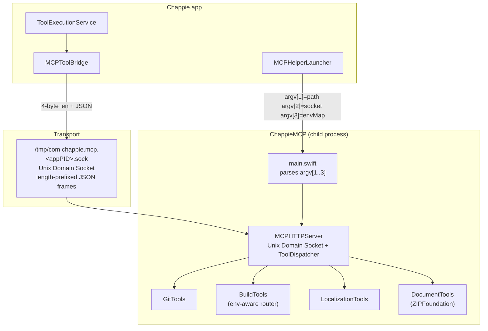

<!--
  ChappieMCP/architecture.md
  ARCHITECTURE DOCUMENT — CHAPPIEMCP
  Update after every significant change.
-->

# ChappieMCP — Architecture

## 1. Purpose

ChappieMCP is a local helper process launched by `Chappie.app` as a child process.
It provides the AI agent with tools for git, build/test, localization, and Office document editing.

**Why a separate process:**
- Independence: helper restarts without restarting the app
- Separation of concerns: UI layer has no direct knowledge of git/build tools
- User downloads one `.app` — everything is inside

**Location inside .app:**
```
Chappie.app/Contents/Helpers/ChappieMCP
```

---

## 2. File Structure

```
ChappieMCP/
├── architecture.md
├── main.swift                         # Entry point: reads argv, starts MCPUnixServer
└── Sources/ChappieMCP/
    ├── DevEnvironment.swift           # Mirrors ChappieCore.DevEnvironment (rawValues must stay in sync)
    ├── Server/
    │   ├── MCPHTTPServer.swift        # Unix Domain Socket server + ToolDispatcher; socket I/O on a private GCD queue
    │   ├── ClientWatcher.swift        # poll()s the client socket while a tool runs; hang-up cancels the tool's Task
    │   └── SocketIO.swift             # poll()-based read/write with one overall deadline per transfer
    └── Tools/
        ├── ProcessRunner.swift        # Shared child-process runner: parallel pipes, timeout, cancel = stop the whole process tree
        ├── ProcessTree.swift          # Identical copy of ChappieCore's file (SIGTERM tree, SIGKILL after 2 s); parity is tested
        ├── GitTools.swift             # git_status, git_add, git_commit, git_log, git_reset, git_revert, git_checkout
        ├── BuildTools.swift           # build_project, run_tests, read_build_log (env-aware routing)
        ├── PathGuard.swift            # Byte-identical copy of ChappieCore's PathGuard (parity test) — project containment
        ├── LocalizationTools.swift    # loc_* tools (Xcode / xcstrings only); create/rename/delete accept only .xcstrings
        └── DocumentTools/             # read_document, write_document (Office formats via ZIPFoundation)
            ├── DocumentTools+Excel.swift  # readExcel: workbook.xml + sharedStrings + ALL worksheets in natural order
            └── DocumentTools+Media.swift  # OfficeMediaCollector: pictures of docx/pptx/xlsx/odt → temp folder + [image N] XML comments
```

---

## 3. Architecture Diagram



---

## 4. Transport Protocol

**Unix Domain Socket** — `/tmp/com.chappie.mcp.<appPID>.sock` (per app instance, passed as argv[2])

```
Request:  [4 bytes UInt32 BE length] [JSON: {"tool": "git_status", "args": {}}]
Response: [4 bytes UInt32 BE length] [JSON: {"result": "...", "error": null}]
```

| Argument | Value |
|---|---|
| `argv[1]` | Workspace path (working directory for git/build) |
| `argv[2]` | Socket file path |
| `argv[3]` | JSON map `{"ProjectName": "xcode", ...}` — project→env routing |

**MCPHelperLauncher** restarts the helper when workspace or devEnvironment changes.
**MCPToolBridge** connects per call (no persistent connection). Timeout: 600s.

### Helper lifecycle

- **One socket per app instance:** `/tmp/com.chappie.mcp.<appPID>.sock` (`MCPSocket` in ChappieCore). The path is argv[2]; the helper has no default and exits with code 2 without it. Two Chappie instances can no longer delete each other's socket. At launch the app removes sockets of dead PIDs (the legacy fixed name is never touched).
- **Readiness:** the launcher reports `running` only once the socket accepts connections (`MCPSocket.canConnect`), not when the process merely exists.
- **Crash recovery:** an unexpected exit restarts the helper after 1, 2, 4, 8 s (`MCPRestartPolicy`); an uptime of 60 s or more resets the series. After 5 quick failures in a row the launcher stops with `.failed` instead of looping. An explicit launch or a tool call starts a fresh series.
- **Self-heal on call:** when `MCPToolBridge` cannot connect (ENOENT / ECONNREFUSED — the request never reached a helper) it asks the launcher to restart the helper once and retries once. Parallel callers share one recovery.
- **Exit with the app:** the helper polls `getppid()` once a second and exits (removing its socket) when its parent changes — a killed app (Xcode Stop = SIGKILL) leaves no orphan. SIGTERM also cleans up. The socket file is unlinked only if its inode is still the one the helper bound, so a restart on the same path cannot delete the new helper's socket.
- **Not automatic:** helpers left over from before this change are not killed by code.

### Misbehaving clients

A client that connects and goes silent must not starve real calls (24 silent clients used to pin every cooperative-pool thread).
- **Own queue.** Socket reads and writes run on a private concurrent GCD queue, never on Swift's cooperative pool. Only the tool run itself is `async`.
- **One deadline per transfer** (`SocketIO`, `poll()`): 10 s to deliver the whole request, 10 s to take the whole response. A client dripping one byte at a time cannot extend it. The deadline bounds only the transfer, never the tool run (a build may take minutes).
- **Pending cap:** at most 32 connections still delivering their request; extra ones are closed at once.
- **`accept()` errors:** EINTR/ECONNABORTED/EAGAIN/EPROTO retry at once; EMFILE/ENFILE/ENOMEM/ENOBUFS back off 100 ms (logged once); anything else is fatal, so the helper exits and the launcher restarts it.
- A connection that closes without sending a byte is the app's readiness probe and is not logged as an error.

### Cancellation (Stop button)
The app cancels a call by hanging up. The helper never reads from the client again after the request, so any readability on the socket means "peer gone".
- `ClientWatcher` (one `poll()` loop per running tool, on the I/O queue) cancels the tool's `Task` when the peer closes. It is stopped and joined before the descriptor is closed.
- `ProcessRunner` turns Task cancellation into `ProcessTree.terminate`: SIGTERM to the process and all descendants, SIGKILL for survivors after 2 s (pid + start time are checked first, so a recycled pid is never killed). Used by build/test, git and the PDF converter.
- **Git write commands are not cancellable** (`add`, `commit`, `push`, `reset`, `revert`, `checkout`): killing them halfway can leave `index.lock` or a half-applied state. They run to the end even if the client left (only their timeout stops them, see below); only `status` and `log` stop.
- Not cancellable by design: in-process work (loc_*, file/zip document readers) is short and has no child process.

---

## 5. Tools

### Git (GitTools.swift)

| Tool | Command |
|------|---------|
| `git_status` | `git status --short --branch` |
| `git_add` | `git add <paths>` |
| `git_commit` | `git commit -m <message>` |
| `git_log` | `git log --oneline --graph -N` |
| `git_reset` | `git reset HEAD` |
| `git_revert` | `git revert <hashes> --no-edit` |
| `git_checkout` | `git checkout <ref> -- <paths>` |

**`git_diff` is BANNED FOREVER** — loads entire diff into AI context, costs money.

All git commands run with: `GIT_PAGER=cat`, `GIT_TERMINAL_PROMPT=0`, `TERM=dumb`.

**Timeouts (`GitCommandKind`).** Every git call has one; a wrong guess about "hung" is the dangerous part, so the limits follow what the command legitimately does:

| Kind | Commands | Limit |
|---|---|---|
| read | `status`, `log` | 60 s (also cancellable by Stop) |
| local | `add`, `reset`, `checkout` | 120 s |
| hooked | `commit`, `revert` | 10 min (hooks such as linters may be slow) |
| push | `push` | 10 min backstop, plus stall detection: `http.lowSpeedLimit/Time` for HTTPS and `ConnectTimeout` / `ServerAliveInterval` in `GIT_SSH_COMMAND` for SSH. The user's own `core.sshCommand` is kept as the base, never replaced |

- **A timeout on a mutating command means "result unknown", not "failed".** It may have finished before it was stopped (a push can land on the remote). The message says so, forbids automatic retry and tells the model to check `git_status` / `git_log` first. It also lists leftovers it can see (`index.lock`, `REVERT_HEAD`, `MERGE_HEAD`, `CHERRY_PICK_HEAD`). They are reported, never deleted: the lock may belong to a git that is still running.
- The tool has no `--force` / `--delete` variants, so a repeated push after a push that did land only answers "up-to-date" or is rejected as non-fast-forward.
- The kill uses `ProcessTree` (SIGTERM first, so git removes its own locks, SIGKILL after 2 s), which also takes down hook children.
- `CHAPPIE_MCP_TIMEOUT_SCALE` (0 to 1) shrinks all git timeouts. It exists only for live checks; the app never sets it.

**Discovery helpers** (`BuildTools+Helpers`: `ls` for the `.xcodeproj`, `xcodebuild -list`, `xcrun simctl`) run through `ProcessRunner` with timeouts of 10 / 60 / 20 s and fall back to defaults on timeout. The project name is resolved once per call instead of about five times.

### Build (BuildTools.swift) — env-aware routing

`BuildTools` receives `projectEnvMap` at init and routes each tool to the correct shell command.

| Environment | `build_project` | `run_tests` |
|---|---|---|
| `xcode` | `xcodebuild -scheme <App> build` | `xcodebuild -scheme <App>CoreTests test` |
| `nodejs` | `npm run build` | `npm test [pattern]` |
| `python` | — (not available) | `python -m pytest [pattern]` |
| `go` | `go build ./...` | `go test [pkg]` |
| `rust` | `cargo build` | `cargo test [filter]` |
| `java` | `mvn compile` or `gradle build` | `mvn test` or `gradle test` |
| `kotlin` | `gradlew build` | `gradlew test` |
| `flutter` | `flutter build` | `flutter test [file]` |
| `react_typescript` | — (not available) | `npm test [pattern]` |
| `dotnet` | `dotnet build` | `dotnet test [proj]` |

Build log saved to `<workspacePath>/.build_log.txt`.

### Path safety (PathGuard.swift)

All path-taking tools (`loc_*`, `read_document`, `write_document` incl. `output_path`) resolve paths through `PathGuard`: relative only, no `..`, symlinks leading outside the project root are refused. The single exception is an absolute path inside `~/Library/Application Support/Chappie/Attachments` (the app hands those over for attachments). Git/build tools take no file paths from the model.

**Roots.** `loc_*` and documents check paths against the attached projects' roots (`projectPathMap`), never against the workspace folder alone. A root of `/`, empty or non-existent is unusable (`PathGuard.isUsableRoot`): `main.swift` turns such an `argv[1]` into an empty workspace, and `MCPHelperLauncher` no longer substitutes the launch directory (which is `/` under Xcode and made the guard a no-op). With several projects, `loc_create` needs a path whose folder already exists in exactly one project; `loc_rename` keeps the destination in the source's project; `loc_dead_keys` scans only the project that owns the file.

### Localization (LocalizationTools.swift)

Xcode-specific (`.xcstrings` format). Injected only when `devEnvironment == .xcode`.

| Tool | Purpose |
|------|---------|
| `loc_info` | Coverage stats for all .xcstrings files |
| `loc_create` / `loc_delete` / `loc_rename` | File lifecycle |
| `loc_add_language` / `loc_remove_language` | Language management |
| `loc_add_key` / `loc_remove_key` | Key management |
| `loc_next_batch` | Next untranslated batch (100 / N languages) |
| `loc_submit_batch` | Submit translations |
| `loc_key_check` | Check key status across languages |
| `loc_dead_keys` | Find unused keys |

### Documents (DocumentTools.swift)

Office document read/write via ZIP+XML. Uses **ZIPFoundation** (SPM, no external installs).

**Pictures.** `read_document` also extracts the pictures a document uses (`word/media`, `ppt/media`, `xl/media`,
ODT `Pictures/`; PNG/JPEG/GIF/WebP only, at most 20, 30 MB each, 120 MB total). References are resolved through the
part's `_rels` file (DrawingML `a:blip`, VML `v:imagedata`, ODT `draw:image`); pictures nobody references are
appended after the referenced ones. Each reference gets a `<!-- [image N: name] -->` comment before it, so the XML
stays valid and can still be written back with `write_document`. The files go to `<temp>/chappie-mcp-media/<uuid>/`
(file names are prefixed with the number and stripped to their last path component — no zip-slip); the folder and
file paths are returned in the separate `mediaDir` / `media` fields of the response, never in the text. The app
reads and deletes the folder; folders older than an hour (a crash) are pruned on the next extraction.

| Tool | Purpose |
|------|---------|
| `read_document` | Extract XML/text from an Office document (Excel: every sheet; the size gate of the app still applies, 200 KB of text) |
| `write_document` | Replace primary XML entry and save (or save as new file) |

**Supported formats:**

| Format | Read | Write | Primary entry |
|---|---|---|---|
| `.docx` | ✅ | ✅ | `word/document.xml` |
| `.xlsx` | ✅ all sheets | ✅ one entry per call | read: `xl/workbook.xml` (sheet names), `xl/sharedStrings.xml`, every `xl/worksheets/sheet*.xml` (natural order: sheet2 before sheet10). write default: `sheet1.xml`; other sheets via `entry_name` |
| `.pptx` | ✅ | ✅ | `ppt/slides/slide*.xml` |
| `.odt` | ✅ | ✅ | `content.xml` |
| `.rtf` | ✅ | ✅ | plain text (no ZIP) |
| `.csv` | ✅ | ✅ | plain text (no ZIP) |
| `.pdf` | ✅ | ❌ | text extraction only |

**XML normalization (Word):** removes `rsid*` attributes, `w:proofErr`, `w:bookmarkStart/End` — noise added by Word for spell-check / revision tracking.

**Write strategy:** copy original ZIP → replace only primary entry → save. All styles, images, relationships preserved.

---

## 6. xcscheme Rules

### Problem: ⌘+U closed the Chappie window
**Cause:** `ChappieCoreTests.xcscheme` `<LaunchAction>` pointed to `Chappie.app` — Xcode killed it before tests.
**Fix:** `<LaunchAction>` has no `<BuildableProductRunnable>`. Runner uses its own process.

### Problem: `(unknown) 0 Excluded Tests` in Test Navigator
**Cause:** `Chappie.xcscheme` had an empty `<TestAction>`.
**Fix:** `<TestAction>` fully removed from `Chappie.xcscheme`.
