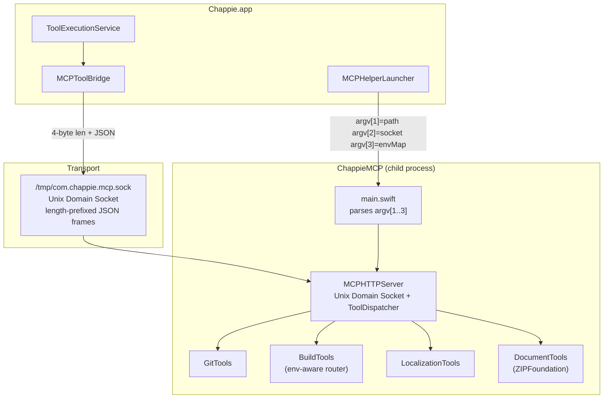

<!--
  ChappieMCP/architecture.md
  ARCHITECTURE DOCUMENT — CHAPPIEMCP
  Update after every significant change.
-->

# ChappieMCP — Architecture

## 1. Purpose

ChappieMCP is a local helper process launched by `Chappie.app` as a child process.
It provides the AI agent with tools for git, build/test, localization, and Office document editing.

**Why a separate process:**
- Independence: helper restarts without restarting the app
- Separation of concerns: UI layer has no direct knowledge of git/build tools
- User downloads one `.app` — everything is inside

**Location inside .app:**
```
Chappie.app/Contents/Helpers/ChappieMCP
```

---

## 2. File Structure

```
ChappieMCP/
├── architecture.md
├── main.swift                         # Entry point: reads argv, starts MCPUnixServer
└── Sources/ChappieMCP/
    ├── DevEnvironment.swift           # Mirrors ChappieCore.DevEnvironment (rawValues must stay in sync)
    ├── Server/
    │   └── MCPHTTPServer.swift        # Unix Domain Socket server + ToolDispatcher
    └── Tools/
        ├── GitTools.swift             # git_status, git_add, git_commit, git_log, git_reset, git_revert, git_checkout
        ├── BuildTools.swift           # build_project, run_tests, read_build_log (env-aware routing)
        ├── LocalizationTools.swift    # loc_* tools (Xcode / xcstrings only)
        └── DocumentTools.swift        # read_document, write_document (Office formats via ZIPFoundation)
```

---

## 3. Architecture Diagram



---

## 4. Transport Protocol

**Unix Domain Socket** — `/tmp/com.chappie.mcp.sock`

```
Request:  [4 bytes UInt32 BE length] [JSON: {"tool": "git_status", "args": {}}]
Response: [4 bytes UInt32 BE length] [JSON: {"result": "...", "error": null}]
```

| Argument | Value |
|---|---|
| `argv[1]` | Workspace path (working directory for git/build) |
| `argv[2]` | Socket file path |
| `argv[3]` | JSON map `{"ProjectName": "xcode", ...}` — project→env routing |

**MCPHelperLauncher** restarts the helper when workspace or devEnvironment changes.
**MCPToolBridge** connects per call (no persistent connection). Timeout: 600s.

---

## 5. Tools

### Git (GitTools.swift)

| Tool | Command |
|------|---------|
| `git_status` | `git status --short --branch` |
| `git_add` | `git add <paths>` |
| `git_commit` | `git commit -m <message>` |
| `git_log` | `git log --oneline --graph -N` |
| `git_reset` | `git reset HEAD` |
| `git_revert` | `git revert <hashes> --no-edit` |
| `git_checkout` | `git checkout <ref> -- <paths>` |

**`git_diff` is BANNED FOREVER** — loads entire diff into AI context, costs money.

All git commands run with: `GIT_PAGER=cat`, `GIT_TERMINAL_PROMPT=0`, `GIT_CONFIG_NOSYSTEM=1`, `TERM=dumb`.

### Build (BuildTools.swift) — env-aware routing

`BuildTools` receives `projectEnvMap` at init and routes each tool to the correct shell command.

| Environment | `build_project` | `run_tests` |
|---|---|---|
| `xcode` | `xcodebuild -scheme <App> build` | `xcodebuild -scheme <App>CoreTests test` |
| `nodejs` | `npm run build` | `npm test [pattern]` |
| `python` | — (not available) | `python -m pytest [pattern]` |
| `go` | `go build ./...` | `go test [pkg]` |
| `rust` | `cargo build` | `cargo test [filter]` |
| `java` | `mvn compile` or `gradle build` | `mvn test` or `gradle test` |
| `kotlin` | `gradlew build` | `gradlew test` |
| `flutter` | `flutter build` | `flutter test [file]` |
| `react_typescript` | — (not available) | `npm test [pattern]` |
| `dotnet` | `dotnet build` | `dotnet test [proj]` |

Build log saved to `<workspacePath>/.build_log.txt`.

### Localization (LocalizationTools.swift)

Xcode-specific (`.xcstrings` format). Injected only when `devEnvironment == .xcode`.

| Tool | Purpose |
|------|---------|
| `loc_info` | Coverage stats for all .xcstrings files |
| `loc_create` / `loc_delete` / `loc_rename` | File lifecycle |
| `loc_add_language` / `loc_remove_language` | Language management |
| `loc_add_key` / `loc_remove_key` | Key management |
| `loc_next_batch` | Next untranslated batch (100 / N languages) |
| `loc_submit_batch` | Submit translations |
| `loc_key_check` | Check key status across languages |
| `loc_dead_keys` | Find unused keys |

### Documents (DocumentTools.swift)

Office document read/write via ZIP+XML. Uses **ZIPFoundation** (SPM, no external installs).

| Tool | Purpose |
|------|---------|
| `read_document` | Extract primary XML/text from Office document |
| `write_document` | Replace primary XML entry and save (or save as new file) |

**Supported formats:**

| Format | Read | Write | Primary entry |
|---|---|---|---|
| `.docx` | ✅ | ✅ | `word/document.xml` |
| `.xlsx` | ✅ | ✅ | `xl/worksheets/sheet1.xml` |
| `.pptx` | ✅ | ✅ | `ppt/slides/slide*.xml` |
| `.odt` | ✅ | ✅ | `content.xml` |
| `.rtf` | ✅ | ✅ | plain text (no ZIP) |
| `.csv` | ✅ | ✅ | plain text (no ZIP) |
| `.pdf` | ✅ | ❌ | text extraction only |

**XML normalization (Word):** removes `rsid*` attributes, `w:proofErr`, `w:bookmarkStart/End` — noise added by Word for spell-check / revision tracking.

**Write strategy:** copy original ZIP → replace only primary entry → save. All styles, images, relationships preserved.

---

## 6. xcscheme Rules

### Problem: ⌘+U closed the Chappie window
**Cause:** `ChappieCoreTests.xcscheme` `<LaunchAction>` pointed to `Chappie.app` — Xcode killed it before tests.
**Fix:** `<LaunchAction>` has no `<BuildableProductRunnable>`. Runner uses its own process.

### Problem: `(unknown) 0 Excluded Tests` in Test Navigator
**Cause:** `Chappie.xcscheme` had an empty `<TestAction>`.
**Fix:** `<TestAction>` fully removed from `Chappie.xcscheme`.
