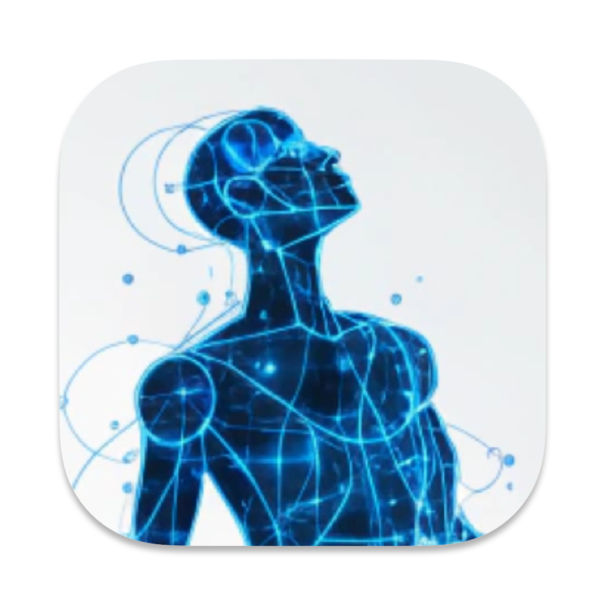
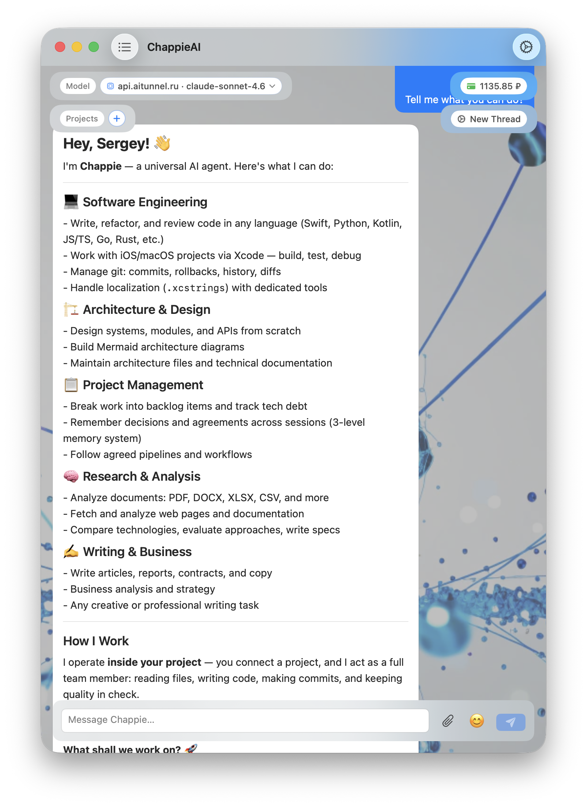
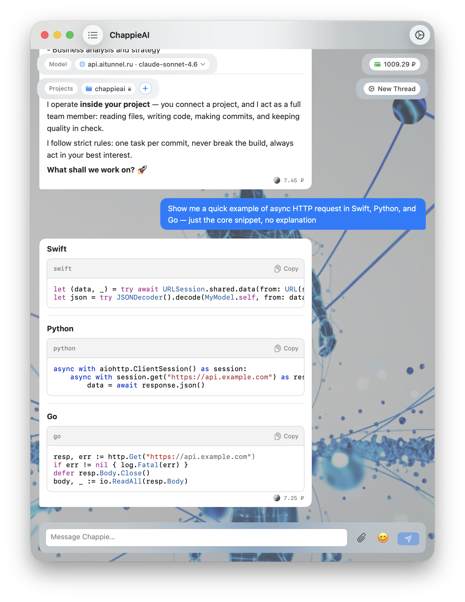
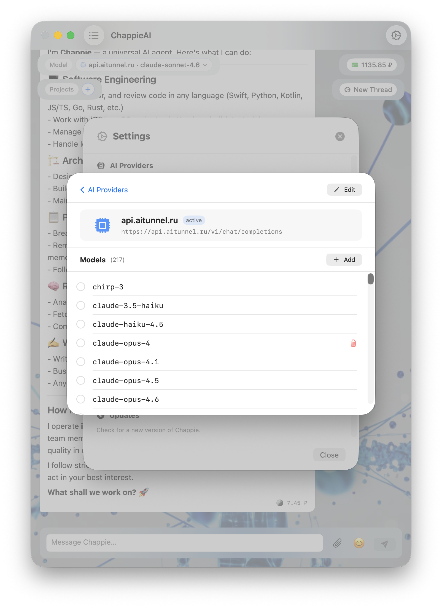
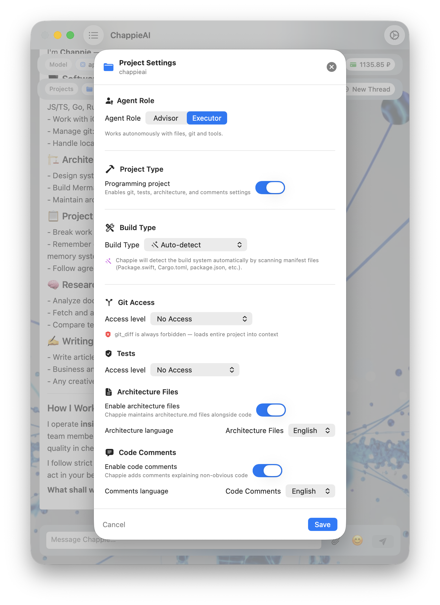

<p align="center">
  
</p>

<h1 align="center">
  
  &nbsp;ChappieAI
</h1>

<p align="center">
  Universal AI agent for macOS — free and open source.
</p>

<p align="center">
  
  
</p>

---

## What is Chappie?

Chappie is not just a chat with AI. It's an agent that lives inside your project: it reads files, writes code, makes commits, runs builds and tests, calls HTTP APIs, and remembers context across sessions.

You bring the task. Chappie brings the execution.

---

## Screenshots

<p align="center">
  
  
</p>

<p align="center">
  
  
</p>

---

## Features

- **Any provider.** OpenAI, Anthropic, Gemini, DeepSeek, Ollama or any OpenAI-compatible API. You enter your own API keys and model names; requests go straight to the provider.
- **Project mode.** Connect a folder and the agent can read and write files, use git, build and run tests (Xcode, SwiftPM, Gradle, Cargo, Go, Node, Python and more).
- **Three-level memory.** Global, project and thread memory that survives between sessions.
- **Curl-Chappie.** HTTP client for debugging backends: per-thread host allow-list with access levels, secrets kept in Keychain and never shown to the model, shared login sessions, repeatable scenarios.
- **Documents and PDF.** Reads Word, Excel, PowerPoint and PDF, including embedded images and scanned pages.
- **Safety gates.** Access levels for terminal and git, command checks, loop guard, timeouts.
- **Chat.** Streaming, Markdown, syntax highlighting, attachments, encrypted backup and restore.
- **10 interface languages.** English, Русский, 中文, Español, العربية, Français, Deutsch, 日本語, Português, हिन्दी.
- **Auto-updates** via Sparkle.

---

## Download

Get the latest `.dmg` from the [Releases](https://github.com/iOSIvanovS/chappieai/releases) page.

**System requirements:** macOS 14 Sonoma or later · Apple Silicon or Intel

> **Updating from a version older than 1.0.22?** The update-signing key was replaced in 1.0.22, so older installations cannot verify newer updates. Install 1.0.22 or later manually once; your threads, memory and settings are kept.

**First launch.** macOS may show a security warning because the app is distributed outside the App Store. See the [step-by-step guide](docs/gatekeeper.md).

---

## Build from source

Requirements: Xcode 16 or later, macOS 14 SDK.

```bash
git clone https://github.com/iOSIvanovS/chappieai.git
cd chappieai
open Chappie.xcodeproj
```

Swift packages (GRDB, ZIPFoundation, Sparkle) are resolved by Xcode. Sparkle updates are signed with the author's private key, so a build from source will not receive official updates.

Architecture notes live in [`architecture.md`](architecture.md) and next to each module.

---

## License

ChappieAI is free software released under the [GNU General Public License v3.0](LICENSE).
You may use, study, modify and redistribute it; derivative works must remain open under the same license.

The name "ChappieAI" and the logo are not covered by the code license. See [TRADEMARK.md](TRADEMARK.md).

## Contributions

This is a one-author project and pull requests are not accepted. Bug reports are welcome, see [CONTRIBUTING.md](CONTRIBUTING.md). You are free to fork under the GPL.

## Support the project

ChappieAI is free. If it is useful to you, you can [send a donation](https://app.lava.top/2651348976?tabId=donate).

## Contact

- Author (private messages, security reports): [@serebanium](https://t.me/serebanium)
- Bugs: [GitHub Issues](https://github.com/iOSIvanovS/chappieai/issues)

---

Copyright (C) 2026 Sergei Ivanov
