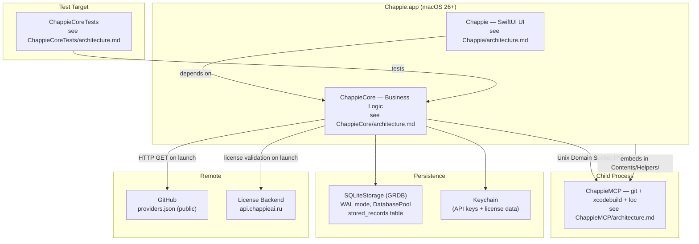

# Chappie — Overall Project Architecture

## 1. Project Structure

```
/Volumes/Storage/Work/Chappie/
├── architecture.md                          # This file (root architecture)
├── licensing.md                             # Licensing system: plans, flows, UI, implementation plan
├── Chappie.xcodeproj/
├── Chappie/                                 # UI target → see Chappie/architecture.md
├── ChappieCore/                             # Business logic → see ChappieCore/architecture.md
├── ChappieCoreTests/                        # Tests → see ChappieCoreTests/architecture.md
├── ChappieMCP/                              # Helper process → see ChappieMCP/architecture.md
└── Scripts/                                 # Internal maintenance scripts (not part of build)
    ├── providers_1_clear.sh                 # Initializes providers.json
    ├── providers_2_append.sh                # Appends a batch of providers/models (≤100)
    ├── providers_3_push.sh                  # Pushes providers.json to GitHub via API
    └── release_publish.sh                   # Publishes a release build
```

---

## 2. Targets

| Target | Type | Purpose |
|---|---|---|
| `Chappie` | SwiftUI App | UI shell, @MainActor, @Observable ViewModel |
| `ChappieCore` | Swift Package Library | All business logic: AI, tools, memory |
| `ChappieCoreTests` | Unit Test Bundle | Tests for ChappieCore |
| `ChappieMCP` | Command Line Tool | Child process: git + xcodebuild + localization |

---

## 3. Architecture Diagram



---

## 4. Target Dependencies

```
Chappie.app
    ├── depends on → ChappieCore (Swift Package)
    └── embeds → ChappieMCP (Contents/Helpers/)

ChappieCoreTests
    └── depends on → ChappieCore

ChappieMCP
    └── standalone (no ChappieCore dependency)
```

---

## 5. Key Technologies

| Technology | Usage |
|---|---|
| Swift 6 (Full Concurrency) | Entire project |
| SwiftUI macOS 26+ | UI layer |
| GRDB (SQLite) | Persistence via SQLiteStorage |
| @Observable | ViewModel |
| Actors | ChappieCore services |
| OpenAI-compatible API | Default wire protocol (AIClient) |
| Anthropic native API | /v1/messages (AnthropicClient) |
| AIClientFactory | Picks correct client by model.providerProtocol |
| Unix Domain Sockets | IPC with ChappieMCP |
| Keychain | API keys + license data storage |
| CryptoKit | Ed25519 signature verification (owner license) |
| GitHub (public repo) | providers.json catalog hosting |

---

## 6. Storage Map

| What | Where | Key/Format |
|---|---|---|
| Thread list + metadata | `stored_records` → key `"threads"` | `[ThreadPayload]` JSON |
| Thread messages | `stored_records` → key `"thread_messages_chunk.<UUID>.<index>"` | `[ChatMessage]` JSON chunks (500 msgs each) |
| Memory (3 levels) | `stored_records` → key `"memory"` | `[MemoryScope]` JSON |
| AI providers | `stored_records` → key `"providers"` | `[AIProvider]` JSON |
| App settings | `stored_records` → key `"app_settings"` | `AppSettingsPayload` JSON |
| API keys | Keychain | `apiKey.id.uuidString` |
| License data | Keychain | `license.*` keys — see licensing.md §5 |

**Rule: SQLiteStorage (GRDB) is the ONLY persistence backend. No SwiftData anywhere.**
**License data lives in Keychain ONLY — never in SQLite.**

> **Projects are stored inside ThreadPayload** — no separate global project registry.
> Each thread owns its own `[ThreadProjectEntry]` with `id`, `displayName`, `absolutePath`.

---

## 7. Memory Structure — Three Levels

| Level | Owner | Physical Location | Tool Parameter |
|---|---|---|---|
| Global | `AppSettings` | `MemoryScope` scope=`"global"` | `scope:"global"` |
| Thread | `ThreadEntity` | `MemoryScope` scope=`thread.id` | `scope:"thread"` |
| Project | `ThreadProject` (per thread) | `MemoryScope` scope=`project.id` | `targetName:"Name"` |

Project memory is **per thread** — the same project in two threads has independent memory.

**System prompt injection order:**
```
[1] Persona + rules (from ChappieViewModel+PersonaBlock.swift)
[2] userName (from AppSettings)
[3] Global memory (if not empty)
[4] Thread memory (if not empty)
[5] Per-project: ProjectSettings + project memory (one block per valid project)
[6] Tool manifest (only tools available in this thread)
```

Empty sections are omitted entirely — no wasted tokens.

---

## 8. Thread Isolation Architecture

| Entity | Role |
|---|---|
| `ThreadProjectEntry` | Project in context of a specific thread; owns `absolutePath`, `ProjectSettings`, memory |
| `ThreadSession` | Runtime container assembled on thread activation, discarded on switch |
| `SystemPromptBuilder` | Deterministic prompt assembly from `PromptContext`; pure value transformer |
| `ToolAccessController` | Hard gate before every tool execution; returns structured `AccessResult` |
| `AppSettingsStore` | Actor-based CRUD for the singleton AppSettings record |
| `LicenseService` | Actor; owns trial/activation/validation/grace period/owner JWT logic |

**Project attachment rules:**
- Only the user can add/remove projects (via `+` button or drag & drop). AI cannot.
- `absolutePath` is set at attachment time and stored directly in `ThreadPayload`.
- Duplicate check: same `absolutePath` → silently ignored, no duplicate added.
- `list_thread_projects` tool is available to AI (read-only).

**Provider/model validation on thread load:**
1. Resolve `providerId` → if not found: show orange banner, block AI calls
2. Resolve `keyId` → if not found: show orange banner, block AI calls
3. Resolve `modelId` → if not found: show warning, allow calls using cached `modelName`
4. Read key value from Keychain → if not found: block AI calls

**Rule: NEVER auto-substitute provider or model on loss.** User must explicitly re-select.

---

## 9. DataStore Pattern — Deterministic Data Flow

```
Write:  DomainStruct (Codable) → JSONEncoder → Data → stored_records.payload → SQLite
Read:   SQLite → stored_records.payload → Data → JSONDecoder → DomainStruct (Codable)
```

**Why this works:**
- SQLite schema is frozen at one table (`stored_records`). No migrations ever.
- Domain structs evolve freely as `Codable` — no schema involvement.
- Decode failure is non-fatal. Callers receive `nil`/`[]` and recover gracefully.
- The entire persistence layer is replaceable without touching domain logic.

**Codable Compatibility Rules (CRITICAL — violation = silent data corruption):**

1. **Never rename a stored property without `CodingKeys`.**
2. **Never remove a stored property** — mark `optional` with a default.
3. **Always give new properties a default value.**

---

## 10. Message Chunking

Messages are stored in chunks of 500 per SQLite row:
- Key format: `thread_messages_chunk.<UUID>.<index>` (zero-padded for lexicographic sort)
- `loadMessages()` loads only the **last chunk** — O(1) open time regardless of history size
- `loadMoreMessages()` loads previous chunks on scroll — lazy pagination
- `deleteByPrefix()` deletes all chunks atomically in one SQL query
- Saving: ViewModel calls `saveLoadedMessages(_, toThreadId:, fromChunk: loadedWindowStartChunk)` — only chunks of the loaded window are rewritten (one transaction); older chunks stay untouched. `replaceAllMessages` is reserved for "clear memory" / delete-old-messages.

---

## 11. Provider Catalog Pipeline

`providers.json` hosted at:
`https://raw.githubusercontent.com/iOSIvanovS/chappieai/main/docs/providers.json`

**Monthly update pipeline:**
1. `Scripts/providers_1_clear.sh` — initializes empty JSON structure
2. `Scripts/providers_2_append.sh <json>` — appends batch of ≤100 models (run multiple times)
3. `Scripts/providers_3_push.sh` — pushes to GitHub via API (requires `$GITHUB_TOKEN`)

Supported providers (10): OpenAI, Anthropic, Google Gemini, DeepSeek, Groq, Mistral, xAI (Grok), OpenRouter, AITunnel, Ollama.

---

## 12. Licensing System

See **`licensing.md`** for the full specification:
- Plans: trial / starter / pro / team / owner
- Validation flow: online on launch + 7-day grace period
- Owner license: Ed25519 JWT, offline-only, issued via admin panel
- UI states: trial banner, paywall sheet, activation sheet, grace period warning
- LicenseService actor (to be added to ChappieCore)
- Implementation plan (phased)

---

## 13. 📚 Docs Group in Xcode Navigator

`📚 Docs` group in `project.pbxproj` — navigation only, not included in build.
Contains root `architecture.md` + `licensing.md` + references to 4 target architecture files.
**Manage manually** via `write_file` in `project.pbxproj`.

---

## 14. Work Pipeline

1. `git_status` — check for uncommitted changes
2. Implement (one task per pass)
3. Add unit tests if needed (business logic, not trivial UI)
4. `build_project`
5. `run_tests` (only after green build)
6. Fix until green
7. Report to user → wait for acceptance
8. `git_commit` (only after user acceptance)

---

## 15. Inviolable Agent Rules

**RULE-01: One task per pass** — decompose into backlog, execute one item, commit, repeat.

**RULE-02: Read architecture files first** — before any feature or refactor.

**RULE-03: git_diff is always forbidden** — loads entire project into context, costs money.

**RULE-04: Never run tests before build** — causes double compilation.

**RULE-05: No final commit if build or tests are red** — a broken commit is worse than none.

**RULE-06: Commit only after user acceptance** — never commit autonomously after task completion.

---

## 📚 Changelog

| Date | Change |
|------|--------|
| 2025-07 | Initial architecture |
| 2026-06 | Storage cleanup: removed DataStoreMigration, V2/V3 schema stubs |
| 2026-07 | Projects refactor: removed global ProjectPayload registry + bookmarks. Projects now live inside ThreadPayload as [ThreadProjectEntry] with absolutePath. AI tools add/remove_project_to_thread removed. |
| 2026-07 | SwiftData removal: SQLiteStorage (GRDB) is now the sole persistence backend. |
| 2026-07 | Chunk system: messages split into 500-msg chunks. Lazy loading. Legacy migration removed after all data migrated. |
