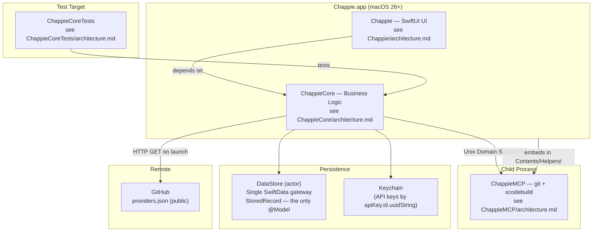

# Chappie — Overall Project Architecture

## 1. Project Structure

```
/Volumes/Storage/Work/Chappie/
├── architecture.md                          # This file (root architecture)
├── Chappie.xcodeproj/
├── Chappie/                                 # UI target → see Chappie/architecture.md
├── ChappieCore/                             # Business logic → see ChappieCore/architecture.md
├── ChappieCoreTests/                        # Tests → see ChappieCoreTests/architecture.md
├── ChappieMCP/                              # Helper process → see ChappieMCP/architecture.md
└── Scripts/                                 # Internal maintenance scripts (not part of build)
    ├── providers_1_clear.sh                 # Initializes providers.json
    ├── providers_2_append.sh                # Appends a batch of providers/models (≤100)
    └── providers_3_push.sh                  # Pushes providers.json to GitHub via API
```

---

## 2. Targets

| Target | Type | Purpose |
|---|---|---|
| `Chappie` | SwiftUI App | UI shell, @MainActor, @Observable ViewModel |
| `ChappieCore` | Swift Package Library | All business logic: AI, tools, memory |
| `ChappieCoreTests` | Unit Test Bundle | Tests for ChappieCore |
| `ChappieMCP` | Command Line Tool | Child process: git + xcodebuild |

---

## 3. Architecture Diagram



---

## 4. Target Dependencies

```
Chappie.app
    ├── depends on → ChappieCore (Swift Package)
    └── embeds → ChappieMCP (Contents/Helpers/)

ChappieCoreTests
    └── depends on → ChappieCore

ChappieMCP
    └── standalone (no ChappieCore dependency)
```

---

## 5. Key Technologies

| Technology | Usage |
|---|---|
| Swift 6 (Full Concurrency) | Entire project |
| SwiftUI macOS 26+ | UI layer |
| SwiftData macOS 26+ | Single-model persistence via DataStore |
| @Observable | ViewModel |
| Actors | ChappieCore services |
| OpenAI-compatible API | Default wire protocol (AIClient) |
| Anthropic native API | /v1/messages (AnthropicClient) |
| AIClientFactory | Picks correct client by model.providerProtocol |
| Unix Domain Sockets | IPC with ChappieMCP |
| Keychain | API key storage (per APIKey.id) |
| GitHub (public repo) | providers.json catalog hosting |

---

## 6. Storage Map

| What | Where | Key/Format |
|---|---|---|
| Threads, messages, settings | `DataStore.Relation.threads` | `[ThreadPayload]` JSON |
| Projects (folder registry) | `DataStore.Relation.projects` | `[ProjectPayload]` JSON |
| Memory (3 levels) | `DataStore.Relation.memory` | `[MemoryScope]` JSON |
| AI providers | `DataStore.Relation.providers` | `[AIProvider]` JSON |
| App settings | `DataStore.Relation.appSettings` | `AppSettingsPayload` JSON |
| API keys | Keychain | `apiKey.id.uuidString` |

**Rule: DataStore.swift is the ONLY file in the project that imports SwiftData.**
**StoredRecord is the ONLY @Model. Its schema never changes. No migrations ever needed.**

---

## 7. Memory Structure — Three Levels

| Level | Owner | Physical Location | Tool Parameter |
|---|---|---|---|
| Global | `AppSettings` | `MemoryScope` scope=`"global"` | `scope:"global"` |
| Thread | `ThreadEntity` | `MemoryScope` scope=`thread.id` | `scope:"thread"` |
| Project | `ThreadProject` (per thread) | `MemoryScope` scope=`project.id` | `targetName:"Name"` |

Project memory is **per thread** — the same project in two threads has independent memory.

**System prompt injection order:**
```
[1] Persona + rules (from ChappieViewModel+PersonaBlock.swift)
[2] userName (from AppSettings)
[3] Global memory (if not empty)
[4] Thread memory (if not empty)
[5] Per-project: ProjectSettings + project memory (one block per valid project)
[6] Tool manifest (only tools available in this thread)
```

Empty sections are omitted entirely — no wasted tokens.

---

## 8. Thread Isolation Architecture

| Entity | Role |
|---|---|
| `ThreadProject` | Project in context of a specific thread; owns its own `ProjectSettings` and memory |
| `ProjectEntity` | Global folder registry only — path + displayName, no logic, no memory |
| `ThreadSession` | Runtime container assembled on thread activation, discarded on switch |
| `SystemPromptBuilder` | Deterministic prompt assembly from `PromptContext`; pure value transformer |
| `ToolAccessController` | Hard gate before every tool execution; returns structured `AccessResult` |
| `AppSettingsStore` | Actor-based CRUD for the singleton AppSettings record |

**Provider/model validation on thread load:**
1. Resolve `providerId` → if not found: show orange banner, block AI calls
2. Resolve `keyId` → if not found: show orange banner, block AI calls
3. Resolve `modelId` → if not found: show warning, allow calls using cached `modelName`
4. Read key value from Keychain → if not found: block AI calls

**Rule: NEVER auto-substitute provider or model on loss.** User must explicitly re-select.

---

## 9. DataStore Pattern — Deterministic Data Flow

**The core architectural principle of persistence in Chappie.**

```
Write:  DomainStruct (Codable) → JSONEncoder → Data → StoredRecord.payload → SwiftData
Read:   SwiftData → StoredRecord.payload → Data → JSONDecoder → DomainStruct (Codable)
```

**Why this works:**
- SwiftData schema is frozen at one model (`StoredRecord`). No migrations ever.
- Domain structs evolve freely as `Codable` — no SwiftData involvement.
- Decode failure is non-fatal. Callers receive `nil`/`[]` and recover gracefully.
- The entire persistence layer is replaceable without touching domain logic.

**Codable Compatibility Rules (CRITICAL — violation = silent data corruption):**

1. **Never rename a stored property without `CodingKeys`.**
   Old JSON has the old key name — rename without `CodingKeys` silently returns nil/default.

2. **Never remove a stored property.**
   Mark it `optional` with a default. Old records must decode cleanly.

3. **Always give new properties a default value.**
   Old records don't have the new key — decoder must not fail.

---

## 10. Provider Catalog Pipeline

`providers.json` is hosted publicly at:
`https://raw.githubusercontent.com/iOSIvanovS/chappieai/main/docs/providers.json`

**Monthly update pipeline (run manually by maintainer):**
1. `Scripts/providers_1_clear.sh` — initializes empty JSON structure
2. `Scripts/providers_2_append.sh <json>` — appends batch of ≤100 models (run multiple times)
3. `Scripts/providers_3_push.sh` — pushes final file to GitHub via API (requires `$GITHUB_TOKEN`)

Supported providers (10): OpenAI, Anthropic, Google Gemini, DeepSeek, Groq, Mistral, xAI (Grok), OpenRouter, AITunnel, Ollama.

---

## 11. 📚 Docs Group in Xcode Navigator

`📚 Docs` group in `project.pbxproj` — navigation only, not included in build.
Contains root `architecture.md` + references to 4 target architecture files.
**Manage manually** via `write_file` in `project.pbxproj`.

---

## 12. Work Pipeline

1. `git_status` — check for uncommitted changes
2. `git_commit` — checkpoint before changes
3. Implement (one task per pass)
4. Add unit tests if needed (business logic, not trivial UI)
5. `build_project`
6. `run_tests` (only after green build)
7. Fix until green
8. `git_commit`
9. Report to user

---

## 13. Inviolable Agent Rules

**RULE-01: One task per pass** — decompose into backlog, execute one item, commit, repeat.

**RULE-02: Read architecture files first** — before any feature or refactor.

**RULE-03: git_diff is always forbidden** — loads entire project into context, costs money.

**RULE-04: Never run tests before build** — causes double compilation.

**RULE-05: No final commit if build or tests are red** — a broken commit is worse than none.


