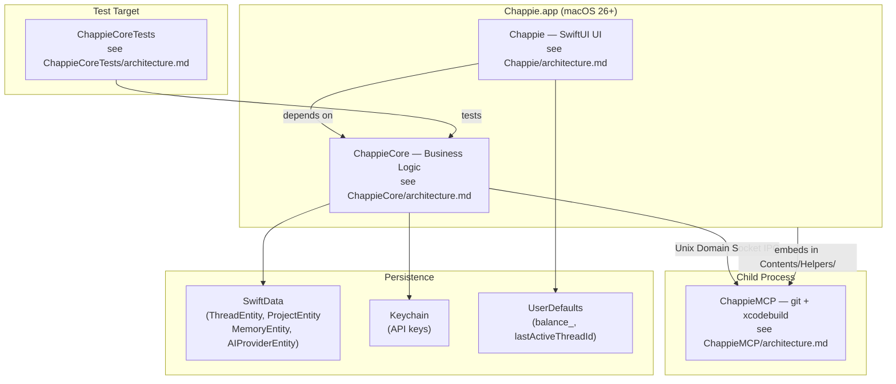

<!--
  architecture.md (project root)

  ARCHITECTURE DOCUMENT — CHAPPIE PROJECT (ROOT LEVEL)

  This file is the single source of architectural truth for the project root.
  The other four files describe each target individually.

  Update when the overall project structure changes.
-->

# Chappie — Overall Project Architecture

## 1. Project Structure

```
/Volumes/Storage/Work/Chappie/
├── architecture.md                     # This file (root architecture)
├── chat_history.json                   # Legacy history file (not used)
├── ChappieCoreTests.xctestplan         # Xcode test plan
├── Chappie.xcodeproj/                  # Main Xcode project
│
├── Chappie/                            # UI target (SwiftUI App, macOS 26+)
│   ├── architecture.md                 # UI layer architecture → see Chappie/architecture.md
│   └── ...
│
├── ChappieCore/                        # Library (Swift Package, business logic)
│   ├── architecture.md                 # Core architecture → see ChappieCore/architecture.md
│   └── ...
│
├── ChappieCoreTests/                   # Test target
│   ├── architecture.md                 # Test architecture → see ChappieCoreTests/architecture.md
│   └── ...
│
└── ChappieMCP/                         # Helper process (git + xcodebuild)
    ├── architecture.md                 # MCP helper architecture → see ChappieMCP/architecture.md
    └── ...
```

---

## 2. Targets and Their Roles

| Target | Type | Purpose |
|---|---|---|
| `Chappie` | SwiftUI App | UI shell, @MainActor, @Observable ViewModel |
| `ChappieCore` | Swift Package Library | All business logic: AI, tools, memory |
| `ChappieCoreTests` | Unit Test Bundle | Tests for ChappieCore |
| `ChappieMCP` | Command Line Tool | Child process: git + xcodebuild |

---

## 3. Architecture Diagram



---

## 4. Target Dependencies

```
Chappie.app
    ├── depends on → ChappieCore (Swift Package)
    └── embeds → ChappieMCP (Contents/Helpers/)

ChappieCoreTests
    └── depends on → ChappieCore

ChappieMCP
    └── standalone (no ChappieCore dependency)
```

---

## 5. Key Technologies

| Technology | Version/Type | Usage |
|---|---|---|
| Swift | 6 (Full Concurrency) | Entire project |
| SwiftUI | macOS 26+ | UI layer |
| SwiftData | macOS 26+ | Thread, project, and memory persistence |
| @Observable | Observation framework | ViewModel |
| Actors | Swift Concurrency | ChappieCore services |
| AITunnel API | OpenAI-compatible | Proxy to Anthropic and other providers |
| Unix Domain Sockets | POSIX | IPC with ChappieMCP |
| Keychain | Security framework | API key storage |
| UserDefaults | Foundation | Per-provider balance (key: balance_<provider.id.uuidString>) |

---

## 6. Per-Provider Balance Storage

**Pattern:** balance stored per-provider in UserDefaults.
- Key: `balance_<provider.id.uuidString>`
- Load: `switchProvider()` on provider change
- Save: `onBalanceUpdate` callback and `result.newBalance` in `AIOrchestrator.process()`
- Old global key `savedBalance` — removed

---

## 7. Chat History (ChatHistoryManager) — DEPRECATING

**WARNING:** `ChatHistoryManager` (JSON file) will be replaced by SwiftData in the next iteration.
`chat_history.json` in the root — legacy file, not used in production.

**Backlog:** `backlog_chat_history_swiftdata` — migrate ChatHistoryManager → SwiftData.

---

## 8. Memory Structure — FINAL (IT-08 ✅, IT-09 ✅)

Three memory levels, all in SwiftData:

| Level | Storage | Tool |
|---|---|---|
| Global | SwiftData MemoryEntity scope="global" | memorize(scope="global") |
| Project | SwiftData MemoryEntity scope="<projectId UUID>" | memorize(targetName="Chappie") |
| Thread | SwiftData MemoryEntity scope="<threadId UUID>" | memorize(scope="thread") |
| Target docs | `<target>/architecture.md` | write_file manually |

**AUTO-INJECTION INTO SYSTEM PROMPT (IT-09 ✅):**

Final prompt structure:
```
[base prompt — Chappie rules]

---
## Memory Context

## Project Settings: Chappie          ← IT-09: agent permissions (first!)
- Role: EXECUTOR
- Git: write [git_status, git_add, ...]
...

## Global Memory
## Project Memory: Chappie
## Thread Context
```

**AGENT PERMISSIONS (IT-09 ✅):**
`ProjectSettings` stored in `ProjectEntity.settingsJSON`.
Default role: `.advisor` (read-only).
`ToolExecutionService.checkToolAccess()` validates permissions before each tool call.
`git_diff` is NEVER allowed — hard ban in code.

---

## 9. 📚 Docs Group in Xcode Navigator

**Solution:** `📚 Docs` group added to `project.pbxproj` as a navigation-only PBXGroup.
- **NOT included in build**, **NOT copied to bundle**
- Contains: root `architecture.md` + 4 references to target architecture files

**GROUP MANAGEMENT — MANUAL ONLY** via `write_file` in `project.pbxproj`.

---

## 10. build_project and run_tests Hang — RESOLVED (2025-07-11)

**Cause:** Pipe deadlock — xcodebuild waits for stdout to be read, we wait for process exit.
**Fix:** Read stdout/stderr on separate DispatchQueues in parallel with waitUntilExit().
**Also:** Explicit `-destination "platform=macOS,arch=arm64"` for xcodebuild.

---

## 11. Work Pipeline

Agreed with user and locked:

1. `git commit` — save checkpoint before refactoring
2. Implement changes
3. Add unit tests if needed (for business logic, not trivial UI)
4. `build_project`
5. `run_tests` (only after green build)
6. Fix errors until consistent state
7. `git commit`
8. Report to user

---

## 12. ⚠️ Inviolable Agent Rules

Rules agreed with the user. Violation is unacceptable.

### RULE-01: One task per pass
**Decompose any multi-step work into a backlog before starting.**
Execute one item, commit, then proceed.
Never bundle unrelated changes in a single pass — even if they seem trivial.

> **Why:** Bundling changes causes signature drift, compile errors, and inconsistent state
> that is hard to roll back. Every "while I'm at it" is a risk.

### RULE-02: Always read architecture files before implementing
Before starting any feature or refactor — read the relevant `architecture.md` files.
Discuss the approach with the user at the design stage, not after the fact.

> **Why:** Architecture files are the ground truth. Skipping them leads to decisions
> that contradict existing patterns and require costly rewrites.

### RULE-03: git_diff is always forbidden
Never call `git_diff` — it loads the entire project into AI context and costs real money.

### RULE-04: Never run tests before build
`run_tests` before `build_project` causes double compilation and wastes time.

### RULE-05: No final commit if build or tests are red
A broken commit is worse than no commit.

---

## 13. REFACTOR-THREADS + PROJECT SETTINGS

### Status: ✅ FULLY COMPLETE (IT-01 → IT-09 ✅)

| # | Iteration | Status |
|---|---|---|
| IT-01 | SwiftData models + JSON serialization | ✅ DONE |
| IT-02 | ThreadSettings + dynamic AppConfig | ✅ DONE |
| IT-03 | Three-level memory in system prompt | ✅ DONE |
| IT-04 | Migration of legacy files → SwiftData | ✅ DONE |
| IT-05 | UI: thread sidebar | ✅ DONE |
| IT-06 | UI: project chips in thread | ✅ DONE |
| IT-07 | Tools: add/remove project | ✅ DONE |
| IT-08 | Memory tools refactor (SwiftData + smart UUID scope) | ✅ DONE |
| IT-09 | ProjectSettings — agent role and permissions | ✅ DONE |
| IT-10 | Per-thread AI provider + model selection | ✅ DONE |
| IT-11 | Thread settings UI: gear chip, context depth, thread name in toolbar | ✅ DONE |
| IT-12 | Thread name + settings passed on creation via NewThreadProviderSheet | ✅ DONE |

---

## 14. Tech Debt

| ID | Issue | Priority |
|----|-------|----------|
| TD-02 | `ChappieCoreTests` requires manual scheme switch in Xcode before ⌘+U | Low |

---

## 15. Backlog

| ID | Task | Priority |
|----|------|----------|
| BL-01 | Migrate ChatHistoryManager → SwiftData (per-thread chat history) | High |
| BL-03 | Universal balance and message cost support for top-10 AI providers in Russia | Medium |

---

## 📚 Changelog

| Date | Change |
|------|--------|
| 2026-07-XX | Added Mermaid architecture diagram (section 3) per new architecture file rules |
| 2026-07-XX | Added section 11: Inviolable Agent Rules (RULE-01..05) |
| 2026-07-XX | IT-12 ✅: thread name + settings on creation, confirmNewThread 4-param signature |
| 2026-07-XX | IT-11 ✅: ThreadSettingsSheet, gear chip in ProjectChipsView, thread name in toolbar, last thread restore |
| 2026-07-XX | Architecture files translated to English |
| 2026-07-XX | IT-10 ✅: per-thread provider/model, ModelPickerRow, balance pill per-provider in UserDefaults |
| 2026-07-XX | LazyVStack in ChatScrollView (anti-jump streaming strategy), new thread button moved to sidebar header |
| 2026-07-XX | Bug fixed: AI model was set globally instead of per-thread |
| 2026-07-XX | Bug fixed: balance chip: not appearing on startup |
| 2026-05-26 | IT-09 ✅: ProjectSettings, ProjectSettingsSheet UI, ToolExecutionService.checkToolAccess() |
| 2025-07-XX | IT-08 ✅: ActiveMemoryContext, UUID-based scope |
| 2025-07-11 | RESOLVED TD-01: fixed Pipe deadlock in BuildTools.swift |
