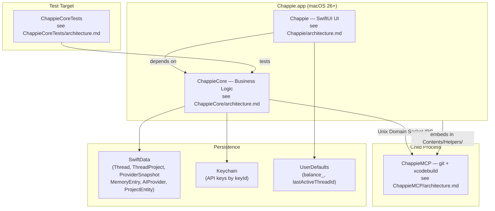

# Chappie — Overall Project Architecture

## 1. Project Structure

```
/Volumes/Storage/Work/Chappie/
├── architecture.md                          # This file (root architecture)
├── architecture-thread-isolation.md         # Thread isolation refactor design ← READ THIS
├── Chappie.xcodeproj/
├── Chappie/                                 # UI target → see Chappie/architecture.md
├── ChappieCore/                             # Business logic → see ChappieCore/architecture.md
├── ChappieCoreTests/                        # Tests → see ChappieCoreTests/architecture.md
└── ChappieMCP/                              # Helper process → see ChappieMCP/architecture.md
```

---

## 2. Targets

| Target | Type | Purpose |
|---|---|---|
| `Chappie` | SwiftUI App | UI shell, @MainActor, @Observable ViewModel |
| `ChappieCore` | Swift Package Library | All business logic: AI, tools, memory |
| `ChappieCoreTests` | Unit Test Bundle | Tests for ChappieCore |
| `ChappieMCP` | Command Line Tool | Child process: git + xcodebuild |

---

## 3. Architecture Diagram



---

## 4. Target Dependencies

```
Chappie.app
    ├── depends on → ChappieCore (Swift Package)
    └── embeds → ChappieMCP (Contents/Helpers/)

ChappieCoreTests
    └── depends on → ChappieCore

ChappieMCP
    └── standalone (no ChappieCore dependency)
```

---

## 5. Key Technologies

| Technology | Usage |
|---|---|
| Swift 6 (Full Concurrency) | Entire project |
| SwiftUI macOS 26+ | UI layer |
| SwiftData macOS 26+ | Thread, project, and memory persistence |
| @Observable | ViewModel |
| Actors | ChappieCore services |
| AITunnel API (OpenAI-compatible) | Proxy to Anthropic and other providers |
| Unix Domain Sockets | IPC with ChappieMCP |
| Keychain | API key storage |
| UserDefaults | Per-provider balance (`balance_<provider.id.uuidString>`) |

---

## 6. Per-Provider Balance Storage

Balance stored per-provider in UserDefaults.
- Key: `balance_<provider.id.uuidString>`
- Loaded in `switchProvider()` on provider change
- Saved via `onBalanceUpdate` callback and `result.newBalance` in `AIOrchestrator.process()`

---

## 7. Memory Structure

Three levels — see `architecture-thread-isolation.md` section 3 for full detail.

| Level | Owner | Location | Tool |
|---|---|---|---|
| Global | `AppSettings` | `AppSettings.globalMemory` | `memorize(scope:"global")` |
| Thread | `Thread` | `Thread.threadMemory` | `memorize(scope:"thread")` |
| Project | `ThreadProject` | `ThreadProject.memory` | `memorize(targetName:"Name")` |

Project memory is **per thread** — the same project in two threads has independent memory.

**System prompt injection order:**
```
[1] Persona + 14 rules
[2] userName
[3] Global memory
[4] Thread memory
[5] Per-project: settings + project memory
[6] Tool manifest (only available tools)
```

---

## 8. Thread Isolation

**Critical design — see `architecture-thread-isolation.md` for full detail.**

Key entities:
- `ProviderSnapshot` — frozen copy of provider+key+model selection, validated on thread load
- `ThreadProject` — project in context of a thread; owns its own `ProjectSettings` and `memory`
- `ProjectEntity` — global folder registry only (path + displayName, no logic)
- `ThreadSession` — runtime container assembled on thread activation, discarded on switch
- `SystemPromptBuilder` — deterministic prompt assembly from ThreadSession
- `ToolAccessController` — hard gate before every tool execution, returns structured denial

---

## 9. 📚 Docs Group in Xcode Navigator

`📚 Docs` group in `project.pbxproj` — navigation only, not included in build.
Contains root `architecture.md` + references to 4 target architecture files.
**Manage manually** via `write_file` in `project.pbxproj`.

---

## 10. Work Pipeline

1. `git commit` — checkpoint before changes
2. Implement
3. Add unit tests if needed (business logic, not trivial UI)
4. `build_project`
5. `run_tests` (only after green build)
6. Fix until green
7. `git commit`
8. Report to user

---

## 11. Inviolable Agent Rules

**RULE-01: One task per pass** — decompose into backlog, execute one item, commit, repeat.
Bundling causes signature drift and hard-to-rollback state.

**RULE-02: Read architecture files first** — before any feature or refactor.
Architecture files are ground truth; skipping them leads to costly rewrites.

**RULE-03: git_diff is always forbidden** — loads entire project into context, costs money.

**RULE-04: Never run tests before build** — causes double compilation.

**RULE-05: No final commit if build or tests are red** — a broken commit is worse than none.

---

## 12. Tech Debt

| ID | Issue | Priority |
|----|-------|----------|
| TD-02 | `ChappieCoreTests` requires manual scheme switch in Xcode before ⌘+U | Low |

---

## 13. Backlog

| ID | Task | Priority |
|----|------|----------|
| BL-01 | Migrate ChatHistoryManager → SwiftData (per-thread chat history) | High |
| BL-03 | Universal balance and message cost support for top-10 AI providers in Russia | Medium |
| BL-04 | Thread isolation refactor — see architecture-thread-isolation.md (M-01 through M-10) | Critical |
